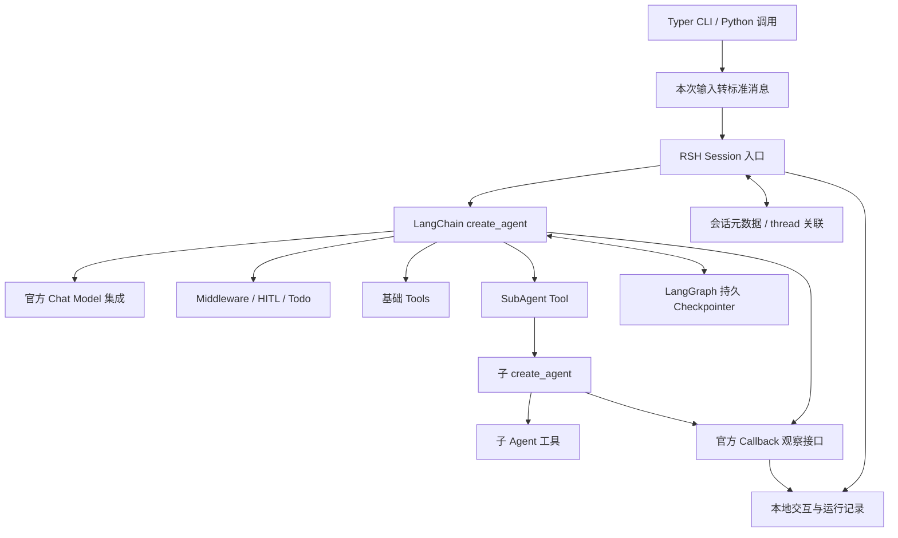

# RS-Harness LangChain 重构方案

日期：2026-09-20｜状态：阶段 1—5 已完成，v0.0.5 离线测试 335 项、真实模型验收 14 项通过；阶段 6 尚未实现

## 1. 目标与范围

使用 LangChain Python 官方开发方式搭建 RSH 的初步框架，包含 Agent Loop、基础工具、Middleware/Hooks、Permission、多模态输入、SubAgent、框架上下文持久化及 RSH 会话记录。LangChain/LangGraph 维护供模型使用的多轮上下文；RSH session 按会话组织用户交互和 Agent 运行轨迹，供查看与开发排查。旧项目仅用于识别功能类别，新版的执行方式、状态结构和扩展接口以官方框架为准。

本轮范围：

- 采用 `create_agent`、`@tool`、官方 Middleware 和 LangGraph Checkpointer，面向本地单用户 CLI。
- 保留 Python 3.12+、uv、Typer、TOML/Pydantic 配置及真实模型调用；新项目独立存储，不自动导入旧会话。
- 工具执行保留 LangChain 默认设置，包括框架对多工具调用的处理；不增加串行化、单工具上限或自定义调度。
- 多模态采用官方消息内容块；SubAgent 采用官方“子 Agent 作为工具”的模式。
- 当前仅复现通用框架，不加入遥感专用行为，也不设置“遥感能力必须通过 MCP”等领域约束。
- 开发阶段保留本地交互与运行记录，暂不实现审计、脱敏或外部轨迹平台接入。记录文件只供查看，不作为模型历史来源、审批状态来源或执行重放依据。

自建后台任务系统、持续子会话管理、旧 API 兼容、MCP 接入、Skills、自动摘要、长期记忆和 Web 服务不纳入本轮。实现按第 5 节六个阶段推进，完成标准是第 6 节的框架能力验收通过。

## 2. 功能与官方机制

| 功能             | 新版方案                                               | 实现边界                                                                      |
| ---------------- | ------------------------------------------------------ | ----------------------------------------------------------------------------- |
| Agent Loop       | `langchain.agents.create_agent`                      | 框架完成模型—工具循环、消息回填与结束判断                                    |
| 基础工具         | `@tool`、Pydantic 参数 schema、`ToolRuntime`       | 提供`bash/read_file/write_file/edit_file/glob`；具体 I/O 由小型工具函数实现 |
| 工具执行         | `create_agent` 默认工具执行机制                      | 接受同一响应中的多个工具调用，不保证调用间顺序                                |
| 任务规划         | `TodoListMiddleware` / `write_todos`               | 使用官方规划状态和提示，不复制旧 Todo 限制及提醒逻辑                          |
| Hooks            | `AgentMiddleware` 的 node/wrap hooks                 | 直接使用官方生命周期扩展点，不保留旧 HookRegistry 协议                        |
| Permission       | `AgentMiddleware` + 条件 `HumanInTheLoopMiddleware` + `Command(resume=...)` | 硬拒绝、危险操作审批与普通操作直通；中断及恢复由官方机制承载 |
| 多模态输入       | `HumanMessage` 与标准 content blocks                 | 图片作为消息输入，不依赖`read_image` 或自定义图片引用协议                   |
| SubAgent         | 子`create_agent` 包装为 `@tool`，注册到主 Agent    | 主 Agent 决定委派，子 Agent 默认每次调用使用独立上下文                        |
| 多轮上下文       | LangGraph 持久 Checkpointer +`thread_id`             | 框架维护 messages、todos 和中断状态，RSH 不自行读写历史消息列表               |
| RSH session 记录 | 会话元数据 + 基于官方回调的本地运行记录                | 记录用户输入、Agent 输出、模型/工具/子代理调用及错误，关联到同一个 thread     |
| CLI/配置         | Typer + TOML/Pydantic                                  | 提供交互、单次请求、会话管理及审批入口                                        |

旧版的顺序执行、`read_image/image_ref`、持续子会话和后台调度不构成兼容要求；旧测试也不作为这些能力的新实现标准。


## 3. 架构与职责



LangChain 负责 Agent 执行、工具调用和生命周期扩展，LangGraph 负责消息状态保存与恢复。RSH 只补充 CLI、配置、本次输入构造、工具 I/O、会话组织与运行记录，不实现第二套历史消息管理、执行循环或任务队列。运行记录到模型上下文之间没有回灌路径。

依赖建议：`langchain`、`langgraph`、`langchain-openai`、`langgraph-checkpoint-sqlite`，以及 Typer、Pydantic、prompt-toolkit。模型通过官方 `ChatOpenAI` 等集成接入，按实际模型验证工具调用和视觉能力。阶段 1 已锁定基础依赖到 `uv.lock`；后续能力在各自阶段验证接口，必要时更新锁文件。

首版采用官方文档中直接包装子 Agent 的方式，暂不需要引入 Deep Agents 或顶层自定义 `StateGraph`。

## 4. 核心设计

### 4.1 Agent、工具与默认执行

- `agents/main.py` 组装模型、工具、middleware、runtime context 和 checkpointer，`application.py` 使用 `ainvoke` 调用并关联 session 记录。只有 CLI 保留用户输入循环。
- 基础工具用 `@tool(args_schema=...)` 声明参数，通过 `ToolRuntime` 获取 workdir 等运行依赖。模型可见参数中不包含可信运行配置。
- 文件工具实现读取、覆盖写入、精确替换和路径匹配；Bash 实现命令执行、超时终止与输出大小限制。保留必要的路径检查和参数校验，不迁移整套旧工具分发器。
- 使用 LangChain 默认工具调度，不设置 `parallel_tool_calls=False`、`max_concurrency=1`，不增加“多工具批次拒绝”守卫。同一响应中有多个调用时交给框架处理；有依赖的操作由 Agent 在获得前一步结果后继续发起。
- `ModelCallLimitMiddleware` 提供每轮交互的模型调用预算；模型超时、输出上限和命令超时从配置读取，不自建预算计数引擎。
- 工具参数与执行错误按照官方工具错误处理模式返回模型可理解的结果；不捕获并吞掉框架的审批中断或取消信号。

### 4.2 Middleware / Hooks

| 扩展目的               | 官方接口                                              |
| ---------------------- | ----------------------------------------------------- |
| Agent 调用前后处理     | `before_agent` / `after_agent`                    |
| 模型调用前后处理       | `before_model` / `after_model`                    |
| 调整模型请求           | `wrap_model_call`                                   |
| 工具执行包装与错误处理 | `wrap_tool_call`                                    |
| 规划与调用预算         | `TodoListMiddleware` / `ModelCallLimitMiddleware` |

首版仅添加实际需要的 middleware：规划、预算、审批与工具错误处理。保留官方扩展接口，不强制复刻旧四事件名称、Stop 继续循环或通知格式。按官方 before/after/wrap 执行顺序组合，在最小测试中验证生效顺序；不添加审计或脱敏 middleware。

交互与运行记录使用官方 callback 观察接口，独立于修改执行行为的 middleware。记录器不修改 Agent State，不决定工具是否执行。

### 4.3 Permission 与人工审批

- 参考用户提供的 s03 Permission 文档和代码，按 `deny → ask → allow` 判定每次调用。工作目录内的读写编辑、glob 和未命中风险规则的 Bash 直接执行，只有命中危险操作规则的调用需要审批；具体规则见第四阶段实施方案。
- 使用官方 `HumanInTheLoopMiddleware(interrupt_on=...)` 的 `when` 谓词，根据工具参数和可信 runtime context 选择 ask 项。危险 Bash（如普通 rm）及工作目录外的 read/write/edit 进入审批；仅允许 approve/reject。
- Bash 硬拒绝清单优先于询问规则，命中时不提供批准选项。通过小型 `AgentMiddleware.awrap_tool_call` 返回带原 tool_call_id 的错误 ToolMessage，不执行 handler；不自建 Agent Loop 或工具分发器。参考子串规则不是完整 Shell 安全隔离。
- 文件工具继续解析路径、检查文件类型和参数；工作目录外访问由条件审批决定，批准后允许当前调用执行，不能再无条件报越界错误。区内结果保留相对路径，区外返回解析后的绝对路径；glob 仍限制在工作区。授权不进入模型可传参数，也不另存永久许可或审批账本。
- CLI 交互只展示待审工具及其操作，使用 `yes/no` 映射为官方的 `approve/reject`；文件驱动接口仍提交官方决定对象。以相同 `thread_id` 提交 `Command(resume={"decisions": ...})`，不重新提交原始用户消息。
- 同一中断含多个待审动作时，为每个动作提供一个 decision，顺序与官方 `action_requests` 一致；多个中断按官方 interrupt ID 路由，不假定只有一个待审批调用。
- 待审批信息和暂停位置由 Checkpointer 保存，不另外维护审批账本或授权状态副本。无交互终端时返回待审批状态，由后续命令恢复；同一会话待审批期间不接受新的普通交互。
- SubAgent 中的审批按官方嵌套调用中断机制传递到调用方，具体恢复接口在第六阶段验证；不为子 Agent 新建独立审批服务。

### 4.4 官方多模态输入

多模态属于消息输入层。使用 `HumanMessage` 的标准内容块，按官方格式组合文本与图像，再将消息交给 `create_agent`。

`inputs.py` 仅构造本次文本或多模态输入，不读取历史、不拼接上下文、不保存会话状态；框架维护的 `state["messages"]` 不属于该模块。

- 首版支持文本、图片，以及文本与图片组合；图像支持 URL 和本地文件。本地文件在入口读取、编码为官方支持的 base64 图像内容块并提供 MIME，URL 使用标准图像 URL 内容块。
- 不实现 `read_image` 工具、自定义 `image_ref`、哈希引用、每轮重新读取图片或 middleware 临时装配协议。
- 标准多模态消息随 Agent State 交给 Checkpointer 保存；允许内容块中的图像数据进入持久状态，不再要求“只保存路径、图片字节不得落盘”。
- 支持形式、格式和大小按所选模型与 provider 的官方能力校验；不沿用旧版32 MiB或特定图片格式的固定契约。不支持的输入明确返回错误。
- 仅图片输入可以作为有效消息提交给支持视觉的模型，不再固定返回 `not_supported`。音频、视频等后续按同一标准扩展，本轮不要求实现。

### 4.5 官方 SubAgent 模式

采用官方 Subagents 文档的基本实现：创建子 `create_agent`，用描述明确的 `@tool` 包装调用，再把该工具注册到主 Agent。

1. 定义子 Agent 的职责、system prompt 和所需工具。
2. 委派工具接收任务输入，调用子 Agent，并返回其最终结果。
3. 主 Agent 决定是否委派、提供什么上下文，以及如何综合结果。

默认每次子调用从独立状态开始，跨轮会话记忆由主 Agent 维护；只显式传递当前子任务需要的上下文。按官方 inherited checkpointer 模式使用调用级状态与中断能力，不手动分配持续 child thread。

委派工具等待子 Agent 返回；多个独立委派可由框架的默认工具机制处理。不实现旧 `task(run/status/wait/close)` 协议、具名子会话续聊、FIFO队列、固定并发4、后台 worker 或父子级联关闭；也不迁移旧版深度1校验逻辑。

首版验证任务委派、结果回传、默认上下文隔离和嵌套审批即可。工具内部子图的状态可见性遵循官方限制，不增加子会话状态查看 API。

### 4.6 框架负责多轮上下文

`create_agent` 具备基于 LangGraph 的 short-term memory。这里的“短期”指同一 thread 内的会话记忆，不表示只能保存在内存。配置持久 Checkpointer 后，消息和 Agent State 可以跨进程恢复；仅传 `thread_id`、未配置 Checkpointer，不会自动获得本地持久记忆。

| 需求                      | 采用机制                                                   |
| ------------------------- | ---------------------------------------------------------- |
| 同一用户会话持续对话      | 为该会话固定`thread_id`，每轮只提交新增消息              |
| 用户、Agent、工具消息维护 | `create_agent` 的消息状态和内置更新机制                  |
| 退出进程后继续上下文      | 官方 SQLite Checkpointer；第一阶段验证异步 saver 接线      |
| 查询当前对话状态          | 框架`get_state/aget_state` 接口，不读取 RSH 记录重建消息 |
| 多会话隔离                | 不同`thread_id`，共用持久化服务                          |

RSH 的一次普通交互只需执行以下流程：找到 session 对应的 thread → 构造本次 `HumanMessage` → 使用该 thread 调用 Agent → 返回结果。下一轮复用该 thread，框架负责恢复历史并合并新消息；RSH 不缓存、拼接或回填一份独立的历史消息列表。审批恢复则提交 `Command(resume=...)`。

本地 CLI 使用 SQLite，测试可以使用 `InMemorySaver`；后者不能满足进程重启后的恢复。更大规模部署再考虑官方数据库 saver；跨 thread 长期记忆用的 Store 不属于当前需求。

持久化解决历史状态保存和恢复，但不能保证任意长度的历史始终全部进入模型窗口，也不能保证模型永远正确回忆每个细节。首版在模型上下文容量内验收多轮记忆；需要长会话时再采用官方裁剪/摘要机制，RSH 原始交互记录可继续保留，不反向覆盖框架上下文。

### 4.7 RSH session 负责交互与运行记录

RSH session 是面向用户的记录容器，保存 workdir、创建时间、配置标识、关闭状态及 `thread_id` 关联。首版可直接令 `session_id = thread_id`，但两者职责仍有区别：前者组织用户可查看的记录，后者定位框架执行状态。

采用最小本地布局：

```text
sessions/
  checkpoints.sqlite3         官方 saver 管理的消息与 Agent State
  <session_id>/
    session.json              RSH 会话元数据和 thread 关联
    trajectory.jsonl          用户交互与 Agent 运行记录
```

- 调用入口记录本次用户输入、最终回答、失败或待审批结果；通过 LangChain 官方 callback 接口记录模型与工具的开始、结束、参数、返回结果和错误。第一阶段验证对话与模型调用记录，第三阶段补齐工具记录，第四阶段记录审批结果，第六阶段验证子调用与 run/parent run ID 的关联。
- 每次用户提交分配 interaction ID；后续审批恢复仍关联同一次交互。记录本次产生的数据，不在每轮重复导出完整模型上下文；不要求 token 级日志或模型未返回的内部信息。
- 子 Agent 的运行过程可记入同一 session 的轨迹，但不因此创建独立持久子会话，也不把子过程消息追加到主 Agent 历史。
- 记录可能包含与 checkpoint 相同的输入和输出，这是只用于查看的记录副本；框架状态仍是多轮上下文和审批恢复的唯一来源。记录缺失不能用来推断动作未执行，记录写入问题不能触发工具重试。
- Checkpoint 保存状态，不替代包含时间、调用关系及错误的完整开发运行记录。首版不依赖快照重建所有运行事件，也不要求记录器具备审计、防篡改、脱敏或副作用重放能力。
- 同一主会话同时接受一个用户交互，恢复时沿用 workdir。`quit/exit` 保留会话；`close` 禁止后续交互与审批恢复，同时保留已有记录供查看。

凭据由环境变量加载，不作为业务状态字段保存。首版支持正常交互后的续聊和官方审批恢复，不承诺任意崩溃窗口的完整轨迹或外部命令只执行一次。

## 5. 通用目录与六阶段实施

### 5.1 目录与职责

目录按应用入口、Agent 组装、输入、工具和会话数据五项职责组织，与旧项目结构无对应关系。会话相关文件放在 `sessions/`，其内部仍明确区分 RSH 元数据、框架 Checkpointer 和运行记录，不维护共享的自定义消息历史。

```text
RS-Harness/
├── pyproject.toml
├── config/
│   ├── default.toml
│   └── example.toml
├── prompts/
│   └── system.md
├── src/rs_harness/
│   ├── cli.py                  CLI 与交互命令
│   ├── config.py               配置、环境变量与模型初始化参数
│   ├── application.py          调用、恢复和关闭入口；连接 Agent 与 session
│   ├── inputs.py               本次文本/多模态标准消息构造
│   ├── agents/
│   │   ├── main.py             主 create_agent 组装
│   │   ├── middleware.py       自定义扩展及官方预算/权限/规划配置
│   │   └── delegation.py       子 create_agent 与委派工具
│   ├── tools/
│   │   ├── filesystem.py       read/write/edit/glob
│   │   └── shell.py            bash
│   └── sessions/
│       ├── catalog.py          session 元数据、thread 关联与查找
│       ├── checkpoints.py      官方 SQLite Checkpointer 的打开与关闭
│       └── recording.py        官方 callback 适配及本地轨迹写入
├── tests/
│   ├── unit/                   配置、输入、工具和规则测试
│   ├── integration/            Checkpointer、Middleware、审批、记录和委派测试
│   └── live/                   显式启用的真实模型冒烟
└── docs/
```

`cli.py → application.py → agents/、inputs.py、sessions/`；Agent 使用 `tools/`，由应用入口注入 Checkpointer 和 callback。`catalog.py` 不保存模型历史，`recording.py` 不参与状态恢复，`checkpoints.py` 不实现自定义消息存储协议。规划和 Permission 使用官方 middleware，不单独建设规划引擎或权限框架。

上图是六阶段完成后的目标结构，省略常规 `__init__.py`。实现时按阶段创建实际需要的文件，不预建空目录、通用注册中心或只包装一次调用的接口层；类型定义就近放置，出现明确复用需求后再拆分。

### 5.2 六阶段与验收

| 阶段                             | 交付内容                                                                                                                                      | 验收关口                                                                                                                         |
| -------------------------------- | --------------------------------------------------------------------------------------------------------------------------------------------- | -------------------------------------------------------------------------------------------------------------------------------- |
| 1. 基本 Loop 对话与 session 记录 | 锁定 LangChain/LangGraph 依赖；创建无工具`create_agent`；接入持久 Checkpointer、`thread_id`、session 元数据、CLI 入口和 callback 运行记录 | 文本单轮、多轮和重启续聊成功；同 thread 保留上下文、不同 thread 隔离；输入、回答、失败和模型调用记录可查看，记录不参与上下文恢复 |
| 2.`AgentMiddleware` 扩展       | 建立官方 middleware 组合入口，接入`ModelCallLimitMiddleware`；按需使用 node/wrap hooks，明确 runtime context 注入方式                       | 用测试模型和最小测试工具验证钩子顺序、状态更新及调用预算；已有对话、记忆和记录不受影响；不提前实现 Permission 或 Todo            |
| 3. 五种基础工具接入与多模态输入  | 以`@tool` 接入 `read_file/write_file/edit_file/glob/bash`；补充 `wrap_tool_call` 错误处理及工具轨迹；标准内容块接收本地/URL图片         | 默认多工具调用正常工作；路径检查、Bash超时和工具错误反馈生效；文本+图片、仅图片输入可用，多模态会话可恢复                        |
| 4. Permission 机制               | 实现 deny/ask/allow 规则；用官方 wrap hook 硬拒绝、HITL when 条件审批；调整越界文件访问；复用 Checkpointer 与 CLI Command 恢复并记录结果 | 普通操作直通，硬拒绝不执行，危险操作批准前不执行、批准后可执行；多 action/interrupt 正确对应；跨进程恢复；待审时禁止普通输入，中断不被吞掉 |
| 5. 任务规划能力                  | 接入`TodoListMiddleware` 与官方 `write_todos`；将规划状态纳入主 Agent State                                                               | 任务可创建、更新、完成和恢复；规划只表达状态，不直接执行任务；非法输入不会破坏已有状态                                           |
| 6. SubAgent 能力                 | 创建职责明确的子`create_agent`，用 `@tool` 注册到主 Agent；按官方调用级上下文隔离传递输入，复用工具及审批配置；补齐嵌套callback记录       | 主 Agent 能委派并综合结果；独立调用默认不共享子历史；嵌套审批可恢复；子调用轨迹可关联且不回灌主上下文；第6节整体验收通过         |

六阶段按 1 → 2 → 3 → 4 → 5 → 6 推进，不再单列提前验证全部能力的阶段。各阶段先验证所需的官方接口，再实现并验收该阶段能力；README、配置示例和测试随阶段更新。

- 第一阶段的 Loop 是无工具对话，由 `create_agent` 驱动；模型—工具完整循环在第三阶段验收。session 记录从第一阶段可用，后续逐步增加工具、审批和子调用事件。
- 第二阶段提供扩展方式，不提前实现后续能力。Permission 和任务规划都是官方 middleware 的具体应用，分别在第四、第五阶段接入。
- 第二阶段的具体改动、接口约定与验收矩阵及实施记录见 [`v0.0.2——AgentMiddleware 扩展.md`](./v0.0.2——AgentMiddleware%20扩展.md)；审查问题已修复，开发完成，离线回归 62 项通过；真实模型冒烟此前连接失败，本次联网复验因自动审批服务 503 未执行。
- 第三阶段的工具契约、多模态入口、验收矩阵和实施记录见 [`v0.0.3——五种基础工具接入与多模态输入.md`](./v0.0.3——五种基础工具接入与多模态输入.md)；五工具、轨迹、本地/URL 图片及恢复已实现，离线回归 134 项、真实模型 6 项通过，含阶段二能力在当前版本的三轮文本复验。
- 第四阶段的审批策略、应用与 CLI 契约、实施步骤及验收矩阵见 [`v0.0.4——Permission 机制.md`](./v0.0.4——Permission%20机制.md)；危险操作条件审批、硬拒绝、外部文件授权、CLI 查询及恢复已实现，共确认离线测试 281 项、DeepSeek Flash 真实模型验收 12 项通过，含既有能力复验。
- 第五阶段的官方 Todo 契约、教程参考边界、Middleware 接线顺序及验收矩阵见 [`v0.0.5——任务规划能力.md`](./v0.0.5——任务规划能力.md)；官方任务规划、状态恢复及组合行为已实现，离线测试 335 项、DeepSeek Flash 真实模型验收 14 项通过，包含跨进程计划续接及既有能力复验。
- 第三阶段在临时工作目录中验证工具；第四阶段完成面向用户的人工审批流程，不为开发阶段增加绕过审批的运行开关。
- 任务规划本身不强依赖 Permission，仍按给定顺序独立验收；SubAgent 放在最后，以复用已经验证的工具、middleware、审批和记录机制。

测试按新框架行为编写；旧项目只作为背景，不作为目录、接口或完整回归基线。

## 6. 验收场景

| 场景             | 可验证结果                                                                                                         |
| ---------------- | ------------------------------------------------------------------------------------------------------------------ |
| 基础 Agent       | 真实模型完成问答和工具循环；配置缺失或调用失败明确报错；空输入不创建会话                                           |
| 默认工具执行     | 一次模型响应中的多个独立工具调用均由框架处理并正确配对；没有人为串行化或整批拒绝，不断言工具完成顺序               |
| 基础工具         | 五种工具按参数执行；路径与参数校验生效；Bash 超时能够结束进程；错误反馈可供模型修正                                |
| Middleware/Todo  | 官方生命周期扩展生效，工具错误处理不吞中断；规划状态可更新并随主会话恢复；模型调用预算生效                         |
| Permission       | 普通操作直接执行；硬拒绝不执行且不可批准；危险操作在批准前不执行，批准后可执行（含越界文件访问）、拒绝反馈；多动作对应正确；待审时拒绝普通输入 |
| 审批恢复         | 重启后以同 thread 恢复官方中断；沿用暂停状态，不把原请求重新当作新交互提交                                         |
| 记忆归属         | 同thread第二轮只提交新消息仍能使用第一轮信息；新进程复用SQLite可续聊；不同thread不共享上下文                       |
| 交互与轨迹       | 记录输入、回答、模型/工具调用及错误；子调用可按run/parent关联；审批恢复关联原交互；不新增持久子会话                |
| 记录与上下文独立 | 使用测试会话删除或修改trajectory记录，Agent仍只从Checkpoint恢复；记录内容不会追加到模型历史，记录失败不会重试工具  |
| 多模态           | 文本+图片、仅图片、本地文件和URL均按标准消息送达支持的模型；不支持的格式或模型能力明确报错；多模态会话可保存并恢复 |
| SubAgent         | 主 Agent 可委派并综合结果；子任务只接收显式输入；两次独立调用默认不继承子历史；不产生旧式持久子会话或后台任务      |
| 嵌套审批         | 子 Agent 受限工具触发官方中断，调用方可批准/拒绝并恢复执行，最终结果返回主 Agent                                   |
| 主会话/CLI       | 多轮和跨进程续聊、thread 隔离、workdir绑定、quit保留、close拒绝续用；stdout JSON可直接解析，交互提示走stderr       |

先运行无网络的确定性测试与框架集成测试，再显式执行少量真实模型冒烟，验证工具调用及视觉输入的 provider 兼容性。测试替身仅用于测试，生产 CLI 不提供伪模型回答。

## 7. 官方依据与验证状态

通过 Context7 核对官方文档；已确认标准多模态消息、默认 SubAgent 上下文、多动作审批，以及 `create_agent` 的 Checkpointer/thread 多轮记忆机制：

- [Agents](https://docs.langchain.com/oss/python/langchain/agents)：`create_agent` 与工具循环。
- [Tools](https://docs.langchain.com/oss/python/langchain/tools)：工具定义、参数与运行时依赖。
- [Messages](https://docs.langchain.com/oss/python/langchain/messages)：`HumanMessage` 与标准多模态内容块。
- [Models](https://docs.langchain.com/oss/python/langchain/models)：模型多模态能力与多工具调用。
- [Custom middleware](https://docs.langchain.com/oss/python/langchain/middleware/custom)、[Built-in middleware](https://docs.langchain.com/oss/python/langchain/middleware/built-in)：生命周期、Todo与调用预算。
- [Human-in-the-loop](https://docs.langchain.com/oss/python/langchain/human-in-the-loop)：中断、逐动作审批和同thread恢复。
- [Subagents](https://docs.langchain.com/oss/python/langchain/multi-agent/subagents)：子Agent作为工具、默认调用级上下文隔离及继承Checkpointer。
- [Short-term memory](https://docs.langchain.com/oss/python/langchain/short-term-memory)、[Persistence](https://docs.langchain.com/oss/python/langgraph/persistence)：框架维护同thread上下文，Checkpointer与跨thread Store职责不同；SQLite异步接线在第一阶段验证。

阶段 1 已完成基本对话、会话与持久化；阶段 2 已完成 middleware、预算和 runtime context。阶段 3 已实现五工具、官方工具错误处理、工具 callback 和标准多模态输入。阶段 4 已实现条件审批与跨进程恢复，当前版本已用 DeepSeek Flash 复验真实工具、文本、图片、危险 Bash 和外部文件批准/拒绝。阶段 5 已接入官方 Todo middleware，验证清单更新、非法输入保护、SQLite 恢复、审批及 Stop Hook 组合，并完成真实模型规划与跨进程续接。callback 签名和多模态序列化以第三阶段实施记录中的锁定版本验证为准；预算按每次 ainvoke 执行段限制，恢复获得新预算。阶段 6 仍待实施，嵌套中断与子调用 callback 在第六阶段验证。记录器继续只做轻量本地适配，不扩展为旧 RSH 上下文引擎或审计系统。
