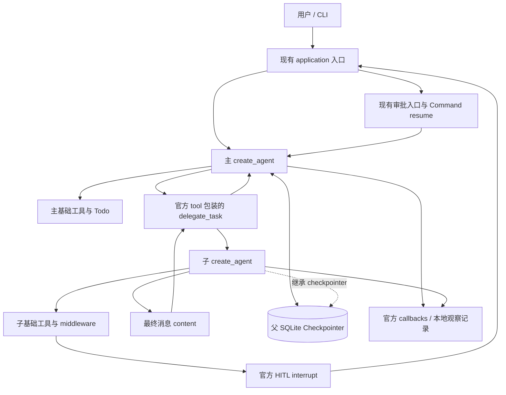

# v0.0.6——SubAgent 委派机制

## 1. 文档信息与完成标准

- 目标版本：`v0.0.6`
- 状态：基础委派、具名配置、工具范围、可恢复失败与持续追问已交付；2026-09-27 已完成子代理静默输出和免审批拒绝策略：601 项离线回归通过，3 个真实模型场景分批通过。第 15、21 节保留历史结果，现行权限和展示契约以第 22 节为准。
- 制定及修订日期：基础方案与实施记录为 2026-09-24；2026-09-26 补充第 16—21 节，继续以官方 Subagents / Subgraphs 机制为执行依据。
- 源码基线：`main` 分支，`aae2ec5`（`feat(model): configure reasoning effort`），实施前项目版本 `0.0.5`。
- 上游设计：[`LangChain重构方案.md`](./LangChain重构方案.md) 第 4.5 节、阶段六。
- 前置能力：[`v0.0.4——Permission 机制.md`](<./v0.0.4——Permission%20机制.md>)、[`v0.0.5——任务规划能力.md`](./v0.0.5——任务规划能力.md)，以及当前代码中的 `read_image`、运行通知和模型推理强度配置。
- 交付记录：2026-09-24 完成基础实现及验证；2026-09-26 补充开发文档并实施三项能力，沿用锁定依赖，没有修改数据集。

阅读规则：第 2—15 节保留基础实现历史，第 16—21 节记录具名定义、工具范围、失败恢复、持续追问及默认角色调整。2026-09-27 的第 22 节覆盖此前有关子审批和 CLI 子运行展示的条款；未覆盖的调用、状态隔离、工具结果、预算、取消和轨迹记录约束继续沿用。历史测试数量不能作为后续变更的验收结果。

目标是在现有主 Agent 中加入一个委派工具，让主 Agent 把边界清晰的子任务交给独立上下文中的子 Agent，等待结果后继续综合、验证和回答。采用 LangChain 官方的 Subagents 模式：子 `create_agent` 包装为 `@tool`，不另建调度引擎。

基础实现的完成标准（新增能力的完成标准见第 21 节）：

1. 主 Agent 可调用 `delegate_task`；子 Agent 使用已有工具完成任务，最终消息 content 按官方工具结果机制返回主 Agent。
2. 两次独立委派及并发委派隔离消息、Todo 和模型预算状态；同一次暂停委派能从 Checkpoint 恢复。
3. 子 Agent 对真实工具动作执行同一套 Permission；单个或多个嵌套中断可经现有 CLI/Python 审批入口恢复，批准、拒绝均有可验证结果。
4. 工具调度保持框架默认行为；不引入后台任务、持续子会话、全局单工具限制或自建状态机。
5. 委派及子模型/工具调用可关联到原 session、interaction 和运行树；暂停、取消、失败不伪装成成功。
6. 保留主 Agent 的规划、多模态、Stop Hook、预算、会话锁和 JSON 输出契约；通过第 12 节验收后才发布 `0.0.6`。

## 2. 当前实现基线

### 2.1 已有职责与接线点

| 位置                                                      | 当前行为                                                                           | 本阶段关系                                           |
| --------------------------------------------------------- | ---------------------------------------------------------------------------------- | ---------------------------------------------------- |
| `src/rs_harness/agents/main.py::build_agent`            | 配置`ChatOpenAI`，装配六种基础工具、middleware、`AgentContext` 和 checkpointer | 注册委派工具；复用已解析模型配置                     |
| `src/rs_harness/agents/middleware.py::build_middleware` | 每张图创建独立 middleware 实例                                                     | 子 Agent 复用同样的权限、错误、图片、规划、预算逻辑  |
| `src/rs_harness/context.py::AgentContext`               | 注入 workdir、Bash 超时、工具输出限制                                              | 显式传递给子调用；不转成模型参数                     |
| `src/rs_harness/application.py`                         | session 锁、普通调用、审批查询/恢复、交互结果、callback 接线                       | 保持唯一应用入口，验证嵌套中断的可见性与恢复         |
| `src/rs_harness/sessions/`                              | SQLite 状态、会话元数据及观察性轨迹                                                | 子调用继承父图持久化与记录链路，不创建第二份 session |
| `src/rs_harness/progress.py::CliProgress`               | 按 callback run_id 展示工具、Todo、审批和模型次数                                  | 增加子任务来源，修正多子审批的统计归属               |
| `prompts/system.md`                                     | 工作目录、工具用途、权限与独立操作提示                                             | 增加委派选择、输入完整性和结果核验指引               |
| `tests/models.py::ScriptedModel`                        | 可编排模型响应，捕获输入、绑定工具及调用次数                                       | 主/子使用不同测试实例，证明隔离和真实工具路径        |

当前 `build_agent` 显式工具为 `read_file / write_file / edit_file / glob / bash / read_image`，`TodoListMiddleware` 另贡献 `write_todos`。旧阶段文档中的“五工具”是历史记录，不能作为本阶段的工具数量基线。

当前 middleware 顺序为：

```text
HumanInTheLoopMiddleware
→ ModelCallLimitMiddleware
→ ToolDenyMiddleware
→ ToolErrorMiddleware
→ ImageInputMiddleware
→ TodoListMiddleware
→ StopHookMiddleware
```

子 Agent 每张图调用一次 `build_middleware(config)`，不共享 middleware 实例。保留此顺序，不为委派重排既有审批与预算钩子。

### 2.2 依赖与证据范围

`uv.lock` 与本地安装核对一致：

| 依赖                            | 版本       |
| ------------------------------- | ---------- |
| `langchain`                   | `1.4.1`  |
| `langchain-core`              | `1.6.3`  |
| `langgraph`                   | `1.2.11` |
| `langchain-openai`            | `1.6.2`  |
| `langgraph-checkpoint-sqlite` | `3.1.1`  |

不预设依赖升级，不新增 `deepagents` 或 `langgraph-supervisor`。网页会持续更新，局部示例可能使用新写法；当前 `create_agent` 实际签名使用 `system_prompt=`，实施代码以锁定版本接口和测试为准。

代码发现采用 Tier 2 图验证，项目 `Users-hgz-WorkSpace-RS-Harness`，初始图代次 `2026-09-24T05:30:33Z`。关键源码覆盖检查无已记录缺口；这是 best-effort 证据，不代表全仓穷尽审计。非代码配置、文档及锁文件直接读取核对。现有能力、官方语义、本方案决策和临时探针结果分别标明，避免把设计写成已交付能力。

## 3. 官方机制与 RSH 接线边界

### 3.1 实现原则

**SubAgent 的调用、状态隔离、并发、中断、恢复和工具结果处理直接使用 LangChain / LangGraph 官方机制。RSH 只负责创建 Agent、注册工具、传入现有运行依赖及展示运行记录。** 官方文档提供多种可选模式；本版本选择其中满足阶段六目标的最小组合，不把项目选择表述为框架限制，也不为未选用的模式提前开发接口。

| 官方机制                              | 本阶段采用方式                                                       | 官方依据                                                                                                                     |
| ------------------------------------- | -------------------------------------------------------------------- | ---------------------------------------------------------------------------------------------------------------------------- |
| 主 Agent 将子 Agent 当作工具调用      | `create_agent` 创建子图，`@tool` 包装调用，注册到主图            | [Subagents：Basic implementation](https://docs.langchain.com/oss/python/langchain/multi-agent/subagents#basic-implementation) |
| 主 Agent 选择工具、输入及结果综合方式 | 保留模型驱动的委派，不增加规则路由器或自建执行循环                   | [Subagents](https://docs.langchain.com/oss/python/langchain/multi-agent/subagents)                                            |
| 默认调用级状态隔离                    | 子图省略 checkpointer 或使用`None`，继承父 saver                   | [Subgraph persistence](https://docs.langchain.com/oss/python/langgraph/use-subgraphs#subgraph-persistence)                    |
| 框架调度多个工具调用                  | 独立委派允许并行，不增加串行守卫或固定并发上限                       | [Subagents](https://docs.langchain.com/oss/python/langchain/multi-agent/subagents)                                            |
| 子图 HITL 与根图恢复                  | 子工具按需暂停，根调用接收 interrupt，以`Command(resume=...)` 恢复 | [官方 Subagents 教程](https://docs.langchain.com/oss/python/langchain/multi-agent/subagents-personal-assistant)               |
| 工具参数和可信运行依赖分离            | 用`@tool` 推导参数 schema，用 `ToolRuntime` 传 context/config    | [Tools](https://docs.langchain.com/oss/python/langchain/tools)                                                                |
| 中断恢复会重新进入包装函数            | 包装函数仅转换输入、调用子图、返回结果                               | [Interrupts](https://docs.langchain.com/oss/python/langgraph/interrupts)                                                      |

### 3.2 从官方选项中确定基础实现范围

| 选择项              | v0.0.6 基础配置                                               | 解释                                                                                       |
| ------------------- | ------------------------------------------------------------- | ------------------------------------------------------------------------------------------ |
| 工具模式            | Tool per agent；首版注册一个通用 worker 工具`delegate_task` | 工具名称及 worker 数量是项目配置；官方也支持多个专用工具或 single dispatch tool            |
| 执行方式            | 等待子工具返回                                                | 使用 Python`async def/await` 接入现有异步调用；文档中的后台 async 模式属于另一个可选方案 |
| 子输入              | 一条包含显式`query` 的用户消息                              | 使用官方隔离输入方式；官方允许从主 state 选取历史或其他上下文，本版本暂不配置该映射        |
| 子输出              | 返回`result["messages"][-1].content`                        | 采用官方基础示例，不增加纯文本转换、摘要截断、固定报告 schema 或结果状态封装               |
| 持久化              | 父图 SQLite，子图`checkpointer=None`                        | 满足独立委派和单次委派内的审批恢复                                                         |
| 子工具和 middleware | 复用 RSH 当前基础工具与 middleware                            | 这是接入现有能力的选择；官方不要求父子工具集或 middleware 完全相同                         |
| 子任务再次委派      | 当前子工具列表不注册委派工具                                  | 本版本没有此能力；不新增深度检查器，也不宣称官方禁止嵌套子图                               |
| 用户交互            | 复用现有审批 UI                                               | 官方 interrupt 也能请求澄清；RSH 目前只接线工具审批，不新增任意澄清问答 UI                 |

基础实现未启用跨调用记忆、传入主历史、结构化状态回传、多个专用 Agent、后台运行等模式。本次补充选择具名子 Agent 配置和跨调用记忆，详见第 16—19 节；其余能力仍不在本次范围内。

### 3.3 本轮方案修订

移除初稿中的额外执行契约：自定义非空/去空白输入验证、最终消息纯文本与非空检查、委派结果字节截断、自定义 `rsh_delegation_id` 及其派生记录协议。输入验证、Agent 结束、工具结果消息和执行身份分别交给官方工具 schema、Agent Loop、ToolNode 和 callback 体系。

保留工作目录、已有权限策略、模型配置、应用会话锁及本地记录，这些属于 RSH 已有接线。下面对其组合方式的说明不构成一套新的 SubAgent 运行时。

## 4. 执行架构与职责



主 Agent 负责选择是否委派、描述子任务、读取返回结果并继续回答或工作。子 Agent 通过自己的 Agent Loop 调用工具，完成后返回主 Agent。简单问答或一步工具操作可以直接由主 Agent 完成，提示词不强制每轮委派。

工作目录和真实文件系统仍由父子共享。不同 Agent 的消息隔离不等于文件隔离；并行写同一文件仍可能冲突。主模型在工具描述与提示指导下拆分独立任务，有依赖的操作等前一步结果返回后再发起。本阶段不新增文件锁、事务回滚、worktree 或调度队列。

保留根调用现有 `run_name="rsh_agent"`；子图可通过官方 `create_agent(name="rsh_worker")` 命名。名称用于观察和识别组件，不是新的 child session 或持续任务句柄。

## 5. 工具输入与结果

### 5.1 输入采用普通工具参数

工具名称为 `delegate_task`，参数为 `query: str`。`@tool` 根据签名生成 schema，`runtime: ToolRuntime[AgentContext]` 由框架注入，不暴露给模型。

```json
{
  "query": "检查 reports/summary.md 与 results/metrics.json 的指标是否一致。路径相对当前工作目录。只读，返回差异与证据位置。"
}
```

工具描述说明能力和适用场景；主系统提示提醒模型写清任务目标、必要背景、输入文件及产物要求。这是模型使用指导，不增加目标、状态、优先级、深度、权限等级等自定义任务字段。

缺字段、错误类型等按当前版本 `@tool` 的参数验证处理。不要另建输入 schema 覆盖默认行为，不为“任务文本应清楚”增加空白拒绝、字符串预解析或额外语义校验。

| 内容                                 | 接线方式                                            |
| ------------------------------------ | --------------------------------------------------- |
| 子任务                               | `query` 形成子图的一条 `HumanMessage`           |
| workdir、Bash 超时、基础工具输出限制 | 显式传入现有`runtime.context`                     |
| callbacks、thread 配置和运行元数据   | 保留当前工具的`runtime.config` 传播               |
| 模型及 provider 配置                 | 工厂使用当前配置；不作为工具参数                    |
| 主历史、主 Todo、主图片              | 当前输入映射不复制，必要事实由主模型在 query 中表达 |

主历史中的内联图片不会因为委派自动传入子模型；子 Agent 可使用现有 `read_image` 读取可访问的本地图片。传入标准多模态消息或主历史属于官方支持的输入映射扩展，本版本暂不提供，不创建 `image_ref` 或自动复制历史机制。

### 5.2 输出采用官方基础返回方式

子 `ainvoke` 正常完成后，直接返回最后一条消息的 `content`。框架负责把工具返回值转换为匹配原委派调用的工具结果，主模型随后继续执行。

- 不把 `content` 强制转换为 `.text` 或 `str(...)`；字符串与框架支持的内容块交给官方工具结果处理。
- 不增加非空最终回答校验、AI 消息类型守卫、固定 JSON 包装或独立的“子任务成功”状态判断。
- 不对委派结果套用 `max_tool_output_bytes` 再次截断；该配置继续用于原有基础工具，不自动变成所有工具的通用输出上限。
- 不返回整个子 state 或全部子历史。若最终 content 自身含支持的内容块，按框架处理；“未合并子历史”不等于“强制丢弃最终内容中的非文本块”。

可以在子系统提示中要求回答包含完成内容、证据、产物位置和未完成事项，但不把这些段落写成运行时 schema。主 Agent 负责理解结果和核验任务，返回非空内容本身不构成成功证明。[官方输入输出扩展说明](https://docs.langchain.com/oss/python/langchain/multi-agent/subagents#context-engineering)

## 6. 工厂与执行流程

### 6.1 最小实现骨架

新增 `src/rs_harness/agents/subagent.py`，创建子 Agent 并导出委派工具工厂；`agents/main.py` 只负责把该工具加入主 Agent。以下展示已实现的核心接线方式，完整工厂见 `src/rs_harness/agents/subagent.py`：

```python
from langchain.agents import create_agent
from langchain.tools import ToolRuntime, tool
from langchain_core.messages import HumanMessage

# config、model、base_tools、subagent_prompt 和 AgentContext 来自现有工厂接线。
subagent = create_agent(
    model=model,
    tools=base_tools,
    system_prompt=subagent_prompt,
    middleware=build_middleware(config),
    context_schema=AgentContext,
    name="rsh_worker",
    # 省略 checkpointer：使用官方默认的调用级继承。
)

@tool
async def delegate_task(query: str, runtime: ToolRuntime[AgentContext]):
    """Complete a delegated task and return the findings to the main agent."""
    result = await subagent.ainvoke(
        {"messages": [HumanMessage(content=query)]},
        config=runtime.config,
        context=runtime.context,
    )
    return result["messages"][-1].content
```

包装器不负责判断 Agent 是否结束、不调度内部工具、不捕获中断转换成文本，也不在子图调用前后执行额外业务副作用。每次委派只通过这次工具调用进入子图，框架负责后续循环和恢复。

子图可在父图工厂中构建并通过闭包复用；隔离由官方调用级状态承担，不把历史、计数、返回值或审批列表存进可变闭包。保留整个运行配置的官方传播，不手写 child thread、checkpoint namespace、checkpoint ID 或新的 saver。

### 6.2 RSH 的装配配置

- 父子使用现有模型配置，包括 timeout、max_tokens、reasoning_effort；不新增 SubAgent 专用 provider 或预算配置。是否复用模型实例按官方模型绑定行为处理，测试使用独立的父/子假模型实例。
- 子 Agent 有自己的 system prompt，用于说明委派职责及当前工作目录。主/子角色提示分别装配，不自动复制主 Agent 的完整提示或对话；必要的工具与权限说明沿用现有规则。
- 子图接入六种基础工具和现有 middleware。`TodoListMiddleware` 提供子图自己的 `write_todos`；不手工声明另一份 TodoState。
- 父图新增一个显式委派工具：按本次配置主模型共八种工具、子模型七种。这个数量是当前装配验收值，不是官方机制限制。
- 每张图取得新的 middleware 实例，避免共享有状态组件；工具执行设置保持框架默认值。

### 6.3 正常委派顺序

1. 现有应用入口打开父 session、取得锁并调用主 Agent。
2. 主模型按工具描述决定是否调用 `delegate_task(query=...)`。
3. 官方工具节点校验参数、注入 runtime，包装器调用子图。
4. 子图用自己的消息和 middleware 运行模型—工具循环。
5. 正常结束后返回最后一条消息的 content；框架完成父工具消息回填。
6. 主模型综合结果，按需要验证产物、调用其他工具或更新主 Todo，最终回答用户。

子 Todo 不自动更新主 Todo；子回答也不自动通过主任务验收。它们由各自 Agent 的状态与后续模型行为处理。

## 7. 官方中断与 RSH 审批接线

### 7.1 在实际子工具上审批

官方教程将 `HumanInTheLoopMiddleware` 配置在子 Agent 内，并仅为根 Agent 配置持久 checkpointer。RSH 沿用这一组合，将现有 read/write/edit/read_image/bash 的判定规则放在子调用链上。[官方教程](https://docs.langchain.com/oss/python/langchain/multi-agent/subagents-personal-assistant#6-add-human-in-the-loop-review)

`delegate_task` 本身不按 query 中出现的命令或路径申请笼统批准。真正的基础工具动作仍执行既有 deny / ask / allow 规则；批准委派文本不代表授权所有后续动作。

外部文件和命中 ask 的 Bash 按已有条件暂停；deny 动作不提供批准入口。人工拒绝保证那次具体动作不执行，子模型接收框架反馈后继续处理。后续新动作仍单独判定；当前字面权限规则不提供跨工具语义防绕过保证。

### 7.2 通过根调用恢复

1. 子 HITL 产生 interrupt，框架保存当前子调用状态并向根执行传播。
2. 应用从根结果或根 snapshot 的官方 interrupts 收集待审动作，沿用现有 interrupted 输出。
3. CLI/Python 调用方提交当前中断的决定；多个中断按各自 ID 路由，每组决定按该组 action_requests 顺序匹配。
4. 同一个父 thread 通过 `Command(resume=...)` 恢复；待审子图继续后，工具结果返回主 Agent。
5. 若后续又产生中断，应用继续显示框架返回的新待审列表。

```python
Command(resume={
    interrupt_a: {"decisions": [{"type": "approve"}]},
    interrupt_b: {"decisions": [{"type": "reject"}]},
})
```

RSH 现有接口仅接线 approve/reject、完整决定集合和待审门禁，本阶段保持这一应用协议。官方支持的其他决定或普通 `interrupt(value)` 澄清不因此被否定；若以后需要这些交互，应扩展现有 UI 的输入映射，而不是改造 SubAgent 机制。

重启恢复使用相同 session、SQLite 和重建的父子图；不重发原 HumanMessage，不读取 trajectory 重建状态。无需向用户分配 child session ID，也不向子图另发一份 RSH 自定义 resume 命令。

### 7.3 恢复重入与副作用

恢复会从调用子图的包装函数重新进入，因此包装器只做确定性输入映射。副作用留在原有工具/图节点，由官方执行与 Checkpoint 语义处理。[官方说明](https://docs.langchain.com/oss/python/langgraph/interrupts#using-with-subgraphs-called-as-functions)

验收应证明正常审批恢复没有重复已完成的工具动作；不能据此承诺任意进程强杀下的 exactly-once。并发子调用中的其他动作可能已完成，某个子图暂停或失败不会回滚它们。

主图自己同批提出需审基础工具时，主 HITL 可能先暂停整个工具节点，此时子调用尚未开始。进入工具节点后产生的子中断属于下一层执行；测试必须覆盖这两种情况，不自行串行化以规避它们。

## 8. 官方状态与持久化语义

| 官方参数                     | 语义                                                              | 基础实现                           |
| ---------------------------- | ----------------------------------------------------------------- | ---------------------------------- |
| `checkpointer=None` / 省略 | 每次新调用从独立状态开始；调用内继承父 checkpointer，支持暂停恢复 | 采用                               |
| `checkpointer=True`        | 同 thread 上跨调用保留子历史；需要处理相应并发约束                | 基础实现未启用；补充设计见第 19 节 |
| `checkpointer=False`       | 子图不做 checkpoint，不提供对应的持久恢复能力                     | 当前不启用                         |

模式及其限制以 [LangGraph Subgraph persistence](https://docs.langchain.com/oss/python/langgraph/use-subgraphs#subgraph-persistence) 为准。调用级独立不代表数据绝不落盘；同一次委派的恢复状态仍可由父 saver 保存。

主 messages/todos 随父 session 保存；子 messages/todos 归属本次子调用，不与主 state 合并。再次调用相同工具也不会自动续接上一次子历史。runtime context 在应用执行和恢复时注入，不能从模型文本还原权限或工作目录。

工具内部的子图不能假定可被 `get_state(subgraphs=True)` 静态发现；能从父调用收到中断，不代表能通过该 API 浏览完整子 state。保留官方可见性边界，不读取内部 checkpoint 命名空间补做子会话管理。[官方说明](https://docs.langchain.com/oss/python/langchain/multi-agent/subagents#checkpointing-and-state-inspection)

SQLite 是恢复依据，RSH session 元数据只组织用户会话，trajectory 只用于观察。三者职责保持不变，不新增子任务状态文件或状态表。

## 9. 现有 middleware 的组合

这些能力来自基础实现的 RSH 配置与官方 middleware，并非 Subagents 模式自带的统一规则。补充设计中的子工具装配和委派错误处理分别以第 17、18 节为准。

| 组件                      | 组合方式                                                         |
| ------------------------- | ---------------------------------------------------------------- |
| HumanInTheLoop / ToolDeny | 在父/子实际工具调用处各自生效，规则不因委派变化                  |
| ModelCallLimit            | 父子图分别使用现有`run_limit`，不引入跨图总计数                |
| ToolError                 | 子工具的已知执行错误仍返回框架工具错误；不增加委派错误分类器     |
| ImageInput                | 继续验证各图实际提交给模型的消息，不把子图所有图片自动复制给父图 |
| TodoList                  | 每张图维护自己的 todos，使用官方工具更新                         |
| StopHook                  | 沿用当前实现与默认空 hooks，只作用于当前图历史及循环             |

### 9.1 预算

维持 `ModelCallLimitMiddleware(run_limit=config.runtime.max_model_calls, exit_behavior="error")`。父模型调用由父图计数，子模型调用由子图计数；多个子任务合计可能超过这个值，CLI 展示次数也不是执行预算。[官方 Model call limit](https://docs.langchain.com/oss/python/langchain/middleware/built-in#model-call-limit)

前期锁定版本探针确认：子图 `run_limit=1` 在审批恢复后刷新 run 预算，可继续下一次模型调用。本版本沿用这一行为，不手动清零或复制计数。`thread_limit` 是另一个官方选项，本阶段不切换过去，也不扩展为委派树费用治理。

预算在请求模型时检查，批准后的工具可能已经执行，再因下一次模型调用超限终止。失败不表示先前副作用自动撤销。

### 9.2 异常与取消

委派包装器不包一层通用 try/except，不把任意异常改写为字符串结果。`GraphInterrupt` 由官方根图处理为审批暂停；其他 `GraphBubbleUp` 及取消信号保留框架语义。子模型预算、provider 或未知程序错误沿现有调用链处理，不增加全任务自动重试。

现有 `_tool_error` 只转换 `ToolException`，因此必须通过集成测试确认嵌套中断、未知异常和取消不会被错误吞掉。取消使用原异步调用链，保留基础 Bash 工具的进程组清理，不创建 detached worker。

Stop Hook 默认仍为空。以后集中注册的检查只应依据当前 Agent 的任务及消息，不能将子回答误作父任务已经完成。本版本不增加角色 Hook 路由、子 deadline 或子会话 close 协议。

## 10. 官方运行信息与现有记录展示

### 10.1 记录身份与来源

callback 继续从父调用传播到子调用，复用同一 session/interaction 的记录器，不重复注册。执行身份使用官方 `run_id`、`parent_run_id`、工具 `tool_call_id` 和图/工具名称；不定义需要跨恢复保持不变的 RSH delegation ID。

当前 TrajectoryRecorder 只记录模型/工具，运行树的中间 chain 节点可能缺失。需要完整关联时，最小补录官方 chain callback 的名称、run_id、parent_run_id 及结束/错误类型即可；不保存整份 chain inputs/outputs，不把完整运行配置落盘。此工作是 callback 到本地 JSONL 的适配，不创建新的子任务生命周期协议。

暂停恢复可以产生新的 callback run_id，按框架返回的执行尝试如实记录。不要为了让两次执行共享一个自定义身份而修改 checkpoint 配置，不用轨迹去重副作用。

现有 `on_tool_error` 与 `on_llm_error` 会把控制流异常记录为普通错误；实施时应分类或过滤 `GraphBubbleUp`、`CancelledError`，让待审和取消保留真实含义，不伪造成功结果。记录写入失败继续保持 best effort，不触发模型/工具重试。

### 10.2 CLI 展示

保留 CLI ask/交互审批，以及 Python get_pending_approvals/resume 入口；当前 CLI 没有独立 approvals/resume 子命令。JSON stdout 仍输出现有 InteractionResult。过程提示继续走 stderr；不新增子任务管理 CLI。

用官方图/工具名称及 run 父子关系标明子模型、子工具和子 Todo 的来源。同名并发调用按原 run_id 分开；不把子计划展示成主计划。模型计数仍是当前展示范围内的总次数，不暗示共享预算。

现有整批审批统计不能归到第一个完成的子 HITL 上；统计在根调用范围展示，明确区分“决定已提交”和“实际动作已执行”。调整仅限观察层，审批决定仍由官方 interrupt ID 和既有 application 接口处理。子中断、取消不显示为普通工具失败，不新增 task 正文预览或输出完整子消息。

## 11. 基础实现步骤与最小改动（已完成）

| 步骤              | 文件范围                                                  | 交付及验证                                                                |
| ----------------- | --------------------------------------------------------- | ------------------------------------------------------------------------- |
| 1. 固化官方组合   | 新增`tests/integration/test_subagents.py`               | 用真实框架证明工具包装、content 返回、隔离、并行、中断和 SQLite 恢复      |
| 2. 接入子图       | 新增`agents/subagent.py`，修改 `agents/main.py`       | 按第 6 节包装，复用模型、工具和 context；验证主/子实际工具集              |
| 3. 提示与已有能力 | `prompts/system.md`、子工厂中的角色提示；必要的定向测试 | 主 Agent 得到工具使用指导，子 Agent 得到独立职责提示；沿用现有 middleware |
| 4. 观察性接线     | `sessions/recording.py`、`progress.py` 及相关测试     | 使用官方运行关系补足子来源，正确处理控制流，验证 JSON 静默                |
| 5. 组合验收       | 新增 live 用例，已有 Permission/Todo/Hook/多模态/CLI 测试 | 经真实 ask/resume、独立进程恢复和模型调用验证，不只直接测子函数           |
| 6. 版本交付       | README、pyproject、包版本、uv.lock、本方案和总方案        | 验收后同步`0.0.6`；不捎带依赖升级                                       |

原则上复用 `application.py`、`context.py`、既有 saver、Permission 和六种基础工具。若测试揭示实际接口缺口，再修改最窄责任层；不通过重写 Agent Loop、自建 scheduler 或关闭审批解决集成问题。

## 12. 基础实现验收矩阵

### 12.1 确定性及集成

| 编号 | 场景                 | 验收结果                                                                               |
| ---- | -------------------- | -------------------------------------------------------------------------------------- |
| S01  | 工厂接线             | 主八工具、子七工具，名字不重复；runtime 不进入模型 schema；middleware 实例独立         |
| S02  | 完整委派链路         | 主模型→工具→子图→基础工具→最终 content→主模型，tool_call_id 正确配对              |
| S03  | 官方参数验证         | 缺字段、错误类型等遵循锁定版本 @tool schema；没有额外空白校验或任务语义解析            |
| S04  | 输入映射             | 子首轮只有 query 及自己的系统提示，不自动复制父消息、Todo 或图片                       |
| S05  | 连续新委派           | 第二次不带第一次子历史/规划，父图仍保留之前的工具结果                                  |
| S06  | 同一子图并行调用     | 输入和状态互不混淆；真实执行可以重叠，不依赖完成顺序                                   |
| S07  | 运行 context         | 子路径、Bash timeout、基础工具输出限制来自父 session/context                           |
| S08  | 原生 content 返回    | 字符串及支持的内容块按官方 ToolNode 处理，不强制 text、不额外截断、不返回完整 state    |
| S09  | Todo 独立            | 子更新只改变子规划，主 todos 不被覆盖或自动完成                                        |
| S10  | 权限组合             | 基础工具原 allow/ask/deny 规则在子图生效，具体 reject 动作零执行                       |
| S11  | 单个子审批           | 父结果与审批查询可见中断；approve/reject 后子图继续并回传结果                          |
| S12  | 多个子审批           | 两个并行中断及一组多动作都按官方 ID/动作顺序恢复，字典顺序不决定路由                   |
| S13  | 既有审批门禁         | 错误决定不产生副作用，待审期间拒绝普通 ask；不重发用户消息                             |
| S14  | SQLite 重建与跨进程  | 关闭重开 saver、重建父子工厂以及独立进程均可恢复，沿用原 interaction                   |
| S15  | 包装器重入           | 不含额外业务副作用；正常审批恢复不重复已完成基础工具动作                               |
| S16  | 父/子混合工具批次    | 区分父 HITL 先暂停和子图后暂停；已完成兄弟副作用不被误认为已回滚                       |
| S17  | 官方预算组合         | 父子分别计数，run_limit 恢复语义符合探针；没有全局总预算断言                           |
| S18  | 异常和取消           | 中断正常传播，未知异常按现有流程失败；取消子模型/Bash 不被包装成成功，资源清理         |
| S19  | Stop Hook            | 当前图历史和预算独立，默认空 hooks 不附加完成限制                                      |
| S20  | 多模态               | 子 read_image 可供子模型使用；未自动合并子图片历史；最终 content 的支持格式按框架处理  |
| S21  | 官方 callback 与 CLI | run/parent 关系可关联，控制流不误报，子 Todo 来源明确，审批统计不错误归属，JSON 可解析 |
| S22  | 整体回归             | 轨迹损坏不影响恢复；主普通问答、规划、权限、图片、会话锁、模型配置保持既有行为         |

测试复用 `ScriptedModel`，但实际经过 create_agent、ToolNode、middleware 和 SQLite。框架行为断言取自锁定依赖；不要通过新增 RSH 校验器让测试符合自定规则。并发用可控同步点证明重叠，副作用检查文件及实际调用次数。

### 12.2 真实模型验收

1. 委派独立文件检查，主模型综合结论；检查真实工具记录、输入来源和产物事实，不固定文案。
2. 子任务创建/编辑指定产物，主 Agent 根据结果继续完成用户任务；验证实际文件内容。
3. 子动作触发审批，分别批准和拒绝；核对具体动作是否执行，观察模型是否遵守拒绝反馈。
4. 进程 A 子图暂停，进程 B 恢复后完成主回答；不依赖内存子对象或轨迹回灌。
5. 普通简单请求仍可直接回答或使用主工具，委派不是每轮必须动作。

live 仅显式执行，使用临时目录并只批准已核对的测试动作；数据集评测仍全部位于 `./workdir`。实际 live 执行结果见第 15 节，不运行数据集评测。

验证顺序：定向框架集成 → 现有能力组合 → 全量离线 → 新增 live → 既有 live → 锁文件与 diff 检查。观察性展示的修正不能改变官方执行结果，也不要求额外引入流式执行接口来替换当前 ainvoke。

## 13. 方案制定时的验证记录

### 13.1 已确认

- 核对源码、当前锁文件和本地依赖版本，确认六种基础工具、七项 middleware、模型配置和运行 context 的真实基线。
- 尝试 Context7 `resolve-library-id`，服务返回 API key 无效，未得到可用文档；改为直接访问 LangChain/LangGraph 官方文档，未修改用户凭据。
- 初稿阶段运行 `.venv/bin/python -m pytest --tb=short -q`：**490 passed，4 failed，15 deselected，24.29 秒**。四个失败均发生在 `tests/unit/test_shell_tool.py` 的进程存活检查：当前执行沙箱禁止 `ps`，抛出 `PermissionError: Operation not permitted`。这是当前环境下的基线记录，不能写成全量通过，也不能据此认定 Bash 实现存在缺陷；发布验收仍须在允许检查进程的环境复验。
- 上述为初稿阶段的历史记录，当时没有修改源代码或调用真实模型；本次实现和复验另见第 15 节。

### 13.2 临时框架探针与实施门槛

临时探针使用锁定依赖、脚本模型及临时 SQLite，已确认：

| 探针                                                                           | 实际结果                                                                   |
| ------------------------------------------------------------------------------ | -------------------------------------------------------------------------- |
| async 工具内 child.ainvoke，传 runtime.config/context，child checkpointer=None | 可执行，子工具获得预期 context                                             |
| 顺序新委派、同一个编译子图同时委派 alpha/beta                                  | 初始消息分别只有各自任务，不带前次/兄弟历史                                |
| 单个及并行两个子 HITL                                                          | 父结果`__interrupt__` 包含独立 ID，按 ID map 批准后均完成                |
| SQLite 关闭重开、父子工厂重建                                                  | 能查询原中断并恢复，随后新委派仍隔离                                       |
| 委派 wrapper 重入                                                              | 恢复时再次进入，确认包装层不能放业务副作用                                 |
| child run_limit=1                                                              | 无暂停时第二次模型调用超限；审批恢复后 run 预算刷新，可继续                |
| child thread_limit=1/2 对照                                                    | 跨审批累计；已批准工具可能先执行再超限；新委派重新计数                     |
| 父 aget_state(subgraphs=True)                                                  | 可读父 task interrupts，tool 内子图 task.state 为 None，未暴露完整子 state |

临时脚本及输出分别为 `/private/tmp/rsh_subagent_probe.py`、`rsh_subagent_probe_extra.py`、`rsh_subagent_probe_final.py` 和同名 `.out`；各脚本用 `PYTHONPATH=src:tests .venv/bin/python <脚本绝对路径>` 执行。临时文件可能被系统清理，正式实施应把上述契约固化为仓库集成测试。

这些探针没有验证独立 OS 进程、强杀恢复、完整生产 middleware、真实 provider、拒绝分支、审批前已完成兄弟副作用及 callback 展示。它们证明关键官方接口组合可行，不替代 S01—S22，也不构成 v0.0.6 交付验收。

必须在正式实现合并前解决的门槛：父接口能完整读取多个子中断；独立进程可恢复；正常审批恢复不重复已完成副作用；预算与 callback 行为有确定性测试。若锁定版本暴露限制，记录最小复现及必要调整，再选择最小依赖修正；不能静默缩减为“仅无审批子任务可用”。

## 14. 官方参考

以下页面于 2026-09-24 查阅，链接既是实现依据，也是后续检查框架变化的入口：

- [LangChain Subagents](https://docs.langchain.com/oss/python/langchain/multi-agent/subagents)：工具包装、输入输出控制、调用级隔离和状态查看限制。
- [Build a personal assistant with subagents](https://docs.langchain.com/oss/python/langchain/multi-agent/subagents-personal-assistant)：多子 Agent、子 HITL 和按 interrupt ID 恢复示例。
- [LangGraph Subgraphs](https://docs.langchain.com/oss/python/langgraph/use-subgraphs)：调用级、跨调用、无持久化三种模式。
- [LangGraph Interrupts](https://docs.langchain.com/oss/python/langgraph/interrupts)：暂停恢复、包装函数重入、副作用与异常处理约束。
- [LangChain Human-in-the-loop](https://docs.langchain.com/oss/python/langchain/human-in-the-loop)：审批动作、决定顺序和恢复。
- [LangChain Tools](https://docs.langchain.com/oss/python/langchain/tools)：工具 schema、ToolRuntime 和可信 context 注入。
- [LangChain Prebuilt middleware](https://docs.langchain.com/oss/python/langchain/middleware/built-in)：模型预算、规划和 middleware 组合。

## 15. 实施与验收记录（2026-09-24）

### 15.1 已实现范围

- 新增 `agents/subagent.py::build_delegate_tool`，按官方方式使用子 create_agent 和异步 @tool，传递 runtime.config/context，直接返回最终 content。子图默认继承父 checkpointer，没有持续子 thread、后台任务或自定义结果协议。
- `agents/main.py` 注册 delegate_task；生产默认复用主模型配置，build_agent 的可选 subagent_model 仅提供独立模型注入接缝。应用 API 和 CLI 不新增模型路由参数。
- 主工具提示说明委派场景、完整输入、共享文件边界及结果验证；子角色提示独立，子工具不包含委派工具。
- TrajectoryRecorder 补充轻量官方 chain start/end/error 事件，以现有 run_id/parent_run_id 补齐父子调用路径；不保存 chain 输入输出。模型、工具及 chain 的中断/取消不记普通错误。
- CliProgress 使用官方委派工具 run_id 及父子运行关系展示子来源。短标签取 run_id 后 8 位，完整关系仍来自官方运行 ID；UUIDv7 的时间前缀不适合区分同批委派。根执行结束或取消时清理未结束回调缓存，防止取消路径遗留展示状态。
- 审批统计在根恢复开始时显示 Submitted decisions，避免把整批决定挂到第一个子 HITL 上。工具实际执行事实仍以工具结果和产物为准。
- 版本同步为 0.0.6，锁文件只修改 rs-harness 的版本；未升级任何框架依赖。

### 15.2 测试与证据

| 验证                                                                                                               | 结果                                                                            |
| ------------------------------------------------------------------------------------------------------------------ | ------------------------------------------------------------------------------- |
| 全量离线：`.venv/bin/python -m pytest --tb=short -q`                                                             | 522 passed，19 deselected，29.78 秒                                             |
| 新增 live：`.venv/bin/python -m pytest -m live tests/live/test_subagents.py --tb=short -q`                       | 4 passed，151.98 秒                                                             |
| 既有 live：`.venv/bin/python -m pytest -m live tests/live --ignore=tests/live/test_subagents.py --tb=short -q`   | 首轮 14 passed、1 failed，336.99 秒；失败用例及相关路径修正后复验通过，详见下文 |
| 图片定向 live：URL 图片、两种本地上传输入、本地 read_image 及恢复                                                  | 4 passed，40.18 秒                                                              |
| `UV_CACHE_DIR=/private/tmp/rsh-v006-uv-cache uv lock --check --offline`；版本、文档链接、Python 示例及 diff 检查 | 通过；依赖版本未变                                                              |

真实模型验收共覆盖 19 个不同场景（新增 4 个、既有 15 个），分批验证，不是一次 19 项全通过的运行。既有 URL 图片用例首轮及原样复验都因主模型尝试读取虚构的本地路径而进入审批；这两次没有委派工具执行或子图启动。用 HEAD 工厂和 HEAD 系统提示对照时，同一 URL 可直接识别。因此在主提示中补充“直接查看消息中已有图片，read_image 仅用于已知本地路径”，保留原权限策略；随后 URL、两种本地上传以及 read_image/恢复四项 live 均通过，没有批准意外的本地访问。该修改另通过子图图片与装配定向离线检查（2 passed）。

离线新增 28 个参数化测试实例，均包含在 522 项通过结果中。覆盖 S01—S22：独立 middleware 与工具 schema、原生内容块和长/空输出、父历史与子 Todo 隔离、实际并行、可信 context 的超时/输出限制、单/多嵌套审批、父后子连续审批、已完成兄弟动作不重放、跨进程恢复、预算、模型/Bash 取消、Stop Hook、子图片以及官方运行树和 CLI 来源。

跨进程用例由进程 A 执行 CLI ask --json 并以 2 退出；新进程使用实际 Python get_pending_approvals/resume 恢复。当前 CLI 的审批方式是交互界面，没有独立 approvals/resume 子命令，方案第 10 节已据实际接口修正。真实模型用例另验证主模型只通过子委派获取两个独立文件的事实、子修改后主读取核验，以及经独立进程批准/拒绝外部临时文件写入。

初稿中受沙箱 ps 限制失败的进程清理用例，本次在获准执行 ps 的测试环境通过，包括新增的嵌套 Bash 取消检查。所有测试产物位于临时目录，没有运行 RSH 数据集评测。记录失败、轨迹损坏或终端不可写不作为重试工具的理由。

### 15.3 基础实现的边界

- 父子共享文件系统；上下文隔离不提供文件事务或 OS 沙箱。
- 模型预算按每图执行段计算，审批恢复刷新 run 预算，不是委派树总费用限制。
- 普通子调用仅收到 query，既有父图片和历史不自动复制；最终 content 按框架处理。
- 正常审批恢复经过验证，不承诺任意强杀窗口下的外部副作用 exactly-once。
- callback run_id 表示执行尝试，恢复可以产生新值；没有持久子会话或 RSH 自定义委派身份。

## 16. 补充开发范围与取舍（2026-09-26，已实现）

### 16.1 本次目标

在基础委派上补齐三组能力：

1. 为子智能体提供可读名称、独立提示词文件和明确的可用工具集合。
2. 将明确可恢复的子任务失败反馈给主代理，由主代理决定后续行动。
3. 允许主代理继续询问同一子智能体，复用该子智能体此前的消息与 Todo。

本稿采用**配置中固定定义具名子智能体，主代理选择调用**的方案。子智能体定义随应用配置加载，不由模型临时创建；这使提示词、工具权限范围和持续身份可在执行前核对。运行时动态创建、后台执行、任务队列、状态轮询、单独关闭子会话及跨父会话共享记忆均不在本次范围内。

执行仍由官方 `create_agent`、工具节点、middleware 和 Checkpoint 承担。RSH 新增的是配置解析、输入路由、工具装配和有限的调用约束，不复制旧项目的消息账本恢复、线程池或 execution 状态机。不新增多模型路由或子代理专用预算；继续复用当前模型与运行限制。

### 16.2 对基础方案的覆盖关系

| 基础条款                                    | 补充后的要求                                                                               |
| ------------------------------------------- | ------------------------------------------------------------------------------------------ |
| 第 3、5 节：一个通用 worker，参数只有 query | 保留一个`delegate_task` 入口，增加必填 `agent_id`，从配置定义中选择子智能体            |
| 第 6 节：内置子提示、全量基础工具           | 每个子定义拥有提示词文件和工具白名单；实际模型工具与执行工具均按白名单装配                 |
| 第 8 节：所有调用均独立                     | 每个定义明确选择调用级隔离或跨调用记忆；持续模式按父会话与 agent_id 绑定身份               |
| 第 9 节：子模型异常与预算统一向上传播       | 增加限定于委派工具的可恢复错误处理；未知错误、中断和取消保持原行为                         |
| 第 10 节：仅显示运行 ID                     | 显示可读名称、agent_id 和运行片段，官方运行关系仍是追踪依据                                |
| S01、S03、S05、S06、S17、S18                | 分别补充工具范围、新参数、两种记忆模式、同身份并发约束和失败恢复用例；不能原样套用基础断言 |

成功结果仍直接回传最终 `content`；不增加结果摘要截断、完整子状态回灌或统一业务成功 JSON。名称和持续记忆均不改变现有 Permission 判定。

## 17. 具名定义、独立提示词与工具范围

### 17.1 配置契约

Config 通过 `SubagentConfig` 校验 `subagents` 定义列表。以下配置已支持；相对提示词路径相对于 TOML 文件解析。执行前读取提示词，形成不可变 `ResolvedSubagent` 快照供摘要核对与图装配共同使用。

```toml
[[subagents]]
id = "researcher"
name = "Researcher"
description = "读取工作区内容、调研需求与现有实现，梳理约束、证据和验收标准，支持持续追问。"
system_prompt_file = "../prompts/subagents/researcher.md"
tools = ["read_file", "glob", "read_image", "write_todos"]
persistence = "per_thread"

[[subagents]]
id = "engineer"
name = "Engineer"
description = "根据明确需求与调研结论在工作区完成具体实现，修改相关文件并验证结果。"
system_prompt_file = "../prompts/subagents/engineer.md"
tools = ["read_file", "write_file", "edit_file", "glob", "bash", "read_image", "write_todos"]
persistence = "per_invocation"
```

| 字段                   | 约束与用途                                                                     |
| ---------------------- | ------------------------------------------------------------------------------ |
| `id`                 | 配置内唯一，使用`[a-z][a-z0-9_]*`；作为工具选择键和稳定图节点名的组成部分    |
| `name`               | 非空可读名称，支持中文，不含换行和控制字符；只用于身份说明与展示，不作为唯一键 |
| `description`        | 简述职责及适用任务，供主代理选择；不替代子提示词                               |
| `system_prompt_file` | 独立 UTF-8 提示词文件，必须可读且非空；不由模型传入路径                        |
| `tools`              | 必填、无重复的工具名称列表；空列表表示纯推理子代理，不能回退到全部工具         |
| `persistence`        | `per_invocation` 或 `per_thread`，默认前者；持续追问需要显式选择后者       |

配置至少包含一个子定义。未知字段、重复 id、未知工具和无效提示词在模型执行前报配置错误，不静默忽略。默认配置、示例配置、测试配置均需明确更新；项目处于开发阶段，不为旧配置或旧会话增加迁移分支。

### 17.2 主代理调用与提示词装配

采用官方支持的 single dispatch tool 模式，模型参数为 `delegate_task(agent_id: str, query: str)`；可信 runtime 仍由框架注入，不进入模型参数。

```json
{"agent_id": "researcher", "query": "核对 reports/summary.md 中的坐标系与输入资料，返回证据位置。"}
```

主代理的工具说明包含可用 id、可读名称、职责、工具范围及记忆模式。后续追问继续使用同一个 `agent_id`，无需模型保存或拼接 checkpoint ID。未知 id 作为明确的工具错误返回，不创建替代子代理；缺字段、错误类型仍由官方工具 schema 校验。query 不增加独立的空白、长度或语义解析协议。[官方工具组织方式](https://docs.langchain.com/oss/python/langchain/multi-agent/subagents#tool-per-agent-vs-single-dispatch-tool)

子提示词由角色文件与可信运行信息组成：角色文件描述职责、工作方法和交付要求；工厂补充子名称、已绑定工作目录、实际工具集合、记忆模式、共享文件事实及审批约束。角色文件可以使用 `{workdir}`，沿用现有替换方式。提示中要求报告结论、证据、产物位置、验证和未完成事项，但不要求运行时强制解析固定报告格式。

首次调用仅传入本次 query；持续追问仅追加新的 HumanMessage，不重新拼接完整历史、不复制父 Todo 或父图片。可读名称、提示词路径、工具列表、模型配置和运行 context 均不成为模型可覆盖的委派参数。

### 17.3 工具范围必须落实到实际执行

可配置工具限定为现有六种基础工具与 `write_todos`。装配顺序如下：

1. 根据白名单选择基础工具对象，仅把选中项传给子 `create_agent`。
2. 仅在白名单包含 `write_todos` 时装配 `TodoListMiddleware`，由官方 middleware 提供该工具及其状态；不得同时手工重复注册。
3. Permission、错误处理、图像输入校验、预算与 Stop Hook 继续独立装配；涉及具体工具名的配置取实际工具集合，不能因此重新注入未授权工具。
4. 验证最终模型绑定工具和工具节点可执行工具均与配置相符，包括 middleware 贡献的工具。
5. 子图不注册 `delegate_task`；配置中试图列入委派工具、任意 Python 导入路径或未知工具必须失败。

模型即使生成未注册工具的调用，也只能收到框架的工具错误，不能执行对应处理器。仅从提示词隐藏工具、仅过滤模型可见 schema、或只过滤最初的六种基础工具，都不能通过工具范围验收。

工具范围和权限检查分别生效：列入白名单只表示可调用，子代理访问工作区外路径直接拒绝，Bash 命中 ask 或 deny 规则也直接拒绝；主代理保留原审批机制。给子代理配置 `bash` 也授予了其通用命令执行能力；因此“Researcher”的示例同时省去 `bash`、`write_file` 和 `edit_file`，不能通过省去两个写文件工具就声称实现了只读隔离。父子继续共享工作目录，本次工具管理不构成操作系统沙箱。

### 17.4 名称与记录

子名称保留在角色说明、委派工具定义和轨迹 metadata 中；CLI 不再展示子运行提示，只把 `delegate_task` 作为普通工具显示。完整关联使用官方 run_id、parent_run_id、tool_call_id 和图节点名。不要用名称或运行片段路由追问，详见第 22 节。

沿用同一 TrajectoryRecorder，按官方 callback metadata 或链路记录 agent_id / 可读名称；不复制记录器，不建立第二份状态账本。隐藏仅发生在 CliProgress，不移除传入子图的 callbacks，因此轨迹与其他回调仍可观察子执行。JSON stdout 和控制流异常过滤保持原契约。

## 18. 可恢复失败交由主代理决策

### 18.1 错误分类与处理位置

子图中的基础工具错误继续按当前 ToolErrorMiddleware 反馈给子模型。新增处理位于**主图的委派工具边界**：复用主图现有的一个官方 `ToolErrorMiddleware`，其 on_error 按 request.tool_call 的工具名分派；只有 `delegate_task` 进入下表的额外白名单，其他工具仍走现有 `_tool_error`。返回受控错误文本后，由框架生成 `ToolMessage(status="error")` 并匹配原 tool_call_id；未知异常返回 None，继续抛出。不同时装配两个同名 ToolErrorMiddleware，子图也不启用委派错误分类。[官方 Tool error](https://docs.langchain.com/oss/python/langchain/middleware/built-in#tool-error)

| 情况                                                                        | 补充行为                                                                   |
| --------------------------------------------------------------------------- | -------------------------------------------------------------------------- |
| 子模型`ModelCallLimitExceededError`                                       | 告知子本次预算耗尽、任务可能部分执行；父模型决定缩小任务、追问或报告未完成 |
| 子模型调用的`APITimeoutError`、`APIConnectionError`、`RateLimitError` | 在已有 SDK 行为结束后返回明确的暂时失败；不额外自动重跑整个委派            |
| 未知 agent_id、同批重复调用同一个持久子代理                                 | 在子图开始前返回可纠正的工具错误                                           |
| 子基础工具失败或具体动作被拒绝                                              | 仍由子模型先接收既有工具反馈；不把拒绝改造成允许，也不假定子任务整体失败   |
| 父模型自身预算耗尽                                                          | 沿用父图停止行为；不伪装为子任务错误                                       |
| 认证、配置、SQLite / Checkpoint 故障、未知程序错误                          | 保持显式失败，不交给模型无限重试                                           |
| GraphInterrupt / GraphBubbleUp、取消、进程退出信号                          | 保持框架控制流；不转换成普通工具错误或成功结果                             |

实现中按锁定依赖的异常类型匹配，不通过异常字符串包含 “timeout” 等字样推断。白名单仅应用于委派调用，不能扩大现有全局 `_tool_error` 的捕获范围。普通文件/工具的 TimeoutError 不自动等同于模型 provider 超时。其他 HTTP 错误首版不纳入白名单，后续有明确复现再扩展。

### 18.2 返回信息与父代理行为

错误文本应包含 agent_id / 名称、稳定的错误类别和可采取的下一步，明确“此前工具可能已产生副作用”。避免直接回传原始 provider 请求、凭据、完整异常堆栈或子历史。错误不是子代理最终答复，不能沿正常成功通路包装成“已完成”。

主代理收到错误后，可以读取已生成的产物、调整任务后再次委派、调用其他子代理、自己继续处理，或如实报告未完成。主代理继续决策所需的模型轮次仍受父图剩余预算约束，子调用使用自己的新执行预算；委派次数不直接等同于父模型调用次数。没有无限重试循环，也不增加隐式 SDK / 图级重试配置。

某个子任务发生可恢复失败时，同批独立任务仍应正常收集结果；主模型在本批工具结果齐备后继续。此处的“可恢复”表示主流程仍可决策，不表示工作目录回滚、任务必然成功或所有错误后的子状态都可以无条件续跑。

### 18.3 与持续记忆的组合

持续子代理发生已识别的模型阶段失败后，保留官方 Checkpoint 和此前完整消息，不关闭或删除子身份。下一次追问追加新 query；预算继续使用官方 run_limit，不改为跨对话累计限制。

必须通过集成测试证明失败后续问不会重放已完成的写入、重复添加上一条 query 或产生未配对工具消息。若实际失败留下不完整执行状态，必须保持显式失败并要求通过受支持路径处理，不能手工补造 ToolMessage、清空历史或重放旧工具来制造可恢复效果。这是第 21 节的交付门槛。

## 19. 同一子代理的持续追问

### 19.1 身份与记忆边界

持续身份定义为 `(父 session_id, 配置 agent_id)`，每个父会话内每个定义对应一个子智能体上下文。可读名称不是主键，官方 run_id 表示某次执行尝试。

| 配置模式           | 行为                                                                                                  |
| ------------------ | ----------------------------------------------------------------------------------------------------- |
| `per_invocation` | 保留基础语义：每次委派重新开始，允许同定义的多个独立调用并行                                          |
| `per_thread`     | 同一父会话、同一 agent_id 累积子消息及启用的 Todo，可在同一次父交互的后续模型轮次、后续用户交互中追问 |

不同 agent_id、不同父 session 的历史与 Todo 必须隔离。持续模式不会自动继承父消息，也不通过返回完整子状态让父模型间接获得全部历史。子模型应区分“此前观察”与“本次重新验证”，涉及会变化的文件时根据任务需要重新读取。

本次不提供子代理 reset/close API。同一任务需要全新上下文时选择调用级隔离的定义，或创建新的父会话；父会话关闭后沿用现有会话门禁，不能继续调用其中的子代理。

### 19.2 官方持久图的接线

持续子 Agent 使用 `checkpointer=True`，父图继续使用现有 SQLite saver。为每个配置 id 创建一个具有稳定、唯一节点名的 StateGraph 包装，再由委派工具选择调用；采用官方“每个子代理独立具名包装”的方式避免调用顺序影响命名空间。调用级隔离子 Agent 继续使用 None。

图节点名从配置 id 确定，不从调用顺序、显示名或 callback run_id 生成。工具继续传入 runtime.config/context，不手写 checkpoint_ns、不另造 thread_id，不从 trajectory 重建状态。仅给 create_agent 设置 name 不能替代持久图命名空间验证。[官方 Per-thread 与命名空间隔离](https://docs.langchain.com/oss/python/langgraph/use-subgraphs#per-thread)

持久化应包含子 Agent 实际的消息、Todo 以及官方声明为持久状态的 middleware 字段；run 临时计数继续由框架管理，不人为落盘。外层包装只做官方输入输出映射，不能靠返回值手工复制 Todo 或计数器。工具内部子图的静态可见性仍有限，本次不承诺通过根 `get_state(subgraphs=True)` 枚举所有子历史。

### 19.3 同身份并发约束

官方 per-thread 子图不能同时写入同一命名空间。本次采用以下调用规则：

1. 同一条主模型 AIMessage 的工具批次内，对同一个持久 agent_id 最多执行一个委派，按原 tool_calls 顺序保留第一个。
2. 同批后续重复项返回匹配各自 tool_call_id 的错误 ToolMessage，说明应等待结果后在下一轮追问；这些项不得进入子图或产生工具副作用。
3. 不同持久 agent_id、调用级隔离的委派以及普通父工具，保留框架可提供的并行。
4. 第一个结果返回后，主模型可以在同一次父交互的下一轮继续询问同一子代理；不要求用户另发消息。
5. 父会话跨应用调用的并发仍由现有 interaction_lock 限制。

约束通过主图官方 `awrap_tool_call` middleware 接口实现：依据当前调用所属的原始 AIMessage、配置记忆模式及 tool_call_id 作确定性判断。只校验当前批次，不维护进程级锁表、后台队列或持久执行状态机；审批恢复重入时判定必须一致。

官方示例的 `ToolCallLimitMiddleware(run_limit=1)` 也能限制重复调用，但会限制整个父调用中的后续追问，因此不直接用它替代上述批次规则。单纯设置 max_concurrency 或在提示词中要求“不要并发”也不作为状态隔离保证。[官方工具调用拦截接口](https://docs.langchain.com/oss/python/langchain/middleware/custom#wrap-style-hooks)

### 19.4 跨进程续聊与定义一致性

子动作的 Permission 不再产生人工审批中断，拒绝结果作为错误 ToolMessage 保留在子状态中；父代理正常完成当前交互后可以继续追问。主代理自身触发的审批仍使用原有 ask 门禁与 Command 恢复，恢复时不重复追加输入；子拒绝不会触发主代理自动代跑。

进程重启后用相同配置重建父子图，稳定 id / 节点名及同一个父 thread 对接原 SQLite。恢复过程中继续注入原 workdir 与运行限制，名称和 query 均不能作为授权来源。

为防止持久会话或待审恢复时悄悄更换角色与工具范围，创建父会话时解析子定义并将执行定义摘要写入现有 session 元数据。摘要覆盖 id 集合、实际提示词内容、工具集合和记忆模式；不包含 API key，也不另建子状态表。每次 ask/resume 在父会话锁内、进入图执行前重新核对，并使用本次已解析的同一份定义快照装配图。

定义发生变化时返回明确的配置不一致错误，要求恢复原定义或新建父会话，不能带着新工具集执行旧审批。仅修改可读名称不改变身份或历史；调整 id、角色内容、工具范围或记忆模式需要新会话。旧会话数据迁移、热更新已有子状态和更换工作目录不在范围内。

## 20. 补充实施步骤与文件范围

| 步骤                  | 预期改动位置                                                                                         | 完成条件                                                                          |
| --------------------- | ---------------------------------------------------------------------------------------------------- | --------------------------------------------------------------------------------- |
| 1. 配置与角色文件     | `config.py`、`config/example.toml`、`prompts/subagents/*.md`                                   | 校验 id / 名称 / 提示 / 工具 / 模式，按 TOML 目录解析路径；示例明确只读与执行角色 |
| 2. 子工具装配         | `agents/subagent.py`、`agents/main.py`、`agents/middleware.py`                                 | 单一委派入口选择具名定义，基础工具与 middleware 工具均受白名单约束                |
| 3. 持久身份与同批约束 | 子工厂和主图 middleware                                                                              | 唯一具名包装、两种记忆模式、同身份重复项错误回填、不同身份并行                    |
| 4. 可恢复失败         | 主图委派范围的 ToolErrorMiddleware 处理器                                                            | 仅转换白名单错误，主模型可继续；父预算、未知错误及控制流不受影响                  |
| 5. 会话与观察接线     | `sessions/catalog.py`、`application.py`、`progress.py`，必要时 `sessions/recording.py`       | 定义摘要校验发生在执行前；名称与官方运行关系可关联；审批/JSON 契约不变            |
| 6. 测试与交付         | 配置单测、`tests/integration/test_subagents.py`、`tests/live/test_subagents.py`、README 和本方案 | 第 21 节通过后再把补充范围标为已实现；记录新的实际测试结果                        |

上述六步均已完成，提示文件与配置字段已落地；未新增后台任务、额外模型配置或旧会话迁移。沿用现有锁定依赖，持久图、失败续问和审批恢复已由真实图集成测试验证。

主提示词需解释：如何选 agent_id、何时使用持续模式、如何在收到工具错误后核对部分产物，以及同身份需等待结果后再追问。不得通过提示词承诺执行层尚未提供的文件隔离或恢复能力。

## 21. 补充验收与证据状态

### 21.1 必须新增或调整的确定性验收

下列 E01—E16 的确定性验收已通过。新增测试位于 `tests/unit/test_subagent_config.py`（22 项）与 `tests/integration/test_subagent_continuations.py`（30 项）；基础委派及其他回归共 522 项，一并通过，共 574 项。第 15 节保留历史结果，不重复累加。

| 编号 | 场景                | 验收标准                                                                                                |
| ---- | ------------------- | ------------------------------------------------------------------------------------------------------- |
| E01  | 配置校验            | 重复 id、非法模式、未知工具、重复工具、缺失/空提示在模型调用前失败；空工具列表不回退                    |
| E02  | 可读身份与提示      | 中文名称可展示，角色提示独立；模型不能通过工具参数更换提示词、工具集合或 workdir                        |
| E03  | 完整工具白名单      | 实际模型绑定集合与可执行集合符合配置；排除 write_todos 时 middleware 不再提供它；伪造未授权工具零副作用 |
| E04  | 工具范围与权限叠加  | 范围内工具仍执行 allow/ask/deny；外部路径 approve/reject、禁止 Bash、子图禁止再次委派均有效             |
| E05  | 成功输出            | 字符串、空/长内容及支持的内容块保持原生回传，不额外截断，不复制子历史                                   |
| E06  | 子预算失败          | 父仍有预算时收到错误 ToolMessage 并能继续；不将子预算错误计为父预算耗尽                                 |
| E07  | Provider 错误白名单 | 三类暂时错误返回受控信息，认证/配置/未知错误仍失败；不新增整任务自动重试                                |
| E08  | 控制流与部分结果    | HITL、取消正常传播；一个可恢复失败不丢失其他独立子结果，也不回滚已完成副作用                            |
| E09  | 连续追问            | 同一父交互的后续模型轮次、后续父交互均能读取同一子先前观察与 Todo；只追加新 query                       |
| E10  | 隔离与调用顺序      | 不同 id / 父 session 不串历史；调换两个子代理调用顺序仍正确；per_invocation 继续每次独立                |
| E11  | 同身份并发          | 同批重复持久委派只执行首项，其他项正确回填错误；不同身份和独立模式实际执行可重叠                        |
| E12  | 持久审批与跨进程    | 图工厂重建、独立进程恢复后保持子身份/历史；approve/reject 后可再次追问；恢复不重复原输入                |
| E13  | 失败后续问          | 模型超时及子预算耗尽后能继续受支持的追问；既有写入不重放，消息配对完整，失败不被改写为成功              |
| E14  | 定义一致性          | 提示内容、id、工具或模式变化时，普通 ask 和待审 resume 均在执行前拒绝；仅改显示名称不重置历史           |
| E15  | 展示与运行树        | 子名称、id、官方 run/parent 关系对应；恢复新 run_id 不影响追问；JSON stdout 不混入进度                  |
| E16  | 组合回归            | 父图普通工具并行、预算、Todo、图片、Stop Hook、会话锁及已有审批组合继续通过                             |

测试继续使用脚本模型驱动真实工具节点、middleware 和 SQLite。E09 / E10 应把关键事实仅保留在子观察中，不能通过父 query 重新提供答案来伪造记忆；E11 用同步点与调用次数证明约束；E12 必须使用独立进程，不能只复用内存对象。

### 21.2 真实模型与发布门槛

离线通过后，再验证三个真实场景：

1. 主代理根据职责选择Researcher；其真实工具记录符合白名单，并能说明证据来源。
2. 先委派检查，再追问前次未完整回传的细节，验证同一子身份使用了先前上下文；另用独立模式确认新调用不带旧历史。
3. 持续子代理产生需审动作，经批准/拒绝与进程重建后继续完成后续追问，核对实际文件和消息配对。

错误分类由确定性故障注入验收，不通过耗尽真实配额或制造网络故障测试。全部通过后再更新 README、基础断言和本节状态；不把框架探针或历史测试数量记为新增功能已验收。

### 21.3 补充设计时的文档核对记录

- 已用 Context7 和官方文档核对单入口路由、per-thread 持久子图、命名空间隔离、ToolErrorMiddleware 以及官方工具拦截接口；本轮 Context7 可用，第 13 节的鉴权失败仅为历史记录。
- 已检查本地锁定版本的 create_agent、ToolErrorMiddleware、ModelCallLimitMiddleware、TodoListMiddleware 和 ToolCallLimitMiddleware 接口；继续使用 `system_prompt=`，不照搬较新网页中的参数写法。
- 临时内存探针中，两个具名包装的持久子代理在第二次父调用中调换调用顺序，各自仍收到“自己的首次 query、自己的回复、新 query”，父图重建后同样成立。探针没有测试子工厂重建、SQLite、独立进程、Todo、失败续问或本次新增批次约束，不能代替 E01—E16。
- 本节记录的是补充设计时的核对，当时仅修改文档；随后已实施，实际交付证据见第 21.4 节。

### 21.4 补充功能实施记录（2026-09-26）

- 配置与提示：新增 `SubagentConfig` / `ResolvedSubagent`，相对路径、定义唯一性、工具列表、模式与提示文件均在模型执行前检查。默认与示例配置提供资料核查员、通用任务助手；本地默认配置保留原模型设置。
- 委派与工具：单一 `delegate_task(agent_id, query)` 选择真实图，按白名单装配基础工具，按 `write_todos` 是否入选安装官方 Todo middleware。成功结果仍返回最终 content；未知 id 和未注册工具均有确定性验证。
- 失败与并发：复用一个父 ToolErrorMiddleware，仅在委派工具边界转换白名单错误；`SubagentBatchMiddleware` 仅按当前 AIMessage 批次阻止重复持久身份，普通工具与其他身份保留并行。
- 持久与恢复：持续图使用官方 `checkpointer=True`，每个 id 由独立具名 StateGraph 包装；沿用父 SQLite、会话锁及根审批恢复。会话元数据只增加执行定义摘要，观测日志不参与恢复。
- 展示与测试接线：委派工具的可信 metadata 提供名称，子 chain metadata 保存 id / 名称并保留原运行关系。原有测试工厂已适配新增快照参数，不削弱预算、Stop Hook、审批和 JSON 契约。
- 文档依据：本轮重新查询 Context7 官方 Subagents / Tool error 资料，并核对官方具名包装示例。本轮图谱工具被环境审批策略阻止，因此结构核对与影响检查使用直接源码；没有把旧图谱记录当作本轮验证结果。

确定性验收执行 `.venv/bin/python -m pytest -q --tb=short`：**574 passed, 21 deselected，55.08 秒**。其中进程清理检查需要 `ps`，最终完整回归在获准的沙箱外环境运行。首次回归发现测试替代工厂未接收新参数，修正后上述全量结果通过。

| 验收项   | 主要证据                                                                                                                                  |
| -------- | ----------------------------------------------------------------------------------------------------------------------------------------- |
| E01      | `test_subagent_config.py`：非法定义、重复 id、未知工具、空工具、提示缺失/空值、不可变快照                                               |
| E02—E03 | `test_actual_tool_scope_and_independent_prompt`、`test_unregistered_tools_cannot_execute_or_inject_todos`                             |
| E04—E05 | 基础`test_subagents.py` 的权限、拒绝与原生内容回传；持续模式跨进程审批用例                                                              |
| E06—E08 | `test_delegation_error_whitelist`、`test_failed_persistent_child_can_follow_up_without_replaying_effects`、并发独立结果与已有取消测试 |
| E09—E11 | 消息/Todo 续接、反转调用顺序、父会话隔离、同批去重、Event 同步点证明实际重叠                                                              |
| E12—E13 | 独立进程 ask/query/resume/follow，分别批准/拒绝；预算耗尽和超时后继续且写入不重放                                                         |
| E14—E15 | 提示/id/工具/模式变更阻止 ask 与 resume；仅改名保留记忆；名称、运行树及 JSON 输出验证                                                     |
| E16      | 全量离线回归，包含父工具、预算、Todo、图片、Stop Hook、会话锁和审批组合                                                                   |

真实模型使用本地配置的 `glm-5.3-flash`。执行 `.venv/bin/python -m pytest tests/live/test_subagents.py -m live -q --tb=short`：**6 passed，259.36 秒**，覆盖独立文件检查、子代理编辑后父验证、持久子代理批准/拒绝后跨进程追问、资料核查员角色选择与记忆、独立模式不继承历史。

随后加强记忆证据检查：持续模式中，隐藏细节既不出现在首次委派结果，也不由主代理在后续 query 重新提供；原文件删除后仍可从子历史回答，该用例复验通过。独立模式的初次复验因固定 `CODE_UNAVAILABLE` 文案断言失败，模型实际回答了没有历史代码；轨迹显示首次读取的子模型输入消息数为 2、4，后次调用只有 2 条（系统提示与新 query），且没有工具调用。测试改为核对这些执行事实及内容隔离，复验 **1 passed, 5 deselected，41.19 秒**。此处计为 6 个不同场景分批完成验证，不把重复运行累加为新场景。

本轮未重跑其他 15 个真实模型用例；既有功能通过全量离线组合回归，历史真实模型验收保留在第 15 节。没有更换依赖版本，没有使用耗尽配额或真实网络故障制造错误。


### 21.5 默认角色调整（2026-09-26）

默认预设由 inspector / worker 调整为以下两个角色；调度、权限和持久机制沿用第 17—19 节。

| id / 名称 | 职责 | 工具 | 记忆模式 |
| --- | --- | --- | --- |
| `researcher` / Researcher | 读取工作区文件、代码与资料，调研需求和现有实现，返回约束、证据、实施建议与验收标准 | read_file、glob、read_image、write_todos | per_thread，支持持续追问 |
| `engineer` / Engineer | 根据主代理提供的需求与调研结论在工作区完成具体实现，修改相关文件并验证结果 | read_file、write_file、edit_file、glob、bash、read_image、write_todos | per_invocation，每次独立 |

角色提示词分别位于 `prompts/subagents/researcher.md` 与 `prompts/subagents/engineer.md`。Researcher 将调研结果返回主代理，由主代理按需传给 Engineer；子代理之间不直接委派，也不自动共享消息历史。默认配置、示例配置、README 及依赖默认角色的 live 用例已同步。

本次变更涉及 id 与提示内容，采用新预设时需新建父会话。第 21.4 节的真实模型结果为调整前的实施记录，本次验证结果另行记录，不能视为新提示词的真实模型验收。

本次验证：配置、SubAgent 配置与持续追问相关测试 **94 passed（9.18 秒）**；使用脚本模型运行真实委派图，Researcher 成功读取需求文件、Engineer 成功写入实现产物，并核对了各自实际绑定的提示词和工具集合。示例与本地默认配置均可加载，其他模型配置保持原值。本次未调用真实模型。


## 22. 子代理静默输出与免审批权限（2026-09-27）

### 22.1 现行行为与覆盖关系

SubAgent 在主代理侧是普通的 `delegate_task(agent_id, query)` 工具。CLI 交互和普通 ask 只显示其工具级开始、完成/失败通知，不展开 query、子回复正文、内部工具、模型调用、Todo、中间件通知或内部错误详情。可见模型计数只统计主代理；JSON 模式继续只返回结果 JSON。轨迹日志仍包含子运行事件、名称和官方运行关系。

子代理不安装 HumanInTheLoopMiddleware，不申请人工审批。主代理保持原有 Permission 与审批接口；子代理的错误反馈和主代理接手后的审批是两个独立步骤，不自动代跑。

| 工具请求 | 主代理 | 子代理 |
| --- | --- | --- |
| 工作区内合法文件操作 | 执行 | 在工具白名单内执行 |
| read_file/read_image/write_file/edit_file 的实际路径位于工作区外 | 等待审批 | 执行前直接拒绝 |
| Bash 命中原有 deny 规则 | 拒绝 | 拒绝 |
| Bash 命中原有 ask 规则 | 等待审批 | 执行前直接拒绝 |
| Bash 其余命令 | 执行 | 在工具白名单内执行 |
| glob、Todo | 现有范围和状态规则 | 现有范围和子状态规则 |

Bash 沿用已确认的字面命令规则，不新增系统沙箱或 Shell 语义分析，不保证拦截脚本与子进程的间接越界访问。文件工具仍按真实路径解析，包括绝对路径、`..`、符号链接及名称相似的工作区邻接目录。白名单、路径检查与操作系统权限分别生效。

本节替代基础 S11—S13 的子审批场景，以及 E04/E12/E15 中有关子审批和终端子标签的断言；其余历史验收仍作为回归依据。Researcher 与 Engineer 的工具集合、记忆模式和职责不变。

### 22.2 实现接线

- `build_middleware(..., allow_approval=True)` 是内部装配入口，主代理使用默认值；子工厂固定传入 False，不新增配置字段，也不让模型覆盖权限模式。
- 现有 ToolDenyMiddleware 在子代理下把 ask/deny 转为错误 ToolMessage，保持 tool_call_id 和工具名，跳过工具处理器；未知普通工具保持原有透传，避免引入不必要的 runtime context 要求。
- 子模型可处理拒绝并继续合法动作，也可报告未完成。没有待审 interrupt，同批合法工具可以继续执行；主代理若另行决定执行需审动作，仍由用户决定批准或拒绝。
- CliProgress 以委派工具的 run_id 标记隐藏范围，沿 parent_run_id 传播。委派工具本身保留普通通知，子事件不影响模型计数或重复错误提示；根调用结束、失败及取消时清理范围。
- 隐藏只作用于显示层，TrajectoryRecorder 不变。移除原来只为 CLI 子名称标签服务的工具 metadata 映射，子 chain 的 agent_id / name metadata 继续记录。
- 子工厂运行提示、Researcher/Engineer 角色文件和文件工具描述明确区分“主代理审批、子代理拒绝”；主提示说明接手需要重新遵循主代理权限。

### 22.3 验收要求与记录

1. 四种文件工具 × 四种越界路径表示均直接拒绝，无副作用、无内容泄漏、无待审状态；区内读、写、编辑、图片与 glob 正常。
2. Bash 的 allow/ask/deny 分别执行/拒绝/拒绝，包括工作区内原本需审的删除或 chmod；同批合法工具不受子拒绝阻塞。
3. TTY 交互、普通 ask、ask --json、并行委派、子工具错误、子模型失败及取消均符合静默边界，轨迹仍可关联。
4. 拒绝结果能跨图重建与独立进程继续追问，不重放已完成写入；同批持久身份去重与消息配对仍正确。
5. 子拒绝后主代理可选择合法替代动作，或亲自调用需要审批的工具；批准、拒绝和恢复都属于主代理，不能授权子代理越界。
6. 全量离线回归后，再使用真实模型验证上述决策流程；不迁移旧的子审批 Checkpoint，使用新父会话。

验收结果：

- 完整离线回归：`.venv/bin/python -m pytest -q --tb=short`，**601 passed, 22 deselected，51.99 秒**。进程清理检查需要 ps，完整回归在获准的沙箱外环境执行。
- 新增 `test_subagent_policy.py` 的 25 项权限/显示检查，以及 3 项 TTY、普通 ask、JSON ask 检查；原子审批用例调整为拒绝与续聊。完整回归发现普通自定义工具不应被强制要求提供 workdir，已在权限中间件限定检查范围后通过复验。
- 真实模型：本地 `glm-5.3-flash`，主代理接管后的 approve/reject 两个场景通过，覆盖独立进程审批与后续子追问；子拒绝后主代理创建区内替代产物的场景也通过，且区外文件保持原样。
- 首次真实模型批次为 **2 passed, 1 failed, 4 deselected，176.39 秒**。失败源于新测试试图从轻量轨迹的 model_end 消息读取完整 tool_calls；实际子拒绝与父替代操作均已完成。改为读取官方 SQLite Checkpoint 中完整 AIMessage/ToolMessage，核对同一 tool_call_id 的真实请求与错误结果后，该场景复验 **1 passed, 6 deselected，76.59 秒**。共计 3 个不同场景完成验收，未重复计数；本轮未重跑其余 live 用例。
- 运行树、子名称和执行记录继续保存在 trajectory；完整子消息和拒绝配对以 Checkpoint 为准。文档结构、代码示例、本地链接与 diff 空白检查通过。

主代理工具入口、JSON 协议与子工具白名单未改变，未新增依赖、用户开关或系统沙箱。默认角色提示已更新；项目不迁移旧会话或旧子审批 Checkpoint，使用新父会话启用本次行为。


### 22.4 工具通知时机调整（2026-09-27）

普通工具（含 delegate_task）在官方 on_tool_start 回调中立即输出开始通知，不等待工具执行完成；on_tool_end 成功时输出 Completed 和耗时，错误 ToolMessage 或异常继续输出 Failed。示例：

```text
[Tool] Running delegate_task
[Tool] Completed delegate_task (113.84s)
```

开始通知不附耗时，结束通知仍保留该次调用开始时已脱敏的操作摘要，以区分并发的同名工具；成功结果正文不展开。失败只补充失败通知，不再输出 Completed；取消和框架中断不伪装为失败或成功。等待人工审批、权限拒绝而未进入工具调用的动作不打印 Running。

子代理后代事件继续静默，主代理的 Todo 沿用专用计划提示，ask --json 继续只输出结果 JSON。此变更只调整 CliProgress 的显示时机和成功标签，不改变 trajectory 记录时机、工具执行或权限策略。

本次针对性回归 211 项通过（另 1 项进程清理检查未在本批运行），覆盖工具操作前可见 Running、完成顺序、错误/取消、参数脱敏、TTY、JSON 与子代理静默；6 项重点用例强化顺序断言后复验通过（属于前述用例，不重复累计）。本次不重复调用真实模型，第 22.3 节保留此前权限变更的全量和真实模型验收记录。
