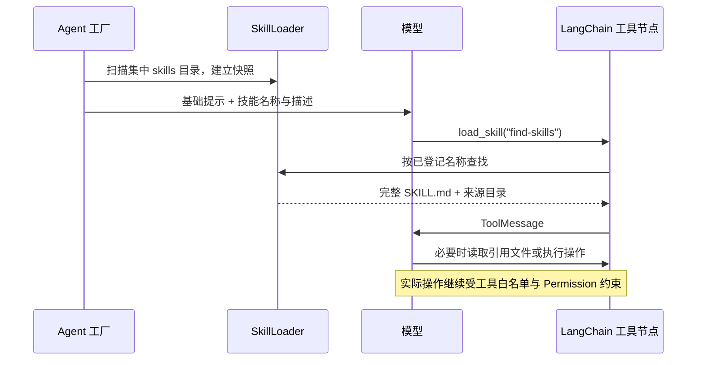

# v0.0.7——Skill 渐进式加载

## 1. 文档信息与完成标准

- 目标版本：`v0.0.7`。
- 状态：已实现。功能交付、资源目录调整和默认配置入口调整的验收分别见第 13、14、15 节。
- 制定日期：2026-09-27。
- 设计基线：`d0c1743`（`feat: complete v0.0.6 subagent delegation`），基线版本 `0.0.6`；交付版本 `0.0.7`。
- 前置能力：[v0.0.6——SubAgent 委派机制](<./v0.0.6——SubAgent 委派机制.md>)，权限及输出行为以其第 22 节为准。
- 本地参考：[s07 Skill Loading 笔记](/Users/hgz/WorkSpace/NoteBooks/MyNotes/Agent/learn-claude-code/s07_skill_loading/README.md)。该路径是本次设计的本地参考，不是运行时依赖。
- 首个验收技能：[.agents/skills/find-skills/SKILL.md](../.agents/skills/find-skills/SKILL.md)。保留用户已添加的内容，不为了适配测试而改写技能。

本阶段在现有 LangChain Agent 中实现“先展示技能目录，再按需读取完整说明”。技能统一维护在项目根目录的 `.agents/skills/`，主 Agent 和显式具备 `load_skill` 工具的子 Agent 均可使用。提示词和运行时会话数据分别归入 `.agents/prompts/`、`.agents/sessions/`，目录调整记录见第 14 节。

完成标准：

1. 扫描 `.agents/skills/*/SKILL.md`，把技能名称、描述作为目录加入模型的 system prompt；新会话首次请求不包含技能正文及关联文件内容。
2. 模型可调用 `load_skill(name)`；完整 `SKILL.md` 通过框架生成的 `ToolMessage` 进入调用者的消息历史，后续模型请求能够使用它。
3. `find-skills` 可以被发现、加载，并用于回答其使用流程；基础验收不依赖联网搜索、Node.js 或安装外部技能。
4. Skill 中引用的文件按需交给现有工具读取，命令交给现有 Bash 工具执行；实际操作继续遵循原有工具白名单、路径和审批规则。
5. 主子消息隔离、Checkpoint 续聊、工具错误、模型预算、审批恢复、子代理静默输出和 CLI JSON 契约继续成立。
6. 单元、框架集成和指定真实模型场景通过后，才更新版本为 `0.0.7` 并补充交付记录。

第 2—10 节记录实现契约与验收要求，第 11 节保留方案制定时的预验证，第 13 节记录功能交付，第 14 节记录资源目录调整，第 15 节记录默认配置入口调整。本次验收实际执行，不以历史版本的通过数量替代；用户提供的技能原文和外部数据集未修改。

## 2. 当前实现基线与接入位置

| 位置 | 当前行为 | 本阶段接入点 |
| --- | --- | --- |
| [agents/main.py](../src/rs_harness/agents/main.py) `build_agent` | 使用 `create_agent` 装配主图、六种基础工具、委派工具及 middleware | 创建一次技能目录快照，传给主图和子图工厂 |
| [agents/middleware.py](../src/rs_harness/agents/middleware.py) `build_middleware` | 按工具集合装配审批、预算、错误、图片、Todo、Stop Hook；主图另有委派批次约束 | 条件装配 `SkillMiddleware`，不重排既有中间件 |
| [agents/subagent.py](../src/rs_harness/agents/subagent.py) `build_delegate_tool` | 按具名定义构造独立子图，工具集合落实到模型与执行图 | 根据白名单决定是否安装技能 middleware |
| [config.py](../src/rs_harness/config.py) | TOML 路径相对配置文件解析；校验子工具白名单并生成执行定义摘要 | 增加单个 `skills_dir` 路径和 `load_skill` 工具名 |
| [context.py](../src/rs_harness/context.py) `AgentContext` | 传入 workdir、Bash 超时、工具输出字节预算 | 复用输出预算，不把目录或正文变成模型可修改参数 |
| [application.py](../src/rs_harness/application.py) `_run_interaction` | 在会话锁内重建 Agent；普通输入传增量消息，恢复传 `Command(resume=...)` | 沿用调用与恢复路径，不另建执行循环 |
| [tools/filesystem.py](../src/rs_harness/tools/filesystem.py) `read_file` | 文本按行读取，有输出限制；工作区外读取由主代理审批、子代理拒绝 | 用于后续引用文件；不因新增技能而扩大普通文件权限 |
| [tests/models.py](../tests/models.py) `ScriptedModel` | 捕获模型输入、绑定工具、调用次数，返回预设响应 | 确定性验证真正发给模型的内容及工具消息 |

当前普通文件工具以 session 的 `workdir` 为工作区。技能目录属于应用配置，不能按 `workdir/skills` 推导，否则使用 `./workdir` 或任意临时工作目录时会丢失项目的技能库。

本地安装与 `uv.lock` 已核对：`langchain 1.4.1`、`langchain-core 1.6.3`、`langgraph 1.2.11`、`PyYAML 6.0.3`。本阶段沿用锁定框架版本。解析 YAML 时使用已有的 PyYAML，并将其从传递依赖提升为项目显式依赖，例如 `pyyaml>=6,<7`；不为此升级其他依赖。

## 3. 技术选择与范围

采用 LangChain 官方 Skills 教程的组合：**本地 SkillLoader + `@tool` 加载函数 + 自定义 `AgentMiddleware` + 现有 `create_agent`**。[官方基础模式](https://docs.langchain.com/oss/python/langchain/multi-agent/skills) 与 [完整教程](https://docs.langchain.com/oss/python/langchain/multi-agent/skills-sql-assistant) 提供了目录摘要和工具加载的依据；下表中的文件扫描与接线规则是 RSH 本版本的设计。

| 能力 | s07 笔记 | v0.0.7 采用方式 |
| --- | --- | --- |
| 技能目录 | 扫描 `skills/*/SKILL.md` | 同样扫描单层技能目录，忽略普通杂项文件 |
| 初始上下文 | 名称、描述拼入 system prompt | 由 middleware 加入当前模型请求 |
| 按需正文 | `load_skill(name)` 查询启动注册表 | 通过 `@tool` 查询本次构图的只读注册表 |
| 正文消息 | 手动 Agent Loop 追加 `tool_result` | LangChain 调度工具并生成 `ToolMessage` |
| 引用资源 | 本节主要展示技能正文 | 保留引用，使用现有文件/Bash 工具逐步处理 |
| 上下文维护 | 正文留在消息列表，后续章节再压缩 | 使用现有 Checkpoint 消息历史；不在本阶段加入压缩 |

不引入 Deep Agents：其内置 `SkillsMiddleware` 是另一条可行路径，但本次只需要扩展既有 LangChain harness。这里的 `SkillMiddleware` 是 RSH 自定义类，不冒称为 LangChain 的内置技能加载器。

本版本不增加技能搜索索引、向量检索、远程仓库同步、多个来源覆盖、热更新监听、技能安装 CLI、动态工具注册、自动执行脚本、专用技能状态机或权限元数据解释器。可通过 `/skill` 或 `rsh list-skill` 查看当前已登记技能，见第 17 节。Skill 的作用是提供说明；“先执行技能 A 再允许工具 B”这类强制流程也不在本次范围内。

## 4. 集中目录、配置与扫描契约

### 4.1 单个技能根目录

```text
RS-Harness/
├── .agents/
│   ├── config.toml          # 默认私有配置，Git 忽略
│   ├── example.toml         # 不含密钥的配置模板
│   ├── skills/
│   │   ├── find-skills/SKILL.md
│   │   └── pdf/             # SKILL.md 及其关联资源
│   ├── prompts/
│   │   ├── system.md
│   │   └── subagents/       # researcher.md、engineer.md
│   └── sessions/            # Git 忽略的运行时数据
│       ├── checkpoints.sqlite3
│       └── <session_id>/
└── workdir/                  # 任务产物与评测工作区
```

运行资源的默认路径如下；各技能可按需包含 `references/`、`scripts/` 和 `assets/`，不会预先加载到模型：

```toml
[runtime]
skills_dir = "../.agents/skills"
system_prompt_file = "../.agents/prompts/system.md"
sessions_dir = "../.agents/sessions"
checkpoint_file = "checkpoints.sqlite3"
```

- `RuntimeConfig.skills_dir` 默认相对值为 `../.agents/skills`；`Config.load` 统一相对 TOML 所在目录解析为绝对路径，包含 `expanduser` 和 `resolve`。仓库的 `.agents/example.toml` 显式写出该字段，因此指向项目根目录的 `.agents/skills/`。提示词与会话目录采用相同解析规则，只有相对的 `checkpoint_file` 继续以会话目录为基准。
- 直接构造 Python `Config` 的调用方和测试须提供已解析的技能绝对路径，避免依赖启动 cwd。
- `Config.summary()` 展示已解析的目录路径，不展示技能全文。
- 只有一个配置根目录；不自动追加用户主目录、其他项目或 session 工作目录中的技能源，也不从模型输入接收额外目录。
- 路径配置用于定位同一套集中技能和支持临时目录测试，不提供多个技能来源或每个子代理独立的技能根目录。

### 4.2 Frontmatter 与发现规则

每个技能以 UTF-8 编码保存 `SKILL.md`，推荐格式与现有 `find-skills` 一致：

```markdown
---
name: find-skills
description: 帮助用户发现适用的 Agent 技能；在用户询问可安装技能时使用。
---

# Find Skills
这里是按需加载的完整操作说明。
```

上例只解释格式，不替换已有文件。解析约定：

1. 排序枚举技能根目录的直接子目录，读取其中的 `SKILL.md`，发现范围与 `*/SKILL.md` 一致。实现显式调用 `iterdir()`，使根目录不可访问时能够报告错误，而不被 glob 的异常处理视为空目录。只接受解析后仍位于技能根目录内的普通文件；越界符号链接不登记。
2. 起始为独占一行的 `---` 时解析 YAML frontmatter，使用 `yaml.safe_load`；缺失结束分隔符、无效 YAML 或非映射结构视为无效文件。不存在 frontmatter 时，全文作为正文。
3. 对齐笔记的回退语义：`name` 缺失、空白或非字符串时用目录名；`description` 缺失、空白或非字符串时用正文首行。描述去除起始标题符号并合并空白为单行。
4. 名称必须能用作单行目录标识，不允许路径分隔符、换行或控制字符；描述回退后仍为空则不登记。未知 frontmatter 字段保留在原始全文中，不赋予额外语义。
5. 同名技能视为配置错误，构图前报出冲突文件；不照搬字典后写覆盖的隐式行为。排序只保证结果稳定，不构成覆盖优先级。
6. 根目录不存在或为空时得到空目录，Agent 仍能运行；根路径实际是文件或不可访问时报告 `ConfigError`。单个无效/不可读文件跳过并记录文件路径及简短原因，不能静默消失，也不能把原始正文写入错误摘要。

扫描诊断走现有日志约定，不向 stdout 直接 `print`，保持 `ask --json` 的输出格式。v0.0.7 实现的是上述明确子集，不宣称完整实现 Agent Skills 规范；例如 `allowed-tools` 不修改工具白名单或审批行为。

### 4.3 快照与刷新时间

每次 `build_agent` 创建一个 `SkillLoader`，扫描一次并保存 `name / description / resolved_path / content`。`content` 是完整原始文件文本，包含 frontmatter。主、子图复用同一只读目录快照，各自创建 middleware 实例。

这与笔记一致：**启动扫描可以读取全文到进程内存，渐进式披露限制的是进入模型上下文的内容。**不把“正文尚未交给模型”描述为“尚未从磁盘读取”。

RSH 每次 ask/resume 会重建图，所以刷新边界是下一次构图，而不是固定的进程启动或每次模型请求。一次构图内新增、修改、删除技能不改变该快照；不使用全局可变缓存或扫描 watcher。

新目录摘要不会删除 Checkpoint 中已加载的旧正文。开发者修改技能后应使用新 session 验收，避免将同一会话中的旧、新说明混用。本版本不持久化技能快照、不保存额外内容哈希、不迁移旧会话，也不保证暂停期间修改技能后的内容一致性。

## 5. 渐进式披露与工具契约

### 5.1 上下文的三个层次

| 层次 | 进入模型的内容 | 触发方式 |
| --- | --- | --- |
| L1：发现 | 全部已登记技能的名称、描述，以及通用加载指引 | 每次模型请求的 system prompt |
| L2：说明 | 选定技能的完整 `SKILL.md` 与来源目录 | `load_skill(name)` 的工具结果 |
| L3：资源 | 该任务实际需要的引用文件或命令结果 | 模型随后调用已有工具，遵循权限和输出限制 |

L1、L2 是本版本新增能力。L3 复用现有工具，不新增资源加载器；不递归扫描或提前拼接引用内容。目录摘要不包含正文、命令示例或整份资源清单。



### 5.2 `load_skill` 接口

对模型暴露的参数只有名称：

```python
def load_skill(name: str) -> str: ...
```

实现以 `@tool` 注册，内部通过 `ToolRuntime[AgentContext]` 获取现有输出预算；`runtime` 不出现在模型参数 schema。注册表通过工厂闭包绑定，禁止在工具调用时把 `name` 拼成文件路径。

成功结果采用普通字符串，在原文前补充简短定位信息：

```text
Loaded skill: find-skills
Skill directory: <resolved skills root>/find-skills
Skill file: <resolved skills root>/find-skills/SKILL.md

<完整原始 SKILL.md>
```

- 关联相对路径以结果中的技能目录为基准。工具不改变 session workdir；后续 Bash 的 cwd 仍为原工作区。
- 未知名称、空白名称、尝试传入路径等不能读取任意文件。无效 schema 交由框架处理，未登记名称抛出 `ToolException`，提示可用名称；复用现有 `ToolErrorMiddleware` 返回错误工具消息。
- 成功结果的 UTF-8 字节数须不超过现有 `max_tool_output_bytes`，包括定位信息。超限返回明确工具错误和拆分说明的建议，不能截断后声称加载完整；开发者可将详细内容移入引用文件。
- 同一技能重复加载仍返回完整说明，不增加 `loaded_skills` 状态或“已加载”短路。提示模型优先复用历史内容，基础实现不承诺自动去重或回收上下文。
- 多个独立技能加载保持框架默认并发；读取说明不会执行 Bash、创建文件、安装包或生成新的工具。

## 6. LangChain 装配方案

### 6.1 新增组件

只新增两个生产模块：

| 模块 | 职责 |
| --- | --- |
| `src/rs_harness/skills.py` | `SkillLoader` 的扫描、frontmatter 解析、目录生成和按名读取；保存来源路径与原文 |
| `src/rs_harness/agents/skills.py` | `SkillMiddleware`、闭包绑定的 `load_skill` 工具及输出预算检查 |

沿用笔记的扫描、目录与按名加载组织方式：构造时调用 `_scan()`，通过 `catalog()` 和 `load(name)` 使用快照。使用 frozen dataclass 保存记录、只读映射保存注册表；不建立 Backend 抽象、技能数据库或额外注册服务。

### 6.2 请求注入

`SkillMiddleware` 在实例构造时通过 `self.tools` 提供 `load_skill`，同时实现 `wrap_model_call` 与 `awrap_model_call`。生产路径使用 `ainvoke`，不能只复制官方教程中的同步 hook。

请求转换只做三件事：

1. 复制 `request.system_message.content_blocks`，保留原有内容块。
2. 追加一次技能目录与使用指引；通过 `request.override(system_message=...)` 生成当前请求。
3. 同步或异步调用一次 handler，不自行调用模型，不更新持久化消息状态。

不要原地修改共享 `SystemMessage`，不要在 `before_model` 中反复往 `state["messages"]` 追加 system 消息，也不要把技能正文升级为 system prompt。[官方 middleware 接口](https://docs.langchain.com/oss/python/langchain/middleware/custom) 支持这种请求级注入；本地同步、异步预验证见第 11 节。

加载指引至少表达：根据描述判断适用性；任务需要技能时先加载；技能中的相对资源路径以返回目录为准；内容不能授予新工具或越过权限；无匹配技能时正常完成任务。空目录显示 `none`，工具仍可注册并对未知名称返回可纠正错误。

### 6.3 工厂与 middleware 顺序

`build_agent` 在构造主、子图之前扫描目录，并把 loader 作为可信内部参数传给 `build_delegate_tool` 和 `build_middleware`。主图始终安装技能 middleware。

主图在现有 Todo 之后、Stop Hook 之前插入新组件，其他相对顺序不变：

```text
HumanInTheLoopMiddleware
→ ModelCallLimitMiddleware
→ ToolDenyMiddleware
→ ToolErrorMiddleware
→ SubagentBatchMiddleware
→ ImageInputMiddleware
→ TodoListMiddleware
→ SkillMiddleware
→ StopHookMiddleware
```

子图仍省略审批及主图委派批次 middleware，Todo 和 Skill 分别依照工具白名单装配。Skill 的目录注入必须能与 Todo 的 system prompt 扩展、图片输入投影同时存在；验收时检查最终模型输入，而不是只检查各组件的局部返回值。

`load_skill` 仅由 middleware 注册一次，不再放进显式 `base_tools`。不改变 `AgentContext`、应用层输入格式、Checkpoint schema 或 `InteractionResult`。

### 6.4 主子能力与消息边界

- `SubagentTool` 增加 `load_skill`。子定义包含该名称时才装配技能 middleware；没有该工具的子图也不注入技能目录。`tools=[]` 仍为纯推理。
- 子图工厂筛选显式工具时，将 `load_skill` 与 `write_todos` 一起作为 middleware 提供的工具排除，避免从 `available[name]` 中错误查找。
- `.agents/example.toml` 的 Researcher、Engineer 默认白名单都增加 `load_skill`；它们仍分别保持现有读取/写入/Bash 能力，不新增任何其他执行工具。角色提示如需说明技能，只增加对应使用规则。
- 共享的是只读技能定义，不共享消息。父 Agent 加载的正文不会自动进入子历史；子 Agent 应自行加载所需技能，返回给父 Agent 的仍只有最终消息 content。
- `per_thread` 子图按原机制保留自己的工具消息，`per_invocation` 子图每次从新状态开始；不增加第二套技能持久化规则。
- 更新默认工具集合会影响现有 `subagents_digest` 检查。使用新父 session 验收，保持现有定义一致性检查，不绕过它或迁移旧 session。

## 7. 权限、资源与运行记录

### 7.1 集中技能源和工作区的边界

配置指定的技能库是应用提供的知识源。`load_skill` 只返回扫描时确认位于该根目录内、已经缓存的 `SKILL.md`，因此不因技能库位于 workdir 外而逐次请求文件审批。此权限仅覆盖已登记技能正文，模型不能选择目录或任意路径。

后续资源访问依然是普通工具调用：

| 操作 | 处理方式 |
| --- | --- |
| 按名加载已登记 `SKILL.md` | 主、子 Agent 在拥有 `load_skill` 时读取注册表 |
| 读取工作区内的关联文本文件 | 通过原 `read_file` 读取，可按 offset/limit 分段 |
| 读取工作区外的技能引用文件 | 主 Agent 按原规则申请审批；子 Agent 直接收到拒绝 |
| 执行技能说明中的命令或脚本 | 必须拥有 Bash，沿用现有 allow/ask/deny 规则 |
| 创建、覆盖、删除或安装内容 | 由后续实际工具动作决定；加载技能不表示已授权或已执行 |

例如 workdir 为 `<repo>/workdir` 时，`<repo>/.agents/skills/find-skills/SKILL.md` 可由注册表加载；技能目录中的其他文件不会因此成为普通 `read_file` 的免审批路径。子 Agent 受阻时向主 Agent 报告，由主 Agent 决定后续合法步骤，不经其他工具规避拒绝。

这意味着 v0.0.7 不承诺每个外部技能都能在任意子代理中完整执行。技能所需工具和环境仍须满足，基础成功标准是发现、加载及在现有能力范围内使用说明。

### 7.2 Checkpoint、预算与输出

- 工具返回字符串由 LangChain 配对为 `ToolMessage`，原 `tool_call_id` 必须保留；正文通过现有消息 reducer 与 SQLite Checkpoint 保存。
- `ask` 仍只提交新用户消息；`resume` 仍只提交恢复命令，不手动重新拼接已加载正文、不从 trajectory 恢复上下文。
- 加载后的下一次模型调用继续计入现有预算；加载正文与自动压缩上下文是两项独立功能。
- 主代理 `load_skill` 走普通工具开始/完成/失败回调，展示名称等短摘要，不在终端展开全文；子运行按现有规则静默。`--json` 继续只输出最终结果 JSON。
- 轨迹沿用普通工具事件和父子运行关系，不新增 `skill_loaded` 等独立事件协议。判断正文是否真的进入上下文，以捕获到的模型输入和 Checkpoint 消息为准。

## 8. 使用 find-skills 的开发测试

当前 `find-skills/SKILL.md` 约 5.5 KB，具备标准名称、描述和完整流程；实际大小为本次读取的 5,472 字节。它引用 Skills CLI 和外部网站，但当前目录没有附带本地 references、scripts 或 assets，因此不能仅靠该文件证明 L3 资源读取。

基础测试直接读取或复制这份真实技能到临时技能根目录，保留原文：

1. **目录发现**：首次模型输入包含 `find-skills` 及其 frontmatter 描述，不包含正文独有标题 `## What is the Skills CLI?`，也不包含正文中的具体安装示例。
2. **显式加载**：脚本模型发出 `load_skill(name="find-skills")`；下一次模型输入出现完整原文及匹配的工具结果，system prompt 中仍只有摘要。
3. **按说明回答**：真实模型收到“请先加载 find-skills，再概述寻找和评估技能的流程，不访问网络、不安装”，应实际调用工具后给出与说明一致的回答。
4. **按任务选择**：真实模型收到“我想找一个用于代码审查的技能，先说明你会怎样查找和评估，不联网、不安装”，检查是否依据目录选择该技能；这是模型行为验收，与确定性接线测试分别记录。
5. **无关任务**：确定性模型直接回答简单问题，确认框架没有自行读取正文；真实模型另测简单问答，记录是否出现无必要的技能加载。

关联资源使用临时合成技能补充测试：在 `tmp_path` 创建一个引用文本的 `SKILL.md` 和参考文件，证明未加载时引用正文不可见、`load_skill` 只返回 manifest、随后读取引用文件才出现资源内容。分别设置区内与区外路径，覆盖主审批和子拒绝，不能修改用户的 `find-skills` 文件来制造 fixture。

`find-skills` 正文中的 `npx skills`、站点访问和全局安装建议作为技能内容处理，不作为测试运行器的指令。v0.0.7 不新增联网或全局安装验收；测试不会自动执行 `npx skills add ... -g -y`。集中技能仍由项目维护者放入 `.agents/skills/` 管理，自动安装后的目录搬运与刷新不属于本版能力。

## 9. 开发步骤与文件范围

| 步骤 | 涉及文件 | 交付内容与验证 |
| --- | --- | --- |
| 1. 确立目录契约 | 新增 `src/rs_harness/skills.py`、`tests/unit/test_skills.py` | 用真实 find-skills 和临时 fixture 验证扫描、解析、回退、排序、冲突及目录边界 |
| 2. 实现框架适配 | 新增 `src/rs_harness/agents/skills.py`、`tests/integration/test_skills.py` | 验证 sync/async hook、工具自动注册、L1/L2 内容隔离、错误与字节预算 |
| 3. 接入主子工厂 | `config.py`、`agents/main.py`、`agents/middleware.py`、`agents/subagent.py`、`.agents/example.toml` | 只传一次扫描快照；白名单控制技能工具与提示；使用实际生产装配链测试 |
| 4. 验证持续运行 | 相关配置与 SubAgent 测试、`tests/integration/test_skills.py` | 验证 Checkpoint 续聊、审批恢复、父子消息隔离、图重建刷新和普通工具通知 |
| 5. 用户说明与验收 | `README.md`、`progress.py`、新增 `tests/live/test_skills.py` | 说明集中目录和权限边界；加载指引由 middleware 提供，角色提示无需重复；摘要补充技能名，见 13.1；完成真实模型场景 |
| 6. 发布收尾 | `pyproject.toml`、`src/rs_harness/__init__.py`、`uv.lock`、本文 | 显式声明 PyYAML；验收通过后将版本更新为 0.0.7，记录实际命令和结果 |

步骤 1 之前声明 YAML 直接依赖即可开始开发，最终版本号留到步骤 6。实施不新增 CLI 子命令；预期无需修改应用执行、session 存储、基础文件权限或进度事件协议。若集成测试暴露这些边界确需变化，应先在本文写明具体原因和最小变更，不能顺带重构。

Skill 初次实现未修改私有配置；后续目录调整按用户授权同步路径字段，见第 14 节。外部数据集不在本次变更范围，实际任务产物和数据集评测仍在 `workdir`，自动化测试的临时目录由 pytest 管理。

## 10. 验收矩阵与发布门槛

### 10.1 确定性与集成验收

| 编号 | 场景 | 必须证明的结果 |
| --- | --- | --- |
| S01 | 真实 find-skills 与普通杂项文件 | 技能名称/描述正确；`.DS_Store`、无 manifest 目录不登记 |
| S02 | 无 frontmatter、缺字段、空白/非字符串字段、多行描述 | 按约定回退和规范化，正文完整保留 |
| S03 | 无效 YAML、非映射、缺结束符、不可读文件、重复名称 | 无效项有诊断；同名冲突明确失败，不静默覆盖 |
| S04 | 缺失/空技能目录与错误根路径 | 空目录不阻断 Agent；根路径错误明确失败；无 stdout 污染 |
| S05 | 不同 cwd、不同 workdir、相对配置路径 | 都从同一个解析后的集中目录发现技能 |
| S06 | 越界 manifest 符号链接、未知名称、路径式名称 | 不读取越界内容，不把名称当路径；合法内部文件仍可用 |
| S07 | 首轮模型输入与工具 schema | 只有 L1；参数仅有 name，无 runtime、目录或正文参数 |
| S08 | 同步及异步加载 | 下一次模型输入有完整原文；ToolMessage 名称/id 配对正确 |
| S09 | 连续模型轮次、Todo、图片投影 | 目录每个请求只出现一次；其他 system 块和消息投影保留 |
| S10 | 重复/多个技能加载、超出输出预算 | 合法调用各自返回；超限明确错误，不产生伪完整正文 |
| S11 | 首次无关任务、合成资源读取 | 框架不主动加载正文；资源只有在后续真实读取后出现 |
| S12 | 生产 ask、同一 session 续聊及独立进程重建 | 正文按 Checkpoint 恢复；不同 session 不共享加载历史 |
| S13 | ask 后续需审动作及 resume | 维持既有中断/拒绝/恢复；不重复提交正文或已完成操作 |
| S14 | 区外技能根与区外引用文件 | load_skill 可读合法注册表；普通外部 read_file 仍主审批/子拒绝 |
| S15 | 子白名单含/不含 load_skill、空工具列表 | 实际图工具和目录提示一致；伪造未注册调用无法执行 |
| S16 | 主子、两个子身份、两种 persistence | 只共享定义，消息互不泄漏；持续子历史续用、独立子从新状态开始 |
| S17 | 单次构图后编辑文件、下次重建图 | 同图保持快照，新图反映新增/修改/删除；无全局缓存串扰 |
| S18 | 主代理通知、子代理静默、JSON 输出、工具错误、预算 | 不打印技能正文；日志不影响结果；后续模型调用仍受限 |

测试必须调用生产工厂或框架图，并检查 `ScriptedModel.inputs`、实际绑定工具、调用配对和持久化状态。只验证 `catalog()` 的字符串或用 mock 直接返回“加载成功”，不能代替 S07—S18。

### 10.2 真实模型验收

新增 `tests/live/test_skills.py`，至少覆盖三个独立场景：显式加载并概述流程、依据任务相关性选择 find-skills、无关问题无需技能。联网只用于调用已配置模型，测试任务明确禁止外部网站访问及安装。测试应核对真实工具调用与结果，不能只根据回答中出现技能名称判定成功。

fixture 使用临时 session、Checkpoint、workdir 和技能目录，并复制真实 find-skills。显式配置可加载技能的子 Agent 后，再验证一次委派加载，确认父模型只看到子最终结果、子 Checkpoint 中有自己的加载消息。

### 10.3 执行顺序

常规验收命令如下，本次实际执行命令与结果见第 13 节：

```bash
uv run pytest tests/unit/test_skills.py tests/integration/test_skills.py --tb=short
uv run pytest --tb=short
uv run pytest -m live tests/live/test_skills.py --tb=short
git diff --check
```

补充受影响的配置和子代理针对性用例后，完成一次全量离线回归；若再有生产代码变更，重跑对应受影响检查。真实模型结果记录模型标识、用例、时间和证据，失败必须如实保留。停止条件是完成标准和矩阵通过、文档与最终实现一致、变更范围受控；不能以“模型说它已经加载”或旧阶段通过数量代替验收。

## 11. 本次方案制定的验证记录

### 11.1 已核对的事实

- 源码发现采用 Tier 2 图验证，项目为 `Users-hgz-WorkSpace-RS-Harness`，覆盖元数据代次为 `2026-09-27T13:19:41Z`。已核对主/子工厂、middleware、配置、运行入口、文件工具、上下文及脚本模型；相关源码路径无已记录覆盖缺口且元数据匹配。这是任务范围内的 best-effort 证据，不是全仓完备性保证。
- `uv.lock` 覆盖元数据显示 `not_tracked`，已直接读取锁定条目并与本地安装版本比较；配置、提示词、技能与历史设计文档同样直接读取核对。
- 官方 LangChain Skills 教程及 middleware 文档已通过 Context7 和官方网站核对，设计未假定存在一个可直接导入的 LangChain 内置 `SkillMiddleware`。
- 已读取用户提供的 s07 README 和项目 find-skills（现位于 `.agents/skills/find-skills/SKILL.md`）；两者的命令示例只作为参考内容，不作为本次执行指令。

### 11.2 最小框架预验证

使用本地锁定依赖、`ScriptedModel`、内存 Checkpoint 和临时定义的 middleware，在独立 Python 进程内完成同步 `invoke`、异步 `ainvoke` 两组探针，均通过以下断言：

1. middleware 的 `self.tools` 能把闭包工具注册到模型与执行图。
2. 首轮只有真实 find-skills 的名称和描述，不含正文独有标记。
3. 工具返回完整技能原文，下一轮出现匹配 `tool_call_id` 的 `ToolMessage`。
4. 每轮 system 消息只追加一份目录，正文始终作为工具消息存在。
5. Checkpoint 消息保存工具结果，不保存此次请求注入的 system 消息。

该预验证探针未调用真实模型、联网、执行技能命令或修改生产代码。它只证明所选框架接线可行，当时尚未覆盖扫描器、完整 middleware 组合、子工具范围、SQLite 跨进程恢复或第 10 节验收；这些项目的最终实施验证见第 13 节。

## 12. 官方参考

- [LangChain Skills：基础模式](https://docs.langchain.com/oss/python/langchain/multi-agent/skills)
- [Build a SQL assistant with on-demand skills：完整教程](https://docs.langchain.com/oss/python/langchain/multi-agent/skills-sql-assistant)
- [Custom middleware：请求 hook 与内容块](https://docs.langchain.com/oss/python/langchain/middleware/custom)
- [Deep Agents Skills：对照的内置实现](https://docs.langchain.com/oss/python/deepagents/skills)

## 13. 交付记录（2026-09-27）

### 13.1 运行摘要的最小补充

集成验收发现，现有 `progress._arguments` 仅展示路径、命令等参数，忽略 `load_skill` 的 `name`，因此通知无法区分正在加载的技能。为满足 S18，在现有摘要字段白名单中加入 `name`，继续复用原有脱敏、转义、160 字符截断和开始/完成通知；不增加事件类型，不展示工具返回正文，不改变子代理静默规则。

### 13.2 最终实现

- 新增 [SkillLoader](../src/rs_harness/skills.py) 和 [SkillMiddleware](../src/rs_harness/agents/skills.py)，完成解析、快照、摘要注入和完整正文工具加载。同步 hook 在真实 LangChain 图中验证，生产异步路径使用完整主子 Agent 装配链验证。
- `Config.load` 解析集中目录，`build_agent` 每次只扫描一次；子 Agent 的工具白名单同时控制工具注册和目录提示。示例 Researcher、Engineer 已加入 `load_skill`；Skill 初次交付时私有配置未改写，后续目录迁移的路径更新见第 14 节。
- 复用普通 ToolMessage、SQLite Checkpoint、输出预算、文件权限及运行事件。未更改应用执行循环、session 格式、基础文件工具或审批协议。
- `PyYAML 6.0.3` 提升为直接依赖。锁定的 LangChain 1.4.1、langchain-core 1.6.3、LangGraph 1.2.11 保持不变；版本号在验收通过后更新为 0.0.7。
- 原始 `find-skills/SKILL.md` 保留，5,472 字节；SHA-256 为 `c00eeea0e13e74fe4a9d84ba0a8542205a1b736d65f13134fe1a6647eb14976f`。

### 13.3 验收证据

| 验收范围 | 实际证据 |
| --- | --- |
| S01—S06 | [单元测试](../tests/unit/test_skills.py)：真实技能、回退、Unicode/多行描述、原文换行、无效输入日志、目录错误、同名冲突、符号链接、配置路径和只读快照 |
| S07—S10 | [集成测试](../tests/integration/test_skills.py)：同步/异步真实图、工具 schema、完整 ToolMessage、Todo/图片组合、重复与并行调用、UTF-8 字节边界 |
| S11—S14 | 同文件：L3 分步读取、独立进程恢复、原文件及 trajectory 删除后续聊、主代理批准/拒绝恢复、子代理外部引用拒绝 |
| S15—S17 | 同文件：空/受限/启用工具范围，伪造未注册调用，父子及两个身份隔离，两种持久模式，新父 session 隔离，单次扫描、同图快照和重建刷新 |
| S18 | 同文件及全量既有测试：技能名通知、错误通知、子代理静默、JSON 契约、预算耗尽后续聊；摘要不打印正文 |
| 真实模型 | [live 测试](../tests/live/test_skills.py)：显式加载后总结、根据代码审查任务选择技能、简单算术不加载、委派加载且正文仅保存在子历史 |

全量离线结果为 **651 passed, 26 deselected**，耗时 67.78 秒；其中新增 Skill 单元与集成测试共 50 项。26 项排除项为带 `live` 标记的测试，本次额外执行其中新增的 4 项 Skill 场景，并非重跑全部历史 live 场景。

真实模型采用私有配置中的 **glm-5.3-flash**，最终 **4 passed**，耗时 109.63 秒，完成时间为 2026-09-27 21:57（Asia/Shanghai）。各场景使用独立进程、临时技能副本、workdir、session 和 Checkpoint。证据来自真实模型输入、工具调用以及父子 Checkpoint；测试附加的调用前 middleware 仅允许 `load_skill` 与 `delegate_task`，其他实际工具动作会在处理器执行前使测试失败。网络只用于调用配置的模型，未执行技能中的 CLI、外部网站搜索或安装。

实际最终验收命令：

```bash
uv --cache-dir /tmp/rsh-skills-uv-cache run --locked pytest --tb=short -q
.venv/bin/python -m pytest -m live tests/live/test_skills.py --tb=short -v
git diff --check
```

另外检查了新增 Python 文件语法与尾部空白、文档本地链接和版本一致性。默认 uv 缓存目录在本次沙箱中不可写，因此使用临时缓存；包含 `ps` 进程清理检查的既有测试在允许该只读检查的环境中执行。未调整生产权限或删除既有测试来绕过环境限制。

### 13.4 验收中发现并处理的问题

1. 既有测试对绑定工具数量和集合的断言未包含新增工具，已更新预期；首次全量回归为 649 通过、1 失败，修正后按最终代码重新完成全量回归。
2. 新增运行通知测试发现技能名被摘要过滤，按 13.1 做了单字段补充，并验证主代理展示与子代理静默。
3. 首次真实模型验收为 3 通过、1 失败：相关性场景已正确加载 `find-skills`，但同时额外调用 `glob`。目录指引补充“按已登记名称直接加载，无需扫描文件”，场景明确只允许加载工具；测试动作限制从 callback 检查改为调用前 middleware，避免仅记录异常却仍执行其他工具。保留相关性选择要求（提示不提供技能名），最终四个场景全部重跑通过。

### 13.5 使用与边界

主 Agent 默认支持加载，示例配置的技能根目录指向项目 `.agents/skills/`。既有配置中的子 Agent 若需使用技能，在其 `tools` 中加入 `load_skill` 并新建父 session；现有子定义摘要校验继续生效。

此版本验证了技能发现、按需正文、资源访问边界及上下文恢复。技能快照在每次构图时刷新；没有热更新、正文去重、自动压缩、安装器或技能脚本自动执行。真实 `find-skills` 没有本地引用文件，L3 资源边界使用临时合成技能验证；其外部搜索和安装流程不属于本次验收。

## 14. 运行资源统一到 .agents（2026-09-27）

### 14.1 目录与配置

按用户确认的范围，迁移运行时会话数据，Python 会话实现继续保留在 `src/rs_harness/sessions/`。版本保持 0.0.7，不增加历史格式升级、旧路径回退或自动迁移逻辑。

- 保留 `.agents/skills/` 已有的 find-skills、pdf 及其关联资源；删除仅剩 `.DS_Store` 的根 `skills/`。
- 将根 `prompts/`、`sessions/` 分别整体移动到 `.agents/prompts/`、`.agents/sessions/`。迁移前两次 `lsof` 检查均未发现会话目录被占用，目标目录不存在，未覆盖已有目标。
- `RuntimeConfig`、`Config.load` 与示例配置采用第 4.1 节的新默认路径；本地私有配置同步主、子提示词、会话和技能路径。对修改前后解析结果做比较，模型、密钥、工具配置及其他字段保持一致。
- Git 忽略规则由 `/sessions/` 改为 `/.agents/sessions/`，技能与提示词可纳入版本管理。配置目录、`skills-lock.json` 和外部数据集的位置不变。

### 14.2 完整性与行为验证

迁移前后逐项比较相对路径、文件 SHA-256、权限和目录结构：3 个提示词文件、32 个会话文件及 13 个技能文件全部一致；数据库及会话记录原样保留。会话源码和 `skills-lock.json` 也通过内容一致性检查。旧的三个根目录均已移除，实际会话数据库受 Git 忽略，提示词和技能 manifest 不被忽略。

新增 4 个确定性用例：省略路径配置与显式覆盖两种情况，以及新目录下批准/拒绝外部读取两种完整交互。它们验证从不同 cwd 解析配置、主子提示词加载、find-skills 与 pdf 的 L1/L2 披露、新目录会话创建、SQLite Checkpoint、续聊和审批恢复。真实技能测试 fixture 的来源已改为 `.agents/skills/`；测试产生的会话仍限定在 pytest 临时目录。

本次验证记录：

- 针对性测试：`tests/unit/test_config.py`、`tests/unit/test_skills.py`、`tests/integration/test_skills.py`，**96 passed**，3.99 秒。
- 真实模型：`glm-5.3-flash`，原有 4 项 Skill 场景重新执行，**4 passed**，130.56 秒。未执行 PDF 处理、外部技能搜索或安装。
- 全量离线回归：`uv --cache-dir /tmp/rsh-skills-uv-cache run --locked pytest --tb=short -q`，**655 passed, 26 deselected**，61.53 秒；2026-09-27 22:36（Asia/Shanghai）确认完成。26 项被排除的 live 测试中，本次另外执行了上述 4 项 Skill 场景。
- 目录完整性、配置加载、Git 忽略规则、文档本地链接、Python 语法与空白检查均通过。

第 13 节保留 Skill 初次交付的历史结果，本节记录本次目录调整的实际验收，不将旧测试结果算作新的验证。

## 15. 默认配置入口改为 .agents/config.toml（2026-09-27）

RSH 从当前目录的 `.agents/config.toml` 读取默认配置，覆盖交互入口及 ask、create-session、list-session、close-session；Python `Config.load()` 使用相同默认值。显式 `--config` 继续有效，子命令显式参数仍优先于根参数，不增加父目录搜索或旧配置回退。

实施时 `.agents/config.toml` 已存在，模型设置与旧私有配置不同，因此直接使用现有文件，未覆盖模型或密钥。已验证该文件中的技能、提示词、会话及 Checkpoint 路径正确解析到当前资源目录，无需调整资源默认值。新的私有配置加入 Git 忽略规则，默认入口调整时保留了旧私有配置及其忽略规则，后续清理见第 16 节；公开模板现位于 `.agents/example.toml`。README 初始化命令和 live 测试的配置入口同步更新。

新增 3 项回归用例，在只有新默认配置的临时项目中验证 Python 默认加载、会话创建/列举/关闭，以及交互启动和 ask 的完整执行。修改前 3 项均因查找旧路径而失败；修改后 CLI 与配置针对性测试 **133 passed**，1.75 秒。现有的子命令显式配置优先级测试也改用新默认路径并通过。

全量离线回归 **658 passed, 26 deselected**，61.70 秒；实际 `rsh --help` 显示默认路径为 `.agents/config.toml`，Git 忽略与文档检查通过。本次仅调整配置入口，不重新调用真实模型；第 14 节的真实模型结果保留为当时的验收记录。

## 16. 示例配置归入 .agents（2026-09-28）

示例配置原样移动到 `.agents/example.toml`，SHA-256 为 `2ccf011382526f9f776ea6ccf36d294486b364a7baf43a315b255a35da7daeed`；移动前后的配置解析结果一致。旧目录中的私有配置与现用 `.agents/config.toml` 字节完全相同，核对后删除重复副本和旧 `config/` 目录，现用私有配置保持原样。

README、当前实施文档、测试 fixture 及 live 测试提示已使用新的模板路径；移除已失效的旧私有配置忽略规则。`.agents/config.toml` 继续被 Git 忽略，`.agents/example.toml` 可纳入版本管理。

执行 CLI、配置与 Skill 集成测试，**158 passed**，4.25 秒。另核对模板哈希、两份配置的资源解析、旧目录不存在、Git 忽略规则及文档引用。本次为文件位置调整，未重复执行全量回归或真实模型测试。

## 17. 查看已安装技能（2026-09-28）

新增交互命令 `/skill` 和 CLI 子命令 `rsh list-skill`。子命令出现在 `rsh --help` 的 Commands 中；交互帮助 `/help` 同步列出 `/skill`。

两个入口复用 `SkillLoader` 和同一输出函数，每次重新扫描当前配置的 `skills_dir`，展示管理目录、数量、技能名称和描述。默认目录是 `.agents/skills/`；扫描与 Agent 使用相同的 manifest 解析、重复名称及路径边界规则。正文不展开，不调用模型，不创建会话，也不把列表写入消息历史。

- 缺失或空技能目录显示 `No skills installed.`。
- 扫描失败时交互命令显示错误并继续等待输入，CLI 子命令显示错误并以 1 退出。
- `/skill` 不接受参数，多余参数返回 `Usage: /skill`。
- `list-skill` 使用默认 `.agents/config.toml`，也支持根参数或子命令上的 `--config`，子命令显式参数优先。先选定有效配置，再由 `Config.load` 校验，避免缺失的默认文件阻断根级显式配置。

新增 13 项回归用例，覆盖两个入口的目录输出、真实 find-skills/pdf 摘要、正文与模型调用隔离、空目录、重复名称、错误根路径、非法参数、交互中再次扫描、帮助注册及配置参数优先级。CLI 与 SkillLoader 针对性测试 **129 passed**，1.84 秒。实现前 `/skill` 测试证明输入会落入普通模型请求；实现后该输入被本地命令处理。

全量离线回归 **671 passed, 26 deselected**，56.02 秒。实际运行 `rsh list-skill` 和交互 `/skill` 均列出 find-skills、pdf；帮助中可见新命令，交互查看前后会话目录未新增记录。文档与 diff 检查通过。此功能为本地目录查看，未重新调用真实模型，不涉及模型 API 变更或新的安装行为。

## 18. Skill 目录总面板（2026-10-16）

`rsh list-skill` 和 `/skill` 通过同一 `_print_skills` 入口使用独立的 `print_skill_catalog(skills_dir, skills, *, console=None)` 渲染函数，风格与 MCP 总面板一致。标题为 `Installed skills`，顶部显示技能总数和管理目录，主体展示技能名称及完整描述；技能名称突出显示，路径和边框使用淡色。

面板最多 100 列，宽终端采用 Skill / Description 两列；不足 72 列时将名称放在上方、描述缩进在下方。路径、名称和描述完整换行，不省略尾部。缺失或空目录在面板内保留管理目录，显示 `0 skills` 和 `No skills installed.`。元数据与路径作为普通文字渲染，控制字符转义；重定向及 `NO_COLOR` 下不输出 ANSI 样式。

```text
╭─ Installed skills ──────────────────────────────────╮
│ 2 skills                                            │
│ Directory: /project/.agents/skills                   │
│                                                     │
│ Skill          Description                          │
│ find-skills    Discover and install agent skills.    │
│ example        示例技能的完整描述。                 │
╰─────────────────────────────────────────────────────╯
```

CLI 直接读取扫描得到的 Skill 名称和描述，不展开正文或各技能的文件路径，也不增加权限或启用状态字段。Agent 使用的 `SkillCatalog.catalog()` 原有文本格式保持不变。每次调用重新扫描完整已安装库，不受主、子 Agent 白名单限制；既有排序、配置参数优先级及错误处理不变，不调用模型、不创建会话。

验收：`.venv/bin/pytest tests/unit/test_skill_display.py tests/unit/test_cli.py tests/unit/test_skills.py tests/unit/test_mcp_display.py tests/integration/test_skill_allowlist.py --tb=short -q`，**214 passed**。覆盖两入口一致、重新扫描、空目录、配置与错误处理、完整中文描述与长名称/路径、32–140 列排版、控制字符与 markup、TTY 和 `NO_COLOR`、技能正文隔离、白名单行为及现有 MCP 面板。另检查 80/40 列渲染效果；`rsh list-skill --help` 和 `git diff --check` 通过。本次未运行全量回归或真实模型测试。
