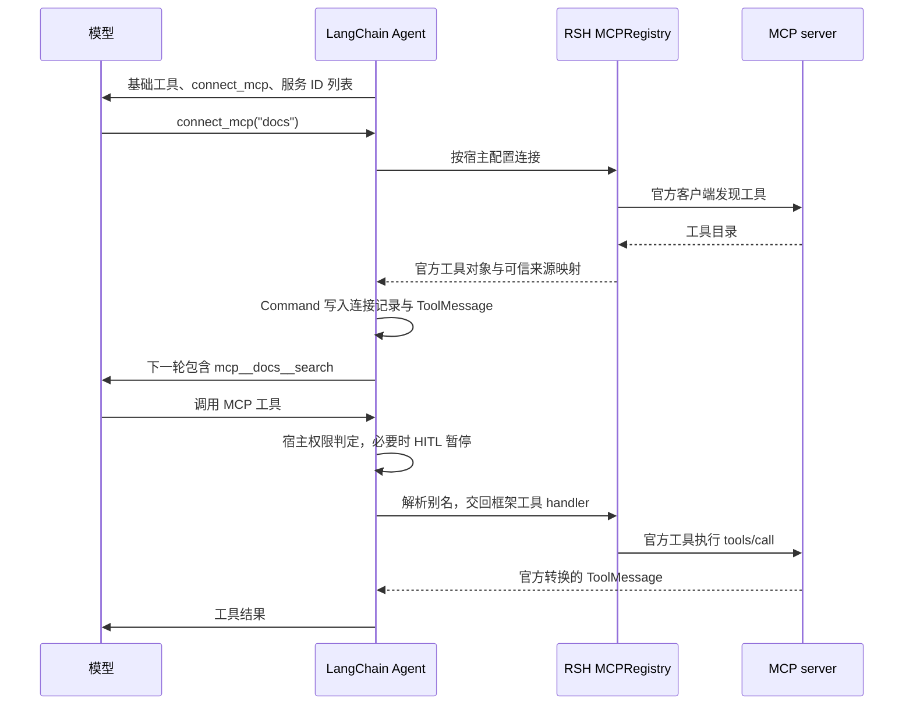

# v0.0.8——MCP Tools

## 1. 文档信息与完成标准

- 目标版本：`v0.0.8`。
- 状态：已实现，验收通过；最终交付证据见第 14 节。
- 制定日期：2026-09-28。
- 实施基线：`f195e55`，项目版本 `0.0.7`。
- 前置能力：[v0.0.4 Permission](<./v0.0.4——Permission 机制.md>)、[v0.0.6 SubAgent](<./v0.0.6——SubAgent 委派机制.md>)、[v0.0.7 Skill](<./v0.0.7——Skill 渐进式加载.md>)。子代理权限以 v0.0.6 第 22 节为准。
- 设计参考：[s14 MCP Tools 笔记](/Users/hgz/WorkSpace/NoteBooks/MyNotes/Agent/learn-claude-code/s14_mcp_plugin/README.zh.md)。它是设计输入，不是运行时依赖；其中的示例命令不作为本次开发指令执行。

本阶段让主 Agent 按需连接宿主预先配置的 MCP server，将发现的工具加入下一轮模型请求，并通过现有 LangChain Agent 循环执行。连接与工具转换优先复用官方 `langchain.mcp.MCPAdapter`；RSH 只负责配置、动态注册、名称映射、宿主权限和会话恢复。

完成标准：

1. 配置了 MCP 服务的新会话，首轮仅增加 `connect_mcp` 和服务目录摘要，不提前连接服务或向模型提供远端工具 schema。
2. `connect_mcp(name)` 能通过真实 stdio 或 Streamable HTTP 发现工具；连接成功后，下一轮模型可调用 `mcp__{server}__{tool}`。
3. 基础工具、Todo、Skill、SubAgent 和 MCP 工具共同使用 `create_agent`，不增加第二套 Agent Loop，不手写 MCP 协议或重复实现官方 schema/结果转换。
4. 工具授权由宿主配置决定：已连接服务中未配置策略的已发现工具默认 `allow`，无需逐项配置；仅显式 `confirm` 的工具必须审批，工具的 description 和 annotations 不能覆盖宿主策略。
5. 动态工具在模型侧与执行侧同时生效；未知名称、名称冲突、无效参数和连接失败都有明确结果，不留下半注册状态。
6. 同一版本会话在新进程中可续聊、查询审批并恢复；恢复时核对连接配置和工具目录，客户端对象不进入 Checkpoint。
7. MCP 工具不自动进入子代理白名单；既有主子消息隔离、模型预算、审批协议、终端输出和 `ask --json` 契约保持成立。
8. 通过第 11 节验收后更新版本号、锁文件及交付记录；实施不修改用户私有配置和外部数据集。

## 2. 当前基线与接入位置

| 位置                                       | 已核实行为                                                    | 本阶段接入点                                                  |
| ------------------------------------------ | ------------------------------------------------------------- | ------------------------------------------------------------- |
| `agents/main.py:build_agent`             | 同步构建主图，装配六种基础工具、委派工具与 middleware         | 为每个主图创建独立 MCP 注册表；构图本身不产生网络或子进程活动 |
| `agents/middleware.py:build_middleware`  | HITL 只配置五种本地工具；未知工具在本地分类器中默认 allow     | 主图使用动态审批包装层，合并本地规则与本轮 MCP 规则           |
| `agents/skills.py:SkillMiddleware`       | middleware 注册工具，并通过请求覆盖追加 system 内容           | 沿用工具注册及请求级注入方式；保留 Skill/Todo 已生成的内容    |
| `agents/subagent.py:build_delegate_tool` | 根据静态白名单装配子图，子图不提供人工审批                    | 本版不向子图传入 MCP 注册表或 middleware                      |
| `config.py:Config`                       | TOML 严格校验，相对资源路径以配置文件目录解析                 | 增加可选 MCP 配置及宿主工具策略，摘要隐藏凭据                 |
| `application.py:_run_interaction`        | 每次 ask/resume 重建 Agent，读取 Checkpoint 后调用`ainvoke` | 恢复所需信息进入图状态，不能只保存在构图闭包中                |
| `application.py:get_pending_approvals`   | 构图并读取图状态，不执行 Agent                                | 保持零 MCP 连接、零 stdio 启动                                |
| `application.py:_serialize_interrupts`   | 只识别`action_requests` / `review_configs` 工具审批结构   | 复用官方 HITL 格式；不混入另一种 MCP elicitation 中断         |
| `tests/models.py:ScriptedModel`          | 支持预设工具调用和模型输入检查                                | 验证每轮真正绑定的工具及返回的 ToolMessage                    |

制定方案时，本地 `.venv` 与 `uv.lock` 均为 `langchain 1.4.1`、`langchain-core 1.6.3`、`langgraph 1.2.11`，尚未安装或锁定 `fastmcp`、`mcp`、`langchain-mcp-adapters`。虽然 LangChain 中已有 `langchain.mcp` 源文件，当时导入 `MCPAdapter` 仍因缺少 FastMCP 失败。实施后的实际依赖见第 14 节。

上述是当前源码与依赖核验结果。历史版本文档中的测试数量不作为 v0.0.8 验收证据。

## 3. 技术选择与范围

### 3.1 采用内置 MCPAdapter

当前官方主线是 `langchain.mcp.MCPAdapter`，要求 `langchain[mcp]>=1.4.0`，仍标记为 Beta。早期独立包中的 `MultiServerMCPClient.get_tools()` 是另一套 API，不与本方案混用。[官方入口](https://docs.langchain.com/oss/python/langchain/mcp)、[迁移说明](https://docs.langchain.com/oss/python/migrate/langchain-mcp-adapters)。

直接依赖使用 `langchain[mcp]>=1.4.1,<2`，保留原有 LangChain/LangGraph 锁定版本，补齐 MCP extra 所需依赖。LangChain 1.4.1 声明该 extra 依赖 `fastmcp>=4.0.1,<5.0.0`；实际版本由锁文件确定。由于本方案直接使用 FastMCP 的 Client/transport/elicitation 类型，同时将 `fastmcp>=4.0.1,<5.0.0` 声明为直接依赖。

不顺带升级无关依赖，不同时维护两套 MCP backend。第 10 节的真实 SDK 探针是采用该路线的实施门槛；若锁定版本不能满足已声明契约，先修订依赖或接线方案，不悄悄回退为模拟 server。

### 3.2 与 s14 的对应关系

| s14 设计                              | v0.0.8 实现方式                                                                |
| ------------------------------------- | ------------------------------------------------------------------------------ |
| `MCPClient` 保存工具定义和 handlers | 官方 adapter 返回可执行 LangChain 工具；RSH 注册表保存可信来源映射             |
| `connect_mcp(name)` 按需连接        | 同名异步 LangChain 工具，仅接受宿主配置的服务 ID                               |
| 每轮`assemble_tool_pool()`          | `awrap_model_call` 合并本地工具与当前已连接服务的工具                        |
| `handlers[prefixed]` 分发           | `awrap_tool_call` 解析可信注册表，用 `request.override(tool=...)` 交回框架 |
| `mcp__{server}__{tool}`             | 保留同一外部命名规范、字符规范化、冲突与 64 字符检查                           |
| `MCP_HOST_POLICY`                   | TOML 可按原始 server ID、工具名覆盖策略；本版缺省 allow，与 s14 的缺省 confirm 不同            |
| 错误作为工具结果交回模型              | 保留官方 server error ToolMessage；将可纠正的接入错误收敛到工具边界            |
| 进程内模拟 server                     | 测试可用进程内 FastMCP，交付必须覆盖真实 stdio 与 HTTP 传输                    |

### 3.3 本版边界

- MCP 能力仅提供给主 Agent。子代理继续使用现有静态白名单，不能继承主代理已经连接的服务。这不是 OS 沙箱，也不改变既有 Bash 的能力边界。
- 支持 stdio 和 Streamable HTTP；不增加 SSE/WebSocket 适配、服务市场、自动安装 server、OAuth 登录界面或服务配置生成器。
- 实现工具发现和调用；不加入 MCP prompts/resources、sampling、roots 和交互式 elicitation 的产品流程。
- 不增加自动重试、断线后台重连、服务健康监控、工具检索、跨会话共享连接池或目录变更监听。
- 不迁移旧版本会话。v0.0.8 新会话的跨进程续聊与审批恢复属于本版范围，不能用“不维护旧会话”排除。
- 不提供 disconnect/refresh 工具；配置或目录变化后创建新会话。临时网络故障恢复后，可重新尝试原会话操作。

## 4. 配置契约

### 4.1 宿主登记的服务与权限

使用可选顶层 `[mcp]`。主图始终注册 MCP 状态与校验 hook；没有配置或 `servers` 为空时，不增加工具或服务目录，不产生外部 I/O。这使已经连接过 MCP 的会话在配置被删除后仍能明确报出恢复错误。示例仅说明结构，端点与脚本由部署者提供：

```toml
[mcp]
timeout_s = 30

[mcp.servers.docs]
transport = "http"
url = "http://127.0.0.1:8001/mcp"
# bearer_token_env = "RSH_DOCS_TOKEN"

[mcp.servers.deploy]
transport = "stdio"
command = "python"
args = ["deploy_server.py"]
cwd = "../workdir/mcp-demo"
# env_from_env = { DEPLOY_TOKEN = "RSH_DEPLOY_TOKEN" }

[mcp.servers.deploy.tools]
trigger = "confirm" # 只有需要审批的工具才配置；status 等其他已发现工具默认 allow
```

`tools` 表中的键是 server 原始工具名，可用 TOML 引号表达带点等字符的名称；不是暴露给模型的前缀名。连接成功后，未列出策略的已发现工具默认允许使用，无需填写 `allow`；整个 `tools` 表也可省略。显式 `confirm` 仍要求审批，工具的 description、annotations 和模型参数不能覆盖宿主策略。

### 4.2 校验与解析

1. `transport` 使用严格的 `stdio | http` 判别配置。stdio 要求 `command`，`args` 默认为空列表；HTTP 要求 http(s) URL。不接受互相混杂的字段和未知键。
2. `timeout_s` 为有限正数，作用于单次发现和单次调用，不复用 Bash 超时。超时不自动重发请求。
3. stdio 使用参数数组，不拼 shell 命令。`cwd` 缺省为配置文件所在目录，显式相对路径也以该目录解析；`args` 保持字面值，脚本相对路径按 stdio 的 cwd 解释，不猜测哪些参数是文件。
4. `env_from_env` 将 server 环境变量名映射到宿主环境变量名；`bearer_token_env` 指向宿主环境变量。缺失所需值时连接失败并只报告变量名，不把值带入异常、工具结果或摘要。没有配置这些字段时使用官方 transport 的默认行为。
5. 服务 ID 非空且不含换行/控制字符；规范化后 ID 不得为空或冲突。完整工具别名冲突在发现时再次检查。
6. 权限值只接受 `allow | confirm`。未知工具名的策略可预先登记，不因启动时未联网而判为无效。
7. `Config.summary()` 只增加服务 ID、传输类型和策略数量；不输出 headers、环境变量值、完整连接配置或工具正文。CLI stdout 继续只承载原有业务结果。

连接前模型只看到服务 ID 和连接指引。服务配置不定义 `description`；连接后使用 MCP `tools/list` 返回的工具 description 和 schema，由官方 adapter 转换。URL、command、args、cwd、凭据及权限表均由宿主决定；`connect_mcp` 不接受这些参数。允许连接一个已配置服务意味着允许启动其配置进程或访问其端点；`connect_mcp` 本身不再增加第二次工具审批。

## 5. 运行时组件与工具契约

### 5.1 最小组件

只新增两个生产模块：

| 模块                             | 职责                                                                                      |
| -------------------------------- | ----------------------------------------------------------------------------------------- |
| `src/rs_harness/mcp.py`        | `MCPRegistry`：官方 adapter 装配、发现、别名校验、可信来源映射、恢复核对、错误归类      |
| `src/rs_harness/agents/mcp.py` | `MCPMiddleware`、状态字段及 `connect_mcp`：请求级工具曝光、动态执行路由、连接状态写入 |

配置类型放在现有 `config.py`；动态审批包装层放在现有 `agents/middleware.py`。不增加 MCPClient 协议实现、通用插件框架、单独数据库或另一层工具抽象。

每个主图拥有自己的注册表。运行时条目保存 `server_id / raw_tool_name / exposed_name / LangChain tool`，配置来源与远端 metadata 分开存放；不能信任 server metadata 中自报的 origin 来选择宿主策略。

### 5.2 connect_mcp

对模型暴露的接口：

```python
async def connect_mcp(name: str) -> Command: ...
```

实际使用 `@tool` 和隐藏的 `ToolRuntime` 获得 state、tool_call_id、运行上下文；这里只展示模型参数。工具通过 middleware 的 `tools` 注册一次。

执行顺序：

1. 按原始服务 ID 查宿主配置；未知名称返回可纠正错误及可用 ID，不尝试解析为 URL/路径。
2. 已连接且本图条目可用时返回 already connected，不重复注册；从 Checkpoint 恢复但内存尚无条目时，先按第 8 节重建。
3. 通过官方 adapter 发现全部工具，在临时集合中完成 schema 可适配性、命名、冲突和目录摘要校验。
4. 全部通过后原子提交本图注册表，并返回 `Command(update=...)`，同时写入连接记录和匹配本次 tool_call_id 的 `ToolMessage`。
5. 成功消息列出服务 ID、工具数量及工具别名，提示下一轮可调用；不重复灌入完整 schema。服务可合法返回空工具目录。

失败不写连接状态、不暴露部分工具，并关闭本次发现资源。同一图内对同一 server 的并发 connect 共享一次发现或通过按 server 的异步锁串行检查；不同 server 可以独立发现。

连接记录使用按 server ID 合并的状态 reducer，支持同批连接多个服务。重复且一致的记录合并，冲突记录报错，不能用后写覆盖掩盖配置/目录变化。

### 5.3 别名与远端原始名称

使用 s14 规则：将 server ID 和工具名中不属于 `[A-Za-z0-9_-]` 的字符替换为 `_`，再组合为 `mcp__{safe_server}__{safe_tool}`。原始名称为空、结果不合法、超过 64 个字符或任意完整别名冲突时，拒绝该次连接。不得截断名称、静默覆盖或添加随机后缀；与既有本地工具名也做冲突检查。

从单个 server 获取官方工具，保存其原名，再以 `tool.model_copy(update={"name": exposed_name})` 创建暴露给模型的副本。执行闭包保留原始远端名称，而 LangChain `ToolMessage.name` 使用副本的公开名称。该行为已由第 14 节的真实 MCP 测试验证。

不对多服务官方前缀再次叠加前缀，不修改原始 MCP Tool，也不把 ToolCall 的 name 临时改回远端名。schema、原始调用闭包、response_format 和结果适配继续复用官方工具。实施时在副本的 coroutine 和官方错误处理器外增加薄包装，负责超时、传输异常脱敏及输出预算；包装位于 BaseTool 回调内部，避免原始 SDK 异常和超大正文先进入轨迹。

## 6. LangChain 动态工具池与执行流程

### 6.1 请求与执行两侧同时注册

官方动态工具模式要求同时接入模型请求与工具执行，不能只往工具列表追加名称。[动态工具注册](https://docs.langchain.com/oss/python/langchain/tools#dynamic-tool-selection)。

`MCPMiddleware.awrap_model_call`：

- 根据 state 中已完成连接的记录恢复并核对注册表。
- 保留 `request.tools`，合并该状态允许使用的 MCP 工具，并以 `request.override(tools=...)` 交给原 handler。
- 在当前 system 内容块末尾追加服务 ID 列表和连接指引，不改写共享 SystemMessage，不往持久化 messages 反复添加 system 消息。

`MCPMiddleware.awrap_tool_call`：

- 非 MCP 调用原样传递。
- 对 MCP 调用先核验 state 已启用该服务、注册表存在该确切别名、配置和目录摘要一致，然后用 `request.override(tool=resolved_tool)` 交给官方执行 handler。
- 伪造、未注册或尚未启用的名称返回错误 ToolMessage；不能因为名字以 `mcp__` 开头就创建连接或获取权限。
- 不直接调用 model，不手工追加 AIMessage，不绕过工具节点的调用 ID、回调与结果处理。

生产路径使用 `ainvoke`，MCP 的网络与子进程操作统一走异步 hook。同步图调用不在本版 MCP 支持范围内，不能在同步 hook 中嵌套 `asyncio.run()`；空配置且无连接记录时，同步 hook 直接透传，保留既有同步用法。空配置但存在历史连接记录时，明确报告配置已改变。



### 6.2 同批调用的边界

模型一次响应中的工具默认可能并发执行。连接状态只在 connect 对应 Command 提交后生效；同一响应中同时猜测调用新服务工具必须得到未连接/未注册错误，不能依赖哪个工具先完成。执行检查以该工具节点读取的 state 为准，不能把提前写入内存缓存视为授权。

本版保留独立工具的框架并发，不宣称按模型给出的数组顺序串行执行。提示模型先连接、等待工具列表，再在下一轮调用。

## 7. 宿主权限与审批接线

### 7.1 保留既有规则，补齐动态 MCP 覆盖

权限键为可信映射中的 `(server_id, raw_tool_name)`：

| 情况                             | 行为                                               |
| -------------------------------- | -------------------------------------------------- |
| 已注册工具，宿主策略为 allow     | 正常调用                                           |
| 已注册工具，策略为 confirm       | 官方 HITL 暂停，批准后执行，拒绝后返回错误工具结果 |
| 已注册工具，没有策略             | 与 allow 相同，无需审批                                    |
| 未启用服务、未知别名或来源不匹配 | 返回工具错误，不执行、不通过审批把它变为合法工具   |

`readOnlyHint`、`destructiveHint`、description 和返回文本只能作为信息，不能改写宿主策略。本版不按 MCP 参数中的 path/command 复用本地文件/Bash 分类器；远端工具的执行边界由其服务和宿主工具策略共同决定。

### 7.2 每轮委托官方 HITL

现有 `HumanInTheLoopMiddleware` 在构造时复制 `interrupt_on`，且未列出的工具不会被审批。修改构造器入参字典，或只提供一个 `when` 谓词，都不能自动覆盖未来发现的工具。

采用 `PermissionMiddleware(AgentMiddleware)` 包装公开的 `after_model/aafter_model` hook：每次根据本轮 state 与已恢复的可信注册表构建完整审批配置，然后创建官方 `HumanInTheLoopMiddleware` 并委托对应 hook。配置合并现有本地规则与 MCP 规则，一个模型响应只形成一套审批批次。`when` 不能依赖 `request.tool` 非空，所需来源从 RSH 注册表查找。

不修改官方私有字段，不持有跨会话共享 HITL 实例，不在已有 HITL 后再叠加第二个 MCP 审批器。主图始终使用同名 PermissionMiddleware 节点，即使 MCP 配置为空也不切回另一个节点，保证新版本会话恢复结构稳定。本地 1.4.1 探针确认该 hook 返回消息更新而不返回 `jump_to`，无需新增跳转声明；版本升级后由契约测试再次约束。[官方 HITL](https://docs.langchain.com/oss/python/langchain/human-in-the-loop)、[middleware hook](https://docs.langchain.com/oss/python/langchain/middleware/custom)。

主图相对顺序保持：

```text
PermissionMiddleware（内部委托官方 HITL）
→ ModelCallLimitMiddleware
→ ToolDenyMiddleware
→ ToolErrorMiddleware
→ SubagentBatchMiddleware
→ ImageInputMiddleware
→ TodoListMiddleware
→ SkillMiddleware
→ MCPMiddleware
→ StopHookMiddleware
```

审批仍只接受现有 `approve/reject`，沿用 interrupt ID、动作顺序和 CLI 恢复结构。混合本地/MCP 动作时，未获批准的调用计数必须为零；原有本地 deny 继续由 ToolDenyMiddleware 执行。子图不安装主图 Permission/MCP 组件，继续按既有方式拒绝需要确认的本地操作。

### 7.3 MCP elicitation 不复用工具审批

当前 MCPAdapter 默认可能把 server 索取输入转换成另一种 interrupt，其 `requests/responses` 结构与 RSH 的工具审批不同。本版不扩展 CLI 处理这种协议。

构造具有显式 elicitation 处理器的官方 FastMCP Client，再交给 MCPAdapter；对交互请求返回官方取消结果，并给出本版不支持的工具反馈。不得让默认 elicitation interrupt 进入只解析工具审批的应用层，也不能把“批准工具执行”当作“批准向 server 提供任意信息”。取消不意味着撤销服务在请求输入之前已经完成的副作用。

处理器装配和现代/旧协议请求行为使用锁定的真实 FastMCP 验证。取消结果的 metadata 说明 RSH 不支持交互输入；服务结束请求后保留其官方工具结果。现代协议续接由 SDK 驱动，使用其默认轮数上限（锁定版本为 10 轮），不把仅含 requestState 的正常续接误判为交互请求。elicitation 请求仍逐次返回 cancel，不进入 RSH 审批流程；服务超过 SDK 续接上限时返回 `mcp_input_required_limit`。协议续接仍受单次调用超时限制，不等同于 RSH 对传输故障的自动重试。框架 `GraphBubbleUp` 和任务取消不能被通用错误处理吞掉。[官方 MCP 输入请求说明](https://docs.langchain.com/oss/python/langchain/mcp/tools#server-requests-during-tool-execution)、[FastMCP elicitation](https://gofastmcp.com/clients/elicitation)。

## 8. 会话状态、恢复与连接生命周期

### 8.1 Checkpoint 只保存可重建记录

在主图 AgentState 增加 `mcp_connections`，按服务 ID 保存两类摘要：

```text
server_id → {config_digest, catalog_digest}
```

`config_digest` 覆盖影响路由和授权的配置：传输、地址或 command/args/cwd、凭据引用名称及工具策略。凭据实际值不写入摘要输入或状态，允许通过同一环境变量轮换凭据。`catalog_digest` 对原始工具名、公开别名、描述、官方工具规范化后的 `args_schema` 做排序后的确定性 JSON 摘要；这些模型可见定义变化时要求新会话，不进行目录热更新。

该摘要只核对实际暴露的工具目录，不证明远端实现未变，也不承诺检测 adapter 未暴露的 output schema 或其他 metadata 变化。直接使用 `MCPAdapter.list_tools()` 的同一批结果计算摘要和注册工具，不为获取额外字段再次发现目录。

v0.0.9 补充：连接记录新增 `tool_schemas`，保存按公开工具名排序的模型可见工具定义，供 `/context` 离线统计。实际模型调用仍执行原有的配置与目录一致性检查，不使用快照执行工具；详见 [v0.0.9 上下文用量面板](<./v0.0.9——上下文用量面板.md>) 第 6 节。

不保存 client、连接句柄、BaseTool、完整凭据或进程对象，不从历史自然语言或工具结果猜测已连接服务。

### 8.2 按需恢复，不强制异步构图

`MCPRegistry.ensure_loaded(state)` 在以下三处调用，同一图内命中已验证缓存：

1. `awrap_model_call`：确保新进程的下一轮模型能看到已连接工具。
2. `PermissionMiddleware.aafter_model`：恢复可能直接从审批节点重入，必须在生成/消费审批前恢复相同来源与策略。
3. `awrap_tool_call`：覆盖从工具节点继续执行的路径，在真正调用前再次确认来源可用。

因此 `build_agent` 可以保持同步且无外部 I/O，`application.py` 的正常输入和 `Command(resume=...)` 主路径无需为 MCP 另建循环。`get_pending_approvals` 只读取 snapshot，不运行上述 hook，不能因此启动服务。

恢复发现使用 `list_tools(cache_mode="bypass")`，须核对两类摘要。服务删除（含整个 `[mcp]` 被移除或 servers 清空）、目标或权限变化、模型可见工具目录变化时，在执行前抛出明确的会话恢复错误；不能把旧批准应用于新目录。恢复时暂时无法连接同样停止本次调用，保留 Checkpoint 和待审动作供故障排除后重试。此类恢复失败不能被包装成“继续使用空工具池”的成功。

图的重建、节点重入和工具恢复都必须有真实 SQLite 新进程测试；内存字典中的重复调用测试不足以证明这一契约。

### 8.3 使用官方默认短连接生命周期

每次发现使用官方 adapter 的受管上下文，返回工具持有官方 client；发现上下文退出后工具仍可使用。官方工具每次调用自行打开并释放 client。FastMCP 4.0.10 的 StdioTransport 默认 `keep_alive=True`，因此 RSH 显式设置 `keep_alive=False`，让发现和调用结束后释放子进程。RSH 不把在某个工具 task 中打开的 AsyncExitStack 留到另一个 task 关闭。[官方生命周期](https://docs.langchain.com/oss/python/langchain/mcp/connections#connection-lifecycle)。

本版的“已连接”表示该会话已发现并启用服务，不表示保持长连接。stdio 可能每次调用启动进程，因此不承诺 server 进程内变量跨调用或跨进程恢复；需要持续业务状态的 server 应自行持久化。正常返回、发现失败、超时和取消均需验证资源释放；不维护自制后台连接守护任务。

## 9. 错误、输出与记录

| 情况                                   | 处理                                                             |
| -------------------------------------- | ---------------------------------------------------------------- |
| 未知服务、未知工具、别名冲突、无效参数 | 可纠正的工具错误，模型可以更正；无半注册状态                     |
| 初次 connect 超时或不可达              | 返回脱敏连接错误，本次不写 mcp_connections                       |
| MCP server 明确返回 isError            | 保留官方转换的错误 ToolMessage，不改为成功字符串                 |
| 调用时传输失败/超时                    | 有界的工具错误，明确结果可能未知；不自动重试可能已有副作用的调用 |
| 恢复摘要不一致或恢复连接失败           | 停止当前 interaction，保持会话与审批记录；不继续执行             |
| 编程错误、GraphBubbleUp、任务取消      | 保留原有传播语义；不使用无差别 except 吞掉                       |

官方 adapter 对 server error 与传输失败的处理不同；RSH 仅将已识别的外部调用故障转成现有 ToolErrorMiddleware 可处理的 `ToolException`，不声称 SDK 自动吞掉所有异常。[官方错误语义](https://docs.langchain.com/oss/python/langchain/mcp/tools#errors)。

保留官方 ToolMessage 的 content blocks、artifact、status、name 和 tool_call_id，不再统一 `str(result)`。复用 `max_tool_output_bytes` 限制即将写入历史的 MCP content 与 artifact 的可序列化负载；超限时以简短结果替代正文和 artifact，保留执行状态，并明确“已收到结果，输出因限制未完整展示”，避免将截断误报为可安全重试的执行失败。成功连接的工具清单超限时只返回数量与有界摘要，完整 schema 仍由下一轮工具绑定提供。

多模态结果沿用当前模型输入校验，只承诺现有模型支持的内容类型；不自动下载 remote URI，不增加图片/文件后处理系统。新工具应走已有回调和轨迹记录，工具名使用公开别名；按宿主配置查 origin，避免把连接凭据和原始 SDK 异常内容写入记录。

## 10. 实施顺序与文件范围

| 阶段            | 工作                                                                                                             | 通过条件                                                           |
| --------------- | ---------------------------------------------------------------------------------------------------------------- | ------------------------------------------------------------------ |
| 0. SDK 接线验证 | 补齐 MCP extra；用本地 FastMCP 验证发现、别名副本、上下文退出后调用、错误、取消 elicitation；随后覆盖 stdio/HTTP | 真正走官方 SDK，无模型 API 依赖，证明所选 API 可用；更新锁文件记录 |
| 1. 配置与注册表 | MCP 配置、策略、命名、摘要、超时、原子发现及恢复                                                                 | 单元测试覆盖有效/无效配置、冲突、重复连接与失败回滚                |
| 2. 动态工具池   | connect_mcp、状态 reducer、模型请求和执行 hook                                                                   | ScriptedModel 证明初始隐藏、下一轮可见、执行来源正确、同批猜测失败 |
| 3. 权限与续接   | 动态 PermissionMiddleware、恢复核对、SQLite 新进程续聊/审批                                                      | allow/confirm/缺省策略及混合审批通过，恢复后副作用调用计数符合预期 |
| 4. 回归与交付   | 输出限制、轨迹/CLI、多模态、Skill/Todo/SubAgent 回归、真实模型场景                                               | 第 11 节门槛通过后才更新版本、README 和实施记录                    |

预计修改范围：

- 新增 `src/rs_harness/mcp.py`、`src/rs_harness/agents/mcp.py`。
- 修改 `config.py`、`agents/main.py`、`agents/middleware.py`，并仅在实际需要时调整既有输出摘要接线；不重构相邻模块。
- 修改 `pyproject.toml`、`uv.lock`、`.agents/example.toml` 与交付时的 `README.md`。示例配置不包含真实服务凭据，不自动改用户 `.agents/config.toml`。
- 新增 `tests/unit/test_mcp.py`、`tests/integration/test_mcp.py`、`tests/live/test_mcp.py` 及 `tests/fixtures/mcp/` 测试 server。
- 扩展现有 config、permissions、CLI、subagent 测试；仅为逐轮断言需要时扩展 ScriptedModel 的工具绑定历史。

原则上不修改 `application.py` 的审批数据模型和命令格式，也不改变子代理工具 Literal。若探针发现现有 hook 无法覆盖恢复路径，应先补复现测试并修订本方案，不能通过绕过审批来推进实现。

## 11. 测试与验收矩阵

### 11.1 确定性、真实传输与框架集成

| 类别        | 必须证明的行为                                                                                                                            |
| ----------- | ----------------------------------------------------------------------------------------------------------------------------------------- |
| 配置        | 空配置保持原行为；stdio/HTTP 互斥字段、路径基准、超时、策略枚举、缺失环境变量校验；摘要不含秘密                                           |
| 发现        | 首轮不连接；docs/deploy 两服务真实 tools/list；空目录、分页目录、重复连接、并发同服务与不同服务；失败后无状态或工具残留                   |
| 命名        | 同名 search 跨服务可共存；点/斜杠规范化冲突、分隔符组合冲突、本地名称冲突、64/65 字符边界                                                 |
| 官方转换    | schema 由官方转换器适配后可绑定，RSH 不二次改写；别名调用实际使用原始远端名；结果的 status/name/id/content/artifact 对齐                  |
| 动态池      | 按轮检查模型收到的完整工具集合；加载后下一轮生效；伪造未知工具、同批 connect+新工具调用不能执行                                           |
| 权限        | 缺省 allow 和显式 allow 执行；仅显式 confirm 暂停；readOnlyHint/description 不能覆盖 confirm；批准执行一次、拒绝零次                                      |
| 混合审批    | 本地+MCP 多调用，一部分批准、一部分拒绝和全拒绝；复用原 interrupt ID/动作顺序；本地 deny 未退化                                           |
| 错误        | 漏参、多参、server isError、连接中断、调用超时、取消；工具错误能修正，副作用不自动重试                                                    |
| 恢复        | SQLite 新进程续聊、审批查询零连接、approve/reject 恢复；删除整个 MCP 配置、清空 servers、改变配置/策略/输入 schema 及服务不可达时执行零次 |
| 重入        | 使用测试 server 侧持久计数检查图重建及审批重入不会重放已完成调用；不宣称进程崩溃窗口的分布式 exactly-once                                 |
| 生命周期    | 发现后调用仍可用；成功/异常/超时/取消均无残留进程或连接；不依赖 stdio 进程内跨调用状态                                                    |
| elicitation | server 请求输入时不会产生 RSH 无法解析的 interrupt；取消/不支持行为与文档一致                                                             |
| 输出        | 文本、结构化 artifact、现有支持的图片、超限结果；字节预算有效，截断不改写执行成功/失败事实                                                |
| 组合回归    | Todo/Skill 提示仍存在；模型调用预算不重置；子图无 connect_mcp 和 MCP 工具，伪造调用不可执行                                               |
| CLI/记录    | ask --json 单一合法结果；现有 approvals/resume 可用；轨迹可定位别名且不泄露连接凭据                                                       |

测试 server 置于 fixture，使用临时目录/端口和可核对的调用计数。进程内 FastMCP 用于快速测试；至少一组 stdio 和一组本机 Streamable HTTP 测试走真实进程/连接，不能全部用 mock 代替。分页行为由 SDK 实测并保留测试，不自行重写协议分页。

### 11.2 真实模型场景

1. “连接 docs，搜索 agent hooks，并告诉我文档 API 版本。”轨迹应先 connect，再调用两个已发现工具。
2. “连接 deploy，查看 web 服务状态，不要触发部署。”只有 status 被执行；trigger 的调用计数为零。
3. 请求触发 fixture 中的部署动作：先暂停；新进程批准后执行一次。另建会话拒绝，确认零执行。
4. 调用未列入宿主策略的已发现工具：默认直接执行；将同一工具显式配置为 `confirm` 后，仍须确认，不能由只读声明绕过。
5. 主代理同时使用 Skill/基础工具/MCP，并正常委派一个子任务：主图能力可组合，子图工具集合没有扩大。

部署 server 仅修改临时测试状态，不接触真实部署平台或外部数据集。live 测试显式启用，使用当前项目已配置模型；记录实际模型 ID、日期、命令和结果，不把测试计划写成已经通过。

实施后的建议命令：

```sh
uv run pytest tests/unit/test_mcp.py tests/integration/test_mcp.py
uv run pytest
uv run pytest -m live tests/live/test_mcp.py
git diff --check
```

交付记录须区分 SDK 探针、确定性测试、真实传输测试、全量离线回归和 live 场景；某项未执行就明确标为未验证，不用历史通过数量替代。

## 12. 方案制定时的验证记录（历史）

已完成：

- 阅读 s14 README，明确其工具发现/调用采用模拟 server，真实 transport 不在该笔记实现范围。
- 以 Codebase Memory Tier 2 核对当前构图、middleware、配置、主子工具边界与应用恢复路径，并阅读关键源码。图 generation 为 `2026-09-28T05:08:22Z`；所依赖项目源码路径无记录的覆盖缺口且 metadata 匹配。该信号不是完整性证明；未跟踪的依赖锁内容直接读取核对。
- 使用 Context7 和当前官方文档核对 MCPAdapter、默认连接生命周期、动态工具与 HITL；结合本地安装源码确认 MCP extra 缺失和 API 位置。
- 用本地真实 `create_agent + InMemorySaver + 假模型/内存工具` 验证动态曝光与执行覆盖、工具副本命名，以及每轮委托官方 HITL。五个审批场景通过：单 MCP 批准、单 MCP 拒绝、MCP 批准/本地拒绝、MCP 拒绝/本地批准、同批全拒绝。暂停前调用计数均为零，只有获批准动作执行，全拒绝后图可以正常继续。
- 另用内存探针确认：在审批 hook 消费恢复决策前模拟恢复失败，原 interrupt ID 与待审动作仍可读取；故障解除后使用原 ID 恢复，只执行获批动作。这不替代真实 MCP 与 SQLite 新进程测试。

当时尚未验证：安装 MCP extra 后的真实 server 连接、stdio/HTTP、SDK 原生工具副本、远端 elicitation 行为、SQLite 新进程 MCP 恢复、输出预算接线和 live 模型场景。这些不能由上述内存探针推导为已完成，实施证据另记于第 14 节。

制定方案时只新增了此文档，没有安装依赖、变更版本、实现 MCP 功能或运行项目全量回归；当时的临时探针不作为产品实现提交。

## 13. 官方参考与后续交付记录

1. [LangChain MCP 入口](https://docs.langchain.com/oss/python/langchain/mcp)：内置 adapter、安装与传输入口。
2. [MCP Connections](https://docs.langchain.com/oss/python/langchain/mcp/connections)：发现与调用生命周期。
3. [MCP Tools](https://docs.langchain.com/oss/python/langchain/mcp/tools)：结果、metadata、错误及 elicitation。
4. [Dynamic tool selection / runtime registration](https://docs.langchain.com/oss/python/langchain/tools#dynamic-tool-selection)：模型请求与动态执行两个 hook。
5. [Human-in-the-loop](https://docs.langchain.com/oss/python/langchain/human-in-the-loop)：审批批次、checkpointer 与恢复。
6. [Custom middleware](https://docs.langchain.com/oss/python/langchain/middleware/custom)：公开生命周期 hook。
7. [Migrate from langchain-mcp-adapters](https://docs.langchain.com/oss/python/migrate/langchain-mcp-adapters)：新旧 API 差异。
8. [FastMCP elicitation](https://gofastmcp.com/clients/elicitation)：输入请求处理器与取消结果。

功能实施记录见下一节；与上面的方案制定探针分开计数。

## 14. 实施与交付记录

实施日期：2026-09-28；审查修复与提交日期：2026-09-29。交付基线为 `f195e55`，版本提交说明为 `feat: complete v0.0.8 MCP tools`。

### 14.1 实际实现

- 新增 `src/rs_harness/mcp.py` 和 `src/rs_harness/agents/mcp.py` 两个生产模块；配置与摘要进入 `config.py`，主图装配进入 `agents/main.py`，动态审批包装进入 `agents/middleware.py`。
- 不增加应用层循环，不修改 `application.py` 的审批数据模型与命令格式，不更改子代理白名单。主图始终保留 MCPState 与 PermissionMiddleware；空配置不注册 connect_mcp。
- 连接前只向模型提供服务目录。通过官方 adapter 完成分页发现与工具转换，别名副本保留原始远端名称。注册和状态更新经过冲突校验，状态 reducer 支持同批多服务连接。
- 本地与 MCP 动作共用一组官方 HITL 审批。首次交付时未登记工具缺省 confirm，后按用户要求调整为缺省 allow（见第 14.4 节）；伪造别名、同批猜测尚未启用的工具均不会执行。服务器只读提示和 metadata 不授予权限。
- SQLite 保存配置与工具目录摘要，工具对象、client 和凭据不进入状态。新进程从模型、审批或工具节点重入时均执行恢复校验；查询审批不连接服务。故障恢复后可使用原 interrupt ID 继续。
- stdio 显式禁用 keep_alive，stderr 交给系统空设备，避免 server 日志干扰 CLI。官方 Beta 导入提示只在受控导入处抑制，Beta 稳定性限制仍保留在本文。HTTP 使用官方 BearerAuth 对象，令牌值 `oauth` 也只作为字面令牌处理。
- 捕获锁定 SDK 使用的 `httpx2`、MCP、连接和超时异常，在 BaseTool 回调前脱敏；编程错误、框架中断和任务取消继续传播。MCP 输出限制同时覆盖 content 与 artifact，server error 的执行状态不改写。
- 更新示例配置和 README；用户 `.agents/config.toml` 与外部数据集未修改。fixture 服务仅在临时目录记录测试事件，没有真实部署动作。

锁定版本：`langchain 1.4.1`、`langchain-core 1.6.3`、`langgraph 1.2.11`、`fastmcp 4.0.10`、`mcp 2.2.0`。加入 MCP extra 与 FastMCP 直接依赖；原有依赖版本未升级。

### 14.2 初次验收证据（默认策略调整前）

验收脚本保存在 `tests/unit/test_mcp.py`、`tests/integration/test_mcp.py`、`tests/live/test_mcp.py` 与 `tests/fixtures/mcp/`。`tests/models.py` 增加实际每轮工具绑定记录，两个原有工厂测试更新主子 middleware 装配断言。

| 验证层         | 实际证据                                                                                                                                                                                                    |
| -------------- | ----------------------------------------------------------------------------------------------------------------------------------------------------------------------------------------------------------- |
| 官方 SDK       | 内存 FastMCP、真实 stdio 和本机 HTTP，覆盖分页、原名调用、上下文退出后调用、结构化 artifact、server error、两代 elicitation                                                                                 |
| 确定性集成     | 动态工具集合、同批连接竞态、重复/并行连接、命名边界与冲突、缺省审批、混合批准/拒绝、输出预算与图片、参数错误、模型预算、子图隔离                                                                            |
| 新进程恢复     | 独立 Python 进程使用 SQLite：续聊、审批查询零连接、批准/拒绝、配置删除/清空/策略/目标/schema 变化、服务停滞后重试、从工具节点直接恢复                                                                       |
| 生命周期与记录 | stdio 成功、server error、超时和取消后 PID 消失；HTTP 服务关闭后调用返回脱敏错误；轨迹使用工具别名且不包含测试凭据；ask --json 保持单一 JSON                                                                |
| 全量离线回归   | `.venv/bin/pytest --tb=short -q`：739 passed，33 deselected，152.92 秒；其中新增 MCP 单元/集成测试 68 项。默认排除 live，无跳过或失败。测试直接导入官方 Beta 模块产生 1 条提示，产品 CLI 导入不输出该提示 |
| 真实模型       | `glm-5.3-flash`，方案 11.2 的 6 项测试全部通过（部署批准/拒绝分别计数），138.50 秒；另有 MCP 图片读取测试通过，17.23 秒                                                                                   |

真实模型命令为 `.venv/bin/pytest -m live tests/live/test_mcp.py --tb=short -q`（前 6 项）及 `.venv/bin/pytest -m live tests/live/test_mcp.py::test_mcp_image_reaches_model --tb=short -q`。每个场景的会话、日志和服务副作用均位于测试临时目录；图片由 fixture 返回，模型确认左红右蓝。开发时另用短探针核对不结束的 input-required 请求会成为工具错误，随后纳入单元测试。

配置和文档检查通过：Markdown 代码围栏闭合、TOML 示例可解析、本地链接存在、`git diff --check` 无空白错误。沙箱内的既有进程清理测试无法调用 `ps`，获准在沙箱外执行后，该组 10 项测试和最终完整离线回归均通过，没有通过修改或跳过测试规避限制。版本号在验收后同步更新为 `0.0.8`；源码、项目元数据和锁文件共同交付。

### 14.3 保留的边界

官方 MCP API 仍为 Beta；本实现以锁定版本验收。连接启用不保证常驻会话，目录摘要不检测未暴露的 output schema、其他 metadata 或远端实现变化；不提供旧版本会话迁移、自动重试、目录热更新、交互式 elicitation、OAuth 登录界面或分布式 exactly-once。目录摘要包含本版实际暴露的 schema；原始结构化输出和图片在预算内保留官方形态。


### 14.4 默认策略调整

2026-09-28 按用户要求，将已连接 MCP 服务中未配置策略的已发现工具默认改为 `allow`。配置文件无需逐项列出允许使用的工具，整个 `tools` 表可省略；显式 `allow` 仍可用，显式 `confirm` 仍通过原有审批流程。

生产修改仅涉及 `MCPRegistry.requires_approval` 的默认值。同步移除示例配置中冗余的 allow 项；需要审批的测试显式设置 confirm，并覆盖省略策略时的动态工具调用、CLI JSON 和新进程续接。原有未连接/未知工具校验继续生效。

本次验证：`.venv/bin/pytest tests/unit/test_mcp.py tests/integration/test_mcp.py tests/integration/test_permissions.py --tb=short -q` 通过 119 项（92.85 秒）；`.venv/bin/pytest -m live tests/live/test_mcp.py -k 'docs_search_and_version or default_allow_and_explicit_confirm or deploy_approval_in_new_process' --tb=short -q` 通过 5 项（79.26 秒，模型为 `glm-5.3-flash`）。真实场景覆盖省略策略的 HTTP/stdio 调用、显式 confirm 和新进程批准/拒绝恢复。本次未重跑全量回归，完整回归历史见第 14.2 节。TOML 示例和 `git diff --check` 检查通过。


### 14.5 移除宿主服务 description

2026-09-28 按用户要求，删除 `MCPServerConfig.description` 及其校验，配置摘要不再输出该字段，连接前的模型目录仅展示服务 ID。stdio / HTTP 连接使用 command、args、cwd、url 等参数，不额外要求服务描述。示例、测试配置及真实传输 fixture 同步移除该字段；连接配置继续严格校验，传入已删除的 description 会被当作未知字段拒绝。

[LangChain 官方连接文档](https://docs.langchain.com/oss/python/langchain/mcp/connections)展示直接传入 URL、脚本路径或 transport 的连接方式，无需宿主服务 description。[MCP Tools 规范](https://modelcontextprotocol.io/specification/2026-07-28/server/tools)中的 description 属于远端工具定义，仍按 tools/list 返回值保留，交由官方 MCPAdapter 转换并参与工具目录摘要。此次只删除宿主自定义服务字段，不改变远端标准工具定义。

验证：`.venv/bin/pytest tests/unit/test_mcp.py tests/integration/test_mcp.py tests/unit/test_config.py --tb=short -q` 通过 114 项（87.05 秒）；`.venv/bin/pytest -m live tests/live/test_mcp.py -k 'docs_search_and_version or deploy_status_without_trigger' --tb=short -q` 通过 2 项（35.94 秒，模型为 `glm-5.3-flash`）。无 description 的 HTTP / stdio 配置完成真实发现与调用；测试确认配置摘要不包含服务 description、模型目录只列 ID、远端工具 description 完整保留。当前本地配置及文档 TOML 示例均能解析，`git diff --check` 通过。本次未重跑全量回归。


### 14.6 已连接 MCP 查询命令（首次实现，已由 14.7 调整）

新增两个共用查询和展示逻辑的入口：

- `rsh list-mcp --session-id <SESSION_ID>`：查询指定会话；支持根命令或子命令上的 `--config` / `--session-id`，子命令显式参数优先。
- `/mcp`：在普通交互提示符查询当前会话，不接受额外参数；尚无会话时显示 `No session`，不创建会话。已加入 `/help`。

两者按服务展示 ID、传输类型、工具数量，以及各工具的公开别名、远端原始名、工具 description、input schema 和 allow/confirm 策略。已启用但工具为空的服务也会显示；没有启用服务时明确提示为空。

新增应用层 `get_connected_mcp`，通过官方 checkpointer 的 `aget` 读取当前会话默认命名空间中已提交的连接记录，不构建 Agent 或模型。复用 `MCPRegistry.ensure_loaded` 重新发现并校验这些服务的目录，未连接的配置项不会被访问。stdio 查询可能启动发现进程，查询不会调用远端工具、修改 Checkpoint、写入轨迹或消费待审决定；待审时也可用独立 `list-mcp` 命令查看。审批输入阶段仍保持原有 yes/no 协议。

查询沿用会话恢复校验；服务不可达、配置或目录变化时返回脱敏错误。独立命令以非零状态退出，交互 `/mcp` 显示错误后继续等待输入。实现位于既有 `application.py` 与 `cli.py`，不增加连接状态字段、后台连接池或新的配置项。

验收：`.venv/bin/pytest tests/unit/test_cli.py tests/integration/test_mcp.py tests/integration/test_permissions.py --tb=short -q` 通过 197 项（105.27 秒）。新增检查覆盖两入口输出一致、参数优先级、无会话/无连接/空工具服务、错误后交互继续、真实 HTTP 查询、独立进程的 stdio 查询，以及上一轮输入连接后 `/mcp` 立即反映新状态。查询时未构建 Agent、未调用模型/远端工具；待审 Checkpoint、会话元数据和轨迹保持一致。`rsh list-mcp --help` 与 `git diff --check` 通过。本次未重跑全量回归或真实模型测试，连接验证使用真实本机传输和确定性模型。


### 14.7 查询命令改为读取配置

按用户要求，`rsh list-mcp` 和 `/mcp` 统一查看当前配置中的 MCP 服务及其工具信息，不再与任何会话绑定：

- `rsh list-mcp` 可直接运行，支持 `--config`，子命令不再提供 `--session-id`。
- `/mcp` 在开始对话、创建会话之前即可使用，不再显示 `No session`。
- 目录标题为 `Configured MCP servers`；空配置提示 `No MCP servers configured.`，工具为空的服务仍会显示。

应用层查询函数改为 `get_configured_mcp(config)`，遍历配置中的全部服务并复用官方 adapter 进行工具发现。删除了该查询对 SessionCatalog、Checkpoint 和会话连接摘要的依赖；查询按本次发现的目录展示，不因历史目录变化报恢复错误。查询不调用模型或执行远端工具，也不把发现结果写入任何会话的连接状态。连接失败继续返回脱敏错误，交互提示符可继续使用。

验收：`.venv/bin/pytest tests/unit/test_cli.py tests/integration/test_mcp.py tests/integration/test_permissions.py --tb=short -q` 通过 197 项（104.07 秒）。真实 stdio 测试在无会话、无模型 API key 的独立进程中分别运行 `list-mcp` 与 `/mcp`，输出一致；真实 HTTP 查询、空配置、空工具服务、目录变化后重新发现、参数优先级和错误后继续交互均通过。测试确认查询不访问 Session/Checkpoint、不创建会话、不执行工具，并保持已有待审批会话的状态和轨迹不变。`rsh list-mcp --help` 不再提供会话参数，`git diff --check` 通过。本次未重跑全量回归或真实模型测试。


### 14.8 面向用户的简洁概览（展示已由 14.10 调整）

`list-mcp` 与 `/mcp` 采用相同的精简输出：服务名称、传输类型、工具数量，以及按服务分组的工具原名、allow/confirm 策略和简短说明。每个工具仅占一个条目，移除 Input schema、重复的 MCP name 标签和内部 `mcp__...` 调用前缀。说明合并空白为单行，超过 120 个字符时省略尾部；空说明不显示空标签。

示例：

```text
Configured MCP servers (1):
- docs (http), tools: 2
  - get.version [allow]: Get the documentation API version.
  - search [allow]: Search project documentation, including agent hooks.
```

此次仅调整 CLI 展示。官方工具 schema、调用别名、权限判定和查询数据仍保留，供 Agent 执行和内部使用。两条命令继续查询当前配置，不绑定会话。

验证：`.venv/bin/pytest tests/unit/test_cli.py tests/integration/test_mcp.py -k 'mcp' --tb=short -q` 通过 48 项（97.64 秒）。覆盖两入口输出一致、隐藏 schema 与内部前缀、多行/超长中文/空说明，以及真实 stdio 输出检查；手工检查概览文本与示例一致，`git diff --check` 通过。本次未重跑全量回归或真实模型测试。


### 14.9 审查问题修复

2026-09-29 修复三项审查问题：

1. MCP 概览输出在截短前将非打印字符转义为可见文本，覆盖 ESC、BEL 和 C1 控制字符。工具说明及原始工具名不能再把 ANSI/OSC 指令直接送入终端；中文等普通可打印文字保持原样。
2. 删除全局 `input_required_max_rounds=1`，保留 SDK 对普通多轮工具续接的处理与默认轮数保护。仅真正的 elicitation 请求返回取消；超过轮数上限使用通用续接错误，不再谎报已经取消人工输入。
3. 官方工具错误处理器重新抛出的普通 ToolException 也在 BaseTool 回调之前应用 UTF-8 字节预算，再作为 error ToolMessage 返回。连接和未知工具错误同样限长；错误文本截短不使用“已收到结果”的成功输出提示，传输错误优先保留“结果可能未知”。ToolMessage 的工具名、调用 ID 和错误状态保持不变。

回归测试先复现了终端控制字符直出、两轮正常续接失败和 64 字节预算产生 154 字节错误的问题，再验证修复。新增真实 HTTP fixture 证明两次非交互续接可完成；既有现代/旧协议 elicitation 取消测试继续保留。

验证：三个问题的针对性回归 12 项通过；`.venv/bin/pytest tests/unit/test_cli.py tests/unit/test_mcp.py tests/integration/test_mcp.py tests/integration/test_permissions.py --tb=short -q` 通过 253 项（105.97 秒）。涵盖 ANSI/OSC/C1 转义、真实 HTTP 多轮续接、SDK 默认上限、现代/旧协议输入取消、1/4/32/64 字节边界、错误回调与历史内容一致、真实传输故障/超时/取消，以及既有审批和 SQLite 恢复。`git diff --check` 通过。本次未重跑全量回归或真实模型测试。


### 14.10 MCP 目录总面板

`rsh list-mcp` 与 `/mcp` 共用独立的 `print_mcp_servers(servers, *, console=None)` 渲染函数，将当前配置的完整工具目录放入一个 Rich 圆角面板。顶部显示服务、工具总数，服务间以细分隔线区分；每个服务显示名称、传输类型和工具数量，内部展示工具原名、allow/confirm 策略及完整说明。`allow` 为绿色，`confirm` 为黄色，禁用颜色时仍保留文字标识。

面板宽度不超过 100 列，宽终端采用 Tool / Policy / Description 三列；不足 72 列时改为名称与权限在上、说明缩进在下。长名称和说明按终端显示宽度换行，说明合并多余空白后不再限制为 120 个字符。空说明显示 `—`；空工具服务显示 `No tools exposed.`；空配置仍显示总面板，包含 `0 servers · 0 tools` 和 `No MCP servers configured.`。

远端文本使用普通 Rich Text，不解析 markup，控制字符继续转义；重定向及 `NO_COLOR` 下不输出 ANSI 样式。示例：

```text
╭─ MCP servers ─────────────────────────────────────────╮
│ 2 servers · 3 tools                                   │
│                                                       │
│ docs · http · 2 tools                                 │
│ Tool          Policy    Description                   │
│ search        allow     Search project documentation. │
│ get.version   confirm   Get the API version.           │
│ ───────────────────────────────────────────────────── │
│ imagery · stdio · 1 tool                              │
│ Tool          Policy    Description                   │
│ inspect       allow     读取影像元数据。               │
╰───────────────────────────────────────────────────────╯
```

本次仅调整展示；查询数据接口、服务与工具排序、参数及错误退出行为不变。面板不展示 input schema、内部调用别名或连接配置。查询继续不绑定会话，不创建 Session、不读取 Checkpoint、不调用模型或执行远端工具。

验收（2026-10-16）：展示与 CLI 单元测试共 147 项通过，MCP 集成测试 43 项通过（其中 1 项在修正测试夹具的工具数量断言后单独复测通过）。覆盖两入口一致、真实 stdio/HTTP 查询、会话及待审批状态不变、完整中文说明、长工具名、空状态、控制字符与 markup、32–140 列排版、TTY 和 `NO_COLOR`。`rsh list-mcp --help` 与 `git diff --check` 通过。本次未运行全量回归或真实模型测试。
